# 二叉树

1.每次写代码的时候都要先写一种就是

#### 写递归函数三要素

1.确定递归函数的参数和返回值

2.确定终止条件

3.确定单层递归逻辑


### 迭代法

在统一迭代法当中，stack，append（None）而不是   "None"  不需要加双引号


迭代法基本都是用的栈执行的，不管是统一迭代法还是啥都是这样

```python
3.        depth = 1 + max(child_result, default=0) 
#要是直接max的话会出现child_result 为0的时候，max就不行了，但是如果加一个加一个默认值 default=0即可
```


```python
    def sumOfLeftLeaves(self, root: Optional[TreeNode]) -> int:  #optional的意思是要不就是 TreeNode要不就是None
```


```python
   #如果像这样分函数写的话 ，nums需要调用  ，这样才是全局nums
self.nums=nums
```


### 二叉搜索树

二叉搜索树的中序遍历是一个严格递增的序列


```python

 #第75行我原本写的 if self.pre：  但是0也会被当做None ，所以就要判断是否为空
        if self.pre is not None:


```


**后序遍历（左右中）就是天然的回溯过程，可以根据左右⼦树的返回值，来处理中节点的逻辑**。  

**后序遍历（左右中）就是天然的回溯过程，可以根据左右⼦树的返回值，来处理中节点的逻辑**

**后序遍历（左右中）就是天然的回溯过程，可以根据左右⼦树的返回值，来处理中节点的逻辑**

**后序遍历（左右中）就是天然的回溯过程，可以根据左右⼦树的返回值，来处理中节点的逻辑**

## 二叉树的前序遍历（前-中-后这个顺序写迭代）

[144. 二叉树的前序遍历 - 力扣（LeetCode）](https://leetcode.cn/problems/binary-tree-preorder-traversal/description/)


### 伪代码

```python
                                   			递归法
# Definition for a binary tree node.
# class TreeNode:
#     def __init__(self, val=0, left=None, right=None):
#         self.val = val
#         self.left = left
#         self.right = right
class Solution:
    def preorderTraversal(self, root: Optional[TreeNode]) -> List[int]:


        def dp(root):            #定义dp递归
            if not root:					#递归结束条件
                return 
            result.append(root.val) 		#中
            dp(root.left)					#左
            dp(root.right)            		#右
            
        result=[]
        dp(root)
        return result
    
    
    										迭代法

class Solution:
    def preorderTraversal(self, root: TreeNode) -> List[int]:

        stack=[] #用来存放中间的节点
        node=root #当前的中节点
        result=[]
        while node or stack: 
            while node:          #左节点遍历结束
                result.append(node.val)
                stack.append(node)
                node=node.left
            node=stack.pop()
            node=node.right
        return result
    
    									统一迭代法（之后的前中后序都是用的这个方法仅改变入栈的顺序即可）
class Solution:
    def preorderTraversal(self, root: TreeNode) -> List[int]:
        result = []
        stack = []

        if root :
            stack.append(root)
     
        while stack:
            node=stack[-1]

            if node is not None:
                node=stack.pop()  #为什么这里要弹出来，是因为他还有左右节点要放进去

                if node.right:
                    stack.append(node.right)
                if node.left:
                    stack.append(node.left)
                stack.append(node)  #在中节点加入None去判断
                stack.append(None)

            else:
                stack.pop()
                node=stack.pop()
                result.append(node.val)
        return result
        

```


### 思路 

递归法：就是把根节点传进去然后直接递归左右  注意里面的顺序，中 左 右 

迭代法： 要用一个stack栈去存储当前的中间节点         node去遍历一直作为中间节点

统一迭代法： 加入None指针去判断什么时候处理中序  并且入栈的时候是因为 要前序-----中左右  所以入栈的时候就是右左中 去入栈  

****

### 易错点：

### 知识点：

```python
 

```


### 重写一遍之后还会犯的错

## 二叉树的后序遍历

[145. 二叉树的后序遍历 - 力扣（LeetCode）](https://leetcode.cn/problems/binary-tree-postorder-traversal/description/)


### 伪代码

```python
										中序遍历
# Definition for a binary tree node.
# class TreeNode:
#     def __init__(self, val=0, left=None, right=None):
#         self.val = val
#         self.left = left
#         self.right = right
class Solution:
    def postorderTraversal(self, root: Optional[TreeNode]) -> List[int]:
        
        result=[]          #后序：左右中

        def dp(root):
            if not root :   #递归结束条件
                return 
            dp(root.left)  				#左
            dp(root.right)				#右
            result.append(root.val)		#中
        
        dp(root)
        return result
										迭代遍历    
    
# Definition for a binary tree node.
# class TreeNode:
#     def __init__(self, val=0, left=None, right=None):
#         self.val = val
#         self.left = left
#         self.right = right
class Solution:
    def postorderTraversal(self, root: TreeNode) -> List[int]:
        result = []
        node = root
        stack = []
        prev = None                    # ★ 新增：上一个被访问的节点

        while stack or node:
            while node:
                stack.append(node)
                node=node.left

            node=stack.pop()
            if not node.right or node.right==pre : #如果没有右节点了，或者右节点已经遍历过了那就直接存下来
                result.append(node)
                pre=node
                node=None        #不设置为none的话他遍历完左右到中的时候又回去遍历左节点了
            else :               #如果有右节点，那就继续遍历
                node=node.right
                stack.append(node)

        return result


            
											统一迭代法

class Solution:
    def postorderTraversal(self, root: TreeNode) -> List[int]:
        result = []
        stack = []

        if root :
            stack.append(root)
     
        while stack:
            node=stack[-1]

            if node is not None:
                node=stack.pop()  #为什么这里要弹出来，是因为他还有左右节点要放进去
                stack.append(node)  #在中节点加入None去判断
                stack.append(None)

                if node.right:
                    stack.append(node.right)
                    
                if node.left:
                    stack.append(node.left)


            else:
                stack.pop()
                node=stack.pop()
                result.append(node.val)
        return result

```


### 思路 

递归法：没有任何技巧可言 ，***感觉后序就是先把左右两边处理完代码放在最上面，然后再单独再去处理中间的  **

***后序遍历（左右中）就是天然的回溯过程，可以根据左右⼦树的返回值，来处理中节点的逻辑。  **


迭代法：看似很难其实一步一步写出来还挺简单的，主要是边想着二叉树边动手的话还挺快的，首先先一直往左遍历，然后判断是否有右节点，有的话就是else里面的内容：再进行遍历，直到没有右节点以及左节点的时候，就存到result当中国，！！！！pre=node！！！pre赋值为当前节点，node=none不然中间节点又去遍历左节点了，然后node.right遍历过了或者没有右节点的时候，就直接存下来


统一迭代法： 加入None指针去判断什么时候处理中序  并且入栈的时候是因为 要后序-----左右中  所以入栈的时候就是中右左 去入栈  

****

### 易错点：

### 知识点：

```python
 

```


### 重写一遍之后还会犯的错


## 二叉树的中序遍历

[94. 二叉树的中序遍历 - 力扣（LeetCode）](https://leetcode.cn/problems/binary-tree-inorder-traversal/)


### 伪代码

```python
										递归法

class Solution:
    def inorderTraversal(self, root: TreeNode | None) -> list[int]:
        result=[]          #中序：中左右

        def dp(root):
            if not root :   #递归结束条件
                return 
            dp(root.left)               #左
            result.append(root.val)		#中
            dp(root.right)				#右
        
        dp(root)
        return result
        
        
        
        
        								迭代法

class Solution:
    def inorderTraversal(self, root):
        result = []
        stack = []
        node = root

        while stack or node:
            while node:
                stack.append(node)      # 先压当前节点
                node = node.left        # 再往左走
            node = stack.pop()          # 左走到底，弹出栈顶
            result.append(node.val)     # 访问（左已处理完，可以访问根）
            node = node.right           # 转右

        return result  
    
    
    
    
    							统一迭代法  ： 中序-左中右 ，stack里面右中左

class Solution:
    def inorderTraversal(self, root):
        result = []
        stack = []

        if root :
            stack.append(root)
     
        while stack:
            node=stack[-1]

            if node is not None:
                node=stack.pop()  #为什么这里要弹出来，是因为他还有左右节点要放进去

                if node.right:
                    stack.append(node.right)

                stack.append(node)  #在中节点加入None去判断
                stack.append(None)

                if node.left:
                    stack.append(node.left)
            else:
                stack.pop()
                node=stack.pop()
                result.append(node.val)  #重新入栈加入到结果集
        return result
        
        
```


### 思路

递归法：和前序的dp差不多只是换了代码顺序

统一迭代法： 加入None指针去判断什么时候处理中序，到最后一个左叶子节点的时候，他还是中序的，然后加入none之后 pop出来了，再加入到result中  并且入栈的时候是因为 要中序-----左中右 所以入栈的时候就是右中左去入栈  （我怎么感觉这样说有点不清楚）

**1. 入栈顺序（为什么是右中左）：**
因为栈是“后进先出”（LIFO）的结构，而中序遍历要求“左中右”的输出顺序。为了保证左节点最先被处理，我们在将当前节点弹出后，必须按照 **右子树 → 当前节点 → 左子树** 的顺序将它们重新压入栈中。

**2. `None` 标记的作用：**
在压入当前节点（中节点）之后，紧接着压入一个 `None`。这个 `None` 的作用是告诉程序：“该节点的左右子树都已经安排好了，当这个 `None` 被弹出时，说明轮到处理这个中节点了。”

**3. 处理逻辑：**
当循环遇到栈顶不为 `None` 时，说明还有子树没展开，就弹出节点并按“右中左”压入；当遇到栈顶为 `None` 时，说明下面那个节点就是需要输出的“中节点”，此时连续弹出 `None` 和真正的节点，将其值加入结果集。

**4. 整体效果：**
虽然入栈顺序是“右中左”，但由于栈的后进先出特性，实际出栈访问的顺序自然就变成了“左中右”，完美契合中序遍历的要求。

****

### 易错点：

当走到了最左边的节点的时候，也要看看最左边节点是否有右节点，这里两个while循环还是太超标了

### 知识点：

```python
 

```


### 重写一遍之后还会犯的错


## 二叉树层序遍历

[102. 二叉树的层序遍历 - 力扣（LeetCode）](https://leetcode.cn/problems/binary-tree-level-order-traversal/description/)


### 伪代码

```python
# Definition for a binary tree node.
# class TreeNode:
#     def __init__(self, val=0, left=None, right=None):
#         self.val = val
#         self.left = left
#         self.right = right
class Solution:
    def levelOrder(self, root: TreeNode | None) -> list[list[int]]: 
        result =[]
        if not root:
            return result
        que=deque()    #队列用来去寻找新的节点遍历
        que.append(root)

        while que:
            each_leaf=[] #保存每一层的结果
            for _ in range(0,len(que)):
                cur=que.popleft()
                each_leaf.append(cur.val)
                if  cur.left:#如果存在左右节点
                    que.append(cur.left)
                if cur.right:
                    que.append(cur.right)
            result.append(each_leaf) #把每一层的结果存到result当中
        return result
```


### 思路 

用一个队列 que 去存储扫描的节点，把他的左右节点都放进去然后， 每一层循环完用each_leaf记录下来 就记录到result当中

****

### 易错点：

### 知识点：

```python
 1.     def levelOrder(self, root: TreeNode | None) -> list[list[int]]: 
这行代码中的list[list[int]]是一个列表里面的元素都是列表，相当于是  [[5,7] , [7 ,8 ,9]]   注意这里面还是有逗号的

2.
myque = deque()#[root] 是只含一个节点的列表
myque.append(root)
        
myque = deque([root])#[root] 是只含一个节点的列表

这两行代码都是一样的，就是初始化
```


### 重写一遍之后还会犯的错


## 二叉树的层序遍历II

[107. 二叉树的层序遍历 II - 力扣（LeetCode）](https://leetcode.cn/problems/binary-tree-level-order-traversal-ii/description/)


### 伪代码

```python
# Definition for a binary tree node.
# class TreeNode:
#     def __init__(self, val=0, left=None, right=None):
#         self.val = val
#         self.left = left
#         self.right = right
class Solution:
    def levelOrderBottom(self, root: TreeNode | None) -> list[list[int]]:
        result=[]   #定义结果数组
        if not root:
            return result
        que=deque() #定义队列去循环储存节点
        que.append(root) 

        while que:
            each_leaf=[]
            for _ in range(0,len(que)):
                cur=que.popleft()
                each_leaf.append(cur.val)
                if cur.left:
                    que.append(cur.left)
                if cur.right:
                    que.append(cur.right)
            result.append(each_leaf)
        result=result[::-1]
        return result
```


### 思路 

和上一题一样，加了一个翻转       result=result[::-1]

****

### 易错点：

### 知识点：

```python
 

```


### 重写一遍之后还会犯的错


## 二叉树的右视图


[199. 二叉树的右视图 - 力扣（LeetCode）](https://leetcode.cn/problems/binary-tree-right-side-view/description/)

### 伪代码

```python
# Definition for a binary tree node.
# class TreeNode:
#     def __init__(self, val=0, left=None, right=None):
#         self.val = val
#         self.left = left
#         self.right = right
class Solution:
    def rightSideView(self, root: Optional[TreeNode]) -> List[int]:

        result=[]   #结果数组
        if not root:
            return result

        que=deque()  #当前要循环的队列
        que.append(root)

        while que:
            each_leaf=[]  #每一层的结果
            for _ in range(0,len(que)):
                cur=que.popleft()
                each_leaf.append(cur.val)
                if cur.left:
                    que.append(cur.left)
                if cur.right:
                    que.append(cur.right)
            result.append(each_leaf[-1])
        return result

```


### 思路 

和上一题一样，只不过改了           26行 result.append(each_leaf[-1])  把最后一个存下来而已

****

### 易错点：

### 知识点：

```python
 

```


### 重写一遍之后还会犯的错


## N叉树的层序遍历

### 伪代码

```python
"""
# Definition for a Node.
class Node:
    def __init__(self, val: Optional[int] = None, children: Optional[List['Node']] = None):
        self.val = val
        self.children = children
"""

class Solution:
    def levelOrder(self, root: 'Node') -> List[List[int]]:
        result =[]      #结果数组
        if not root :
            return result

        que=deque([root])   #循环队列

        while que:
            each_leaf=[]  #存储每一层的节点
            for _ in range(0,len(que)):
                cur=que.popleft()
                each_leaf.append(cur.val)
                if cur.children:
                    for child in cur.children:
                        que.append(child)
            result.append(each_leaf)
        return result
```


### 思路

 和上一题类似，不过要注意看class的node          self.children = children  他的孩子是list类型，所以要for child in cur.children:去循环遍历他

****

### 易错点：

### 知识点：

```python
                 if cur.children:
                    for child in cur.children: #children是list类型要去遍历他
                        que.append(child)
```


### 重写一遍之后还会犯的错


## 在每个树中找最大值

[515. 在每个树行中找最大值 - 力扣（LeetCode）](https://leetcode.cn/problems/find-largest-value-in-each-tree-row/description/)


### 伪代码

```python
# Definition for a binary tree node.
# class TreeNode:
#     def __init__(self, val=0, left=None, right=None):
#         self.val = val
#         self.left = left
#         self.right = right
class Solution:
    def largestValues(self, root: TreeNode | None) -> list[int]:
        result =[]
        if not root:
            return result
        que=deque()    #队列用来去寻找新的节点遍历
        que.append(root)

        while que:
            max=float('-inf')
            for _ in range(0,len(que)):
                cur=que.popleft()
                if cur.val>max:
                    max=cur.val 
                if  cur.left:#如果存在左右节点
                    que.append(cur.left)
                if cur.right:
                    que.append(cur.right)
            result.append(max) #把每一层的结果存到result当中
        return result
```


### 思路 

和上一题类似，只不过吧each_leaf改成了max去记录

****

### 易错点：

### 知识点：

```python

```


### 重写一遍之后还会犯的错


## 填充每个节点的下一个右侧节点指针

[116. 填充每个节点的下一个右侧节点指针 - 力扣（LeetCode）](https://leetcode.cn/problems/populating-next-right-pointers-in-each-node/description/)


### 伪代码

```python
 """
# Definition for a Node.
class Node:
    def __init__(self, val: int = 0, left: 'Node' = None, right: 'Node' = None, next: 'Node' = None):
        self.val = val
        self.left = left
        self.right = right
        self.next = next
"""

class Solution:
    def connect(self, root: 'Optional[Node]') -> 'Optional[Node]':
        if not root:
            return root
        que=deque([root])
        
        while que:
            pre=None
            for i in range(0,len(que)):
                cur=que.popleft()
                if pre:
                    pre.next=cur
                pre=cur
                if cur.left:
                    que.append(cur.left)
                if cur.right:
                    que.append(cur.right)
            pre.next=None

        return root
            

```


### 思路 

其实差不多类似，但是有两个注意的点：

1.pre到底怎么使用，我一直在思考怎么使用，其实即可，我一直脑子没转过来

```python
                if pre:
                    pre.next=cur
                pre=cur
```

2.返回值是一个'Optional[Node]':  也就是root即可其实

****

### 易错点：

### 知识点：

```python

```


### 重写一遍之后还会犯的错


## 填充每个节点的下一个右侧节点指针II

[117. 填充每个节点的下一个右侧节点指针 II - 力扣（LeetCode）](https://leetcode.cn/problems/populating-next-right-pointers-in-each-node-ii/description/)

### 伪代码

```python
"""
# Definition for a Node.
class Node:
    def __init__(self, val: int = 0, left: 'Node' = None, right: 'Node' = None, next: 'Node' = None):
        self.val = val
        self.left = left
        self.right = right
        self.next = next
"""

class Solution:
    def connect(self, root: 'Node') -> 'Node':
        if not root:
            return root
        que=deque([root])
        
        while que:
            pre=None
            for i in range(0,len(que)):
                cur=que.popleft()
                if pre:
                    pre.next=cur
                pre=cur
                if cur.left:
                    que.append(cur.left)
                if cur.right:
                    que.append(cur.right)
            pre.next=None

        return root
            
```


### 思路 

和上一题的代码完全一样

****

### 易错点：

### 知识点：

```python
 

```


### 重写一遍之后还会犯的错


## 二叉树的最大深度

[104. 二叉树的最大深度 - 力扣（LeetCode）](https://leetcode.cn/problems/maximum-depth-of-binary-tree/)


### 伪代码

```python
													1.层序遍历求解

# Definition for a binary tree node.
# class TreeNode:
#     def __init__(self, val=0, left=None, right=None):
#         self.val = val
#         self.left = left
#         self.right = right
class Solution:
    def maxDepth(self, root: TreeNode | None) -> int:
        size=0
        if not root:
            return 0
        que=deque([root])

        while que:
            size+=1
            for _ in range(0,len(que)):
                cur=que.popleft()
                if cur.left:
                    que.append(cur.left)
                if cur.right:
                    que.append(cur.right)
        return size
    	
        
        												2.递归遍历求解
# Definition for a binary tree node.
# class TreeNode:
#     def __init__(self, val=0, left=None, right=None):
#         self.val = val
#         self.left = left
#         self.right = right
class Solution:

    def getdepth(self, root: TreeNode | None)->int :
        if not root :   return 0
        left_depth=self.getdepth(root.left)
        right_depth=self.getdepth(root.right)
        depth=1+max(left_depth,right_depth)
        return depth

    def maxDepth(self, root: TreeNode | None) -> int:

        return self.getdepth(root)

```


### 思路 

层序遍历法：用一个size记录每一层循环的次数即可

递归遍历法：  可以直接想象最小的二叉树【1,2,3】 然后模拟出来是1+max(left_depth,right_depth)

****

### 易错点：

### 知识点：

```python
 

```


### 重写一遍之后还会犯的错


## 二叉树的最小深度


[111. 二叉树的最小深度 - 力扣（LeetCode）](https://leetcode.cn/problems/minimum-depth-of-binary-tree/)

### 伪代码

```python
											1.层序法
# Definition for a binary tree node.
# class TreeNode:
#     def __init__(self, val=0, left=None, right=None):
#         self.val = val
#         self.left = left
#         self.right = right
class Solution:
    def minDepth(self, root: TreeNode | None) -> int:
        minsize=0
        if not  root:
            return 0
        que=deque([root])

        while que:
            minsize+=1
            for _ in range(0,len(que)):
                cur=que.popleft()
                if cur.left:
                    que.append(cur.left)
                if cur.right:
                    que.append(cur.right)
                if not cur.left and not cur.right:
                    return minsize
        return minsize
    
    
    									2.递归法

class Solution:


    def minDepth(self, root: TreeNode | None) -> int:
        if not root:
            return 0
        #1. 左右节点都不存在
        if not root.left and not root.right:
            return 1
        #2. 左节点不存在 右节点存在
        if not root.left: 
            return 1+self.minDepth(root.right)
        #3.右节点不存在，左节点存在
        if not root.right: 
            return self.minDepth(root.left )

        #4.左右节点都存在
        minleft=self.minDepth(root.left)
        minright=self.minDepth(root.right)
        depth=1+min(minleft,minright)

        return depth
```


### 思路 

1.最小深度的条件一定是左右节点都不存在，此时才是最小深度，当左右节点有一个存在的话，就不是最小深度了

2.和之前一样，只不过是左右节点都没有的时候直接return minsize即可

3.递归法的时候要root.left的时候一定要先分情况判断，不然会出现不存在left的情况

****

### 易错点：

### 知识点：

```python
 

```


### 重写一遍之后还会犯的错


## 二叉树的层平均值

[637. 二叉树的层平均值 - 力扣（LeetCode）](https://leetcode.cn/problems/average-of-levels-in-binary-tree/description/)


### 伪代码

```python
# Definition for a binary tree node.
# class TreeNode:
#     def __init__(self, val=0, left=None, right=None):
#         self.val = val
#         self.left = left
#         self.right = right
class Solution:
    def averageOfLevels(self, root: TreeNode | None) -> list[float]:
        result =[]
        if not root:
            return result
        que=deque()    #队列用来去寻找新的节点遍历
        que.append(root)

        while que:
            sum=0
            avg_size=0
            for _ in range(0,len(que)):
                cur=que.popleft()
                avg_size+=1
                sum+=cur.val
                if  cur.left:#如果存在左右节点
                    que.append(cur.left)
                if cur.right:
                    que.append(cur.right)
            result.append(sum/avg_size)
        return result
```


### 思路 


****

### 易错点：

就是注意每一层的sum和avg_size都要置为0

### 知识点：

```python
 

```


### 重写一遍之后还会犯的错


## 翻转二叉树

[226. 翻转二叉树 - 力扣（LeetCode）](https://leetcode.cn/problems/invert-binary-tree/)


### 伪代码

```python
										1.层序法

class Solution:
    def invertTree(self, root: Optional[TreeNode]) -> Optional[TreeNode]:
        if not root:
            return root
        que=deque([root])
        while que:
            for _ in range(0,len(que)):
                cur=que.popleft()
                cur.left,cur.right=cur.right,cur.left # ✅ 无条件交换左右孩子
                
				   # 交换后把（现在的）左右孩子入队，继续往下处理
                if cur.right :
                    que.append(cur.right)
                if cur.left :
                    que.append(cur.left)                    

        return root
        
        								2.递归法
class Solution:
    def invertTree(self, root: Optional[TreeNode]) -> Optional[TreeNode]:
        if not root:
            return None
        root.left , root.right = root.right , root.left
        self.invertTree(root.left)
        self.invertTree(root.right)
        return root        
    
    
    									3.迭代法

class Solution:
    def invertTree(self, root: Optional[TreeNode]) -> Optional[TreeNode]:
        if not root:
            return None
        stack=[]
        stack.append(root)

        while stack:
            node=stack.pop()
            node.left,node.right=node.right,node.left
            if node.left:
                stack.append(node.left)
            if node.right:
                stack.append(node.right)        
        return root
```


### 思路 

层序法：无条件翻转左右节点即可

递归法： 1.确定参数还有返回值类 型 （参数root ，返回值root ）     2.  确定终止条件：        if not root:    return None   3.确定单层递归的逻辑  

迭代法：简简单单前序迭代

****

### 易错点：

### 知识点：

```python
 

```


### 重写一遍之后还会犯的错


## 对称二叉树


[101. 对称二叉树 - 力扣（LeetCode）](https://leetcode.cn/problems/symmetric-tree/)

### 伪代码

```python
							1.递归法
class Solution:
    def compare(self,left,right):
        if left==None and right!=None:  return False  #1.左空右不空
        elif left!=None and right==None:  return False #1.左不空右空
        elif left==None and right==None: return True  #1.左空右空
        elif left.val!=right.val: return False        #1.左右值不相等
        #到了这一步已经能判断到此刻已经对称了

        outside=self.compare(left.left,right.right)
        inside=self.compare(left.right,right.left)
        return outside and inside

    def isSymmetric(self, root: TreeNode | None) -> bool:
        if not root:
            return root
        return self.compare(root.left,root.right)
    
    
    						2.层序遍历法
        # Definition for a binary tree node.
# class TreeNode:
#     def __init__(self, val=0, left=None, right=None):
#         self.val = val
#         self.left = left
#         self.right = right
class Solution:
    def isSymmetric(self, root: TreeNode | None) -> bool:
        if not root:
            return root
        que=deque([root])

        while que:
            leaf=[]
            for _ in range(0,len(que)):
                cur=que.popleft()
                if cur:
                    leaf.append(cur.val)
                    que.append(cur.left)  #不管是不是空全部加进去
                    que.append(cur.right)
                else :
                    leaf.append(None)    #这一层leaf也要加入空节点进去     ，并不需要他的左右子节点是不是空，因为不管一个还是两个，都是要对称的
            if leaf!=leaf[::-1]:
                return  False
        return True
```


### 思路 

1.递归法：  1.传入的参数是左右要对比的节点   2.终止条件是这几个if的判断   3.单层递归逻辑用第三层去执行即可

2.层序遍历法：  空节点也要传入进去，因为也要进去判断的  ，无论是什么都要加入到leaf里面   if cur是为了把东西加入到que当中

****

### 易错点：

### 知识点：

```python
 leaf!=leaf[::-1]
    看下leaf和leaf反转之后是否一样

```


### 重写一遍之后还会犯的错


## N叉树的最大深度


### 伪代码

```python
										1.层序迭代法
"""
# Definition for a Node.
class Node:
    def __init__(self, val: Optional[int] = None, children: Optional[List['Node']] = None):
        self.val = val
        self.children = children
"""

class Solution:
    def maxDepth(self, root: 'Node') -> int:
        if not root:
            return 0  #注意这里是返回的二叉树的大小，返回root是没用的
        que=deque([root])
        size=0

        while que:
            size+=1
            leaf=[]
            for _ in range(0,len(que)):
                cur=que.popleft()
                if cur.children:  #如果存在才能遍历，这点很重要的
                    for child in cur.children:
                        que.append(child)
        return size
    
    
    											2.我自己的递归写法
"""
# Definition for a Node.
class Node:
    def __init__(self, val: Optional[int] = None, children: Optional[List['Node']] = None):
        self.val = val
        self.children = children
"""

class Solution:
    def getdepth(self,root:'Node') ->int:
        if not root:
            return 0
        child_result=[]
        if root.children:
            for child in root.children:
                child_result.append(self.getdepth(child))
        depth = 1 + max(child_result, default=0)
        return depth

    def maxDepth(self, root: 'Node') -> int:
        
        return self.getdepth(root)
    									3.简化后的版本： 直接把自己当做递归函数即可
        
class Solution:
    def maxDepth(self, root: 'Node') -> int:
        if not root:
            return 0
        child_result=[]
        if root.children:
            for child in root.children:
                child_result.append(self.maxDepth(child))
        depth = 1 + max(child_result, default=0)
        return depth
    
    
    
    									4.题解的写法
class Solution:
    def maxDepth(self, root: 'Node') -> int:
        if not root:
            return 0
            
        depth = 0
        if root.children:  # 加个判断防止 children 是 None
            for child in root.children:
                depth = max(depth, self.maxDepth(child))  #循环去打擂台避免了list列表的开销

        return depth + 1
```


### 思路 

1.层序迭代法就和原来的一样的，加个size标记即可

****

### 易错点：

### 知识点：

```python
 1.这道题是返回int   在if not root的时候 要return 0   而不是return root
 
2.                 if cur.children:  #如果存在才能遍历，这点很重要的
                    for child in cur.children:
                        que.append(child)      #并且是这样遍历的child  因为是list类型

                
                
                
                
3.        depth = 1 + max(child_result, default=0) 
#要是直接max的话会出现child_result 为0的时候，max就不行了，但是如果加一个加一个默认值 default=0即可

```


### 重写一遍之后还会犯的错


## 完全二叉树的节点个数

[222. 完全二叉树的节点个数 - 力扣（LeetCode）](https://leetcode.cn/problems/count-complete-tree-nodes/)


### 伪代码

```python
										1.普通的迭代遍历 --但是超出时间限制了
# Definition for a binary tree node.
# class TreeNode:
#     def __init__(self, val=0, left=None, right=None):
#         self.val = val
#         self.left = left
#         self.right = right
class Solution:
    def countNodes(self, root: Optional[TreeNode]) -> int:
        size=0
        if not root:
            return size
        que=deque([root])
        while que:

            for _ in range(0,len(que)):
                cur=que.popleft()
                size+=1
                if cur.left:
                    que.append(cur.left)
                if cur.right:
                    que.append(cur.right)
        return size
									
        								2.普通的递归遍历--也超出了时间限制
class Solution:
    def countNodes(self, root: Optional[TreeNode]) -> int:
        if not root:
            return 0
        leftNum = self.countNodes(root.left)
        rightNum = self.countNodes(root.right)
        
        treeNum = leftNum + rightNum + 1
        
        return treeNum    
    
    
    									3.高级递归--满二叉树
class Solution:
    def countNodes(self, root: Optional[TreeNode]) -> int:
        if not root:
            return 0
        
## 从这里开始就是为了节约时间复杂度而执行的满二叉树的判定
        left_length=1
        right_length=1

        left=root.left
        right=root.right

        while left:  # 1. 求左子树深度 (一直往左走)
            left=left.left
            left_length+=1
        while right: # 2. 求右子树深度 (一直往右走)
            right=right.right
            right_length+=1

        if right_length==left_length:
            return (2** left_length)-1
## 从这里结束就是为了节约时间复杂度而执行的满二叉树的判定

        #  如果不是满二叉树，递归计算左右子树，并加上当前节点
        leftnum=self.countNodes(root.left)
        rightnum=self.countNodes(root.right)

        return leftnum+rightnum+1


```


### 思路 

主要就是要利用完全二叉树的特性，去节约时间成本，判断是否从这个节点开始是满二叉树，是的话后面的节点都不需要去遍历了

！！！判断是否是满二叉树：因为本来就是完全二叉树，所以只需要判断一直往左走和一直往右走的深度是不是一致的

****

### 易错点：

### 知识点：

```python
 
        # 获取左右孩子节点（用于后续遍历）
        left = root.left
        right = root.right
        
        leftDepth = 0
        rightDepth = 0
        
        # 1. 求左子树深度 (一直往左走)
        while left:
            left = left.left
            leftDepth += 1
        # 2. 求右子树深度 (一直往右走)
        while right:
            right = right.right
            rightDepth += 1
        if leftDepth == rightDepth:
            return (2 ** (leftDepth + 1)) - 1
```


### 重写一遍之后还会犯的错


## 平衡二叉树


[110. 平衡二叉树 - 力扣（LeetCode）](https://leetcode.cn/problems/balanced-binary-tree/)


### 伪代码

```python
											1.递归剪枝法
# Definition for a binary tree node.
# class TreeNode:
#     def __init__(self, val=0, left=None, right=None):
#         self.val = val
#         self.left = left
#         self.right = right
class Solution:

    def getHeight(self, root: TreeNode | None)->int:
        if not root:
            return 0

        leftHeight=self.getHeight(root.left)
        if leftHeight == -1:        #提前剪枝免得全部遍历
            return -1

        rightHeight=self.getHeight(root.right)
        if rightHeight == -1:           #如果有一个地方不平衡马上进行拦截不要再继续算了
            return -1

        if abs(rightHeight-leftHeight) >1:
            return -1
        else:
            return 1 + max(leftHeight, rightHeight) #记录这个高度是因为此时也只是一边的子树而已，
                                                    #代码这这一边的高度，还要和另一边的高度相比呢
                                                    #max是因为要记录的是高度所以要最高的


    def isBalanced(self, root: TreeNode | None) -> bool:

        if self.getHeight(root)== -1:
            return False
        else :
            return True
```


### 思路 

1.当高度不一致时直接return -1去剪枝  ，  如果检测到了有-1的存在，直接进行剪枝即可（递归我还是不是很懂的感觉）

****

### 易错点：

### 知识点：

```python
 

```


### 重写一遍之后还会犯的错


## 二叉树的所有路径

[257. 二叉树的所有路径 - 力扣（LeetCode）](https://leetcode.cn/problems/binary-tree-paths/)


### 伪代码

```python
 										1.迭代法
# Definition for a binary tree node.
# class TreeNode:
#     def __init__(self, val=0, left=None, right=None):
#         self.val = val
#         self.left = left
#         self.right = right
class Solution:
    def binaryTreePaths(self, root: TreeNode | None) -> list[str]:
        if not root:
            return []
        result=[]  #用来储存所有路径的结果
        stack=[(root,str(root.val))]  #定义了一个元组的栈

        while stack:
            
            cur,path=stack.pop()

            if not cur.left and not cur.right:
                result.append(path)
            
            if cur.left:
                stack.append((cur.left,path+"->"+str(cur.left.val)))
            if cur.right:
                stack.append((cur.right,path+"->"+str(cur.right.val)))

        return result
    
    								2.递归遍历法

class Solution:
    def traversal(self,cur: TreeNode ,result:list[str],path ):
        path+=str(cur.val)

        if not cur.left and not cur.right:
            result.append( path)

        if cur.left:
            self.traversal(cur.left,result,path+"->")
        if cur.right:
            self.traversal(cur.right,result,path+"->")
        
        
    def binaryTreePaths(self, root: TreeNode | None) -> list[str]:
        if not root:
            return root
        result=[]
        path=""

        self.traversal(root,result,path)
        return result
```


### 思路 

迭代法：用当前的cur，path存入stack当中，把path一起打包带走到stack， 到他的叶子结点就一直加入到path当中即可

递归法：传入三个参数，当前节点，结果集result，路径path   ，没有左右节点的时候直接把当前结果加入结果集，不然就一直遍历

****

### 易错点：

### 知识点：

```python
 
stack=[(root,str(root.val))]  #定义了一个元组的栈  这样就相当于吧root和str（val） 都存入了stack当中

```


### 重写一遍之后还会犯的错


## 左子叶之和

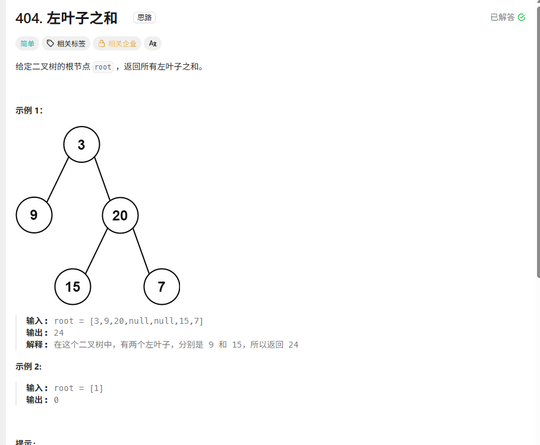

[404. 左叶子之和 - 力扣（LeetCode）](https://leetcode.cn/problems/sum-of-left-leaves/)

### 伪代码

```python
 										1.递归法
# Definition for a binary tree node.
# class TreeNode:
#     def __init__(self, val=0, left=None, right=None):
#         self.val = val
#         self.left = left
#         self.right = right
class Solution:
    def sumOfLeftLeaves(self, root: Optional[TreeNode]) -> int:  #获取以这棵树为根的左子叶之和
        if not root:
            return 0

        leftvalue=0
        
        if root.left and  not root.left.left and not root.left.right:  #判断是不是左叶子
                leftvalue= root.left.val 
        else:
                leftvalue=self.sumOfLeftLeaves(root.left)

        
        rightvalue=self.sumOfLeftLeaves(root.right)

        return leftvalue+rightvalue

    										2.迭代法
# Definition for a binary tree node.
# class TreeNode:
#     def __init__(self, val=0, left=None, right=None):
#         self.val = val
#         self.left = left
#         self.right = right
class Solution:
    def sumOfLeftLeaves(self, root: Optional[TreeNode]) -> int:  #获取以这棵树为根的左子叶之和
        if not root:
            return 0
        stack=[root]
        result=0
        while stack:
            cur=stack.pop()

            if cur.left and not cur.left.left and not cur.left.right:#是左叶子就加了这一行而已
                result+=cur.left.val

            if cur.left:
                stack.append(cur.left)
            if cur.right:
                stack.append(cur.right)                
        return result

```


### 思路 

递归法:    一定要注意，递归的核心就是把他当做黑盒子， sumOfLeftLeaves 就是用来拿以这棵树为根的左子叶之和

  if root.left: 和  if not root.left.left and not root.left.right: 就是说明这个root。left就是左叶子了


迭代法：就一直和之前一样stack然后加起来result然后 进行一个结果判断即可

****

### 易错点：

### 知识点：

```python
 

```


### 重写一遍之后还会犯的错


## 找树左下角的值

[513. 找树左下角的值 - 力扣（LeetCode）](https://leetcode.cn/problems/find-bottom-left-tree-value/description/)

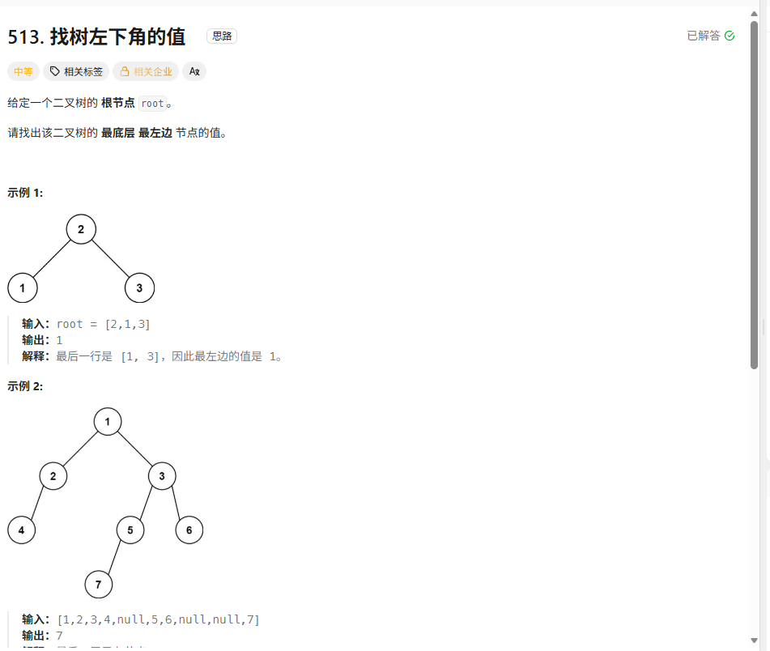

### 伪代码

```python
									1.层序法
# Definition for a binary tree node.
# class TreeNode:
#     def __init__(self, val=0, left=None, right=None):
#         self.val = val
#         self.left = left
#         self.right = right
class Solution:
    def findBottomLeftValue(self, root: TreeNode | None) -> int:
        if not root:
            return 0
        
        que=deque([root])

        while que:
            leaf=[]
            for _ in range(0,len(que)):
                cur=que.popleft()
                leaf.append(cur.val)
                if cur.left:
                    que.append( cur.left)
                if cur.right:
                    que.append(cur.right)
        return leaf[0]
    
    										2.递归法
class Solution:
    def traversal(self,root,depth):

        if not root:
            return
        if not root.left and not root.right:
            if  depth>self.maxdepth:
                self.maxdepth = depth
                self.result = root.val
                return

        if root.left:
            self.traversal(root.left,depth+1)
        if root.right:
            self.traversal(root.right,depth+1)
    

    def findBottomLeftValue(self, root: TreeNode | None) -> int:
        self.maxdepth=-1
        self.result=0
        self.traversal(root,0)
        return self.result
```


### 思路 

1.层序法： 直接层序法然后return leaaf【0】即可

2.递归法 ：定义全局maxdepth和result 然后一直遍历一下 ，最终没有左右节点的时候，说明可以更改一下maxdepth和result的值了

****

### 易错点：

### 知识点：

```python
 

```


### 重写一遍之后还会犯的错


## 112路径总和

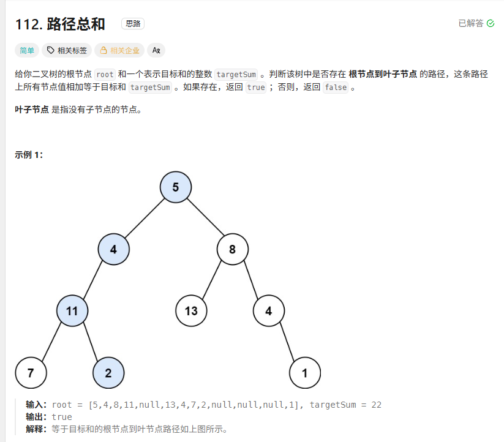

[112. 路径总和 - 力扣（LeetCode）](https://leetcode.cn/problems/path-sum/description/)


### 伪代码

```python
										1.迭代法
# Definition for a binary tree node.
# class TreeNode:
#     def __init__(self, val=0, left=None, right=None):
#         self.val = val
#         self.left = left
#         self.right = right
class Solution:
    def hasPathSum(self, root: TreeNode | None, targetSum: int) -> bool:
        if not root:
            return False
        stack=[(root,root.val)] 

        while stack:

            cur,sum=stack.pop()
            if not cur.left and not cur.right:
                if sum==targetSum:
                    return True
            if cur.left:
                stack.append((cur.left,sum+cur.left.val))  #这个sum+cur.left.val非常的有回溯效果
     
            if cur.right:
                stack.append((cur.right,sum+cur.right.val))
        return False
    
    
    									2.递归法
class Solution:
    def traversal(self,root,sum,targetSum):
        if not root:
            return False

        if not root.left and not root.right:#到达了根节点
            if sum==targetSum:
                return True
            else: 
                return False

        if root.left:
            if self.traversal(root.left,sum+root.left.val,targetSum):
                return True

        if root.right:
            if self.traversal(root.right,sum+root.right.val,targetSum):
                return True

        return False

    def hasPathSum(self, root: TreeNode | None, targetSum: int) -> bool:
        if not root:
            return False

        
        return self.traversal(root,root.val,targetSum)
```


### 思路 

1.迭代法和19题二叉树的所有路径一样，用元组存起来然后加起来判断即可

2.自己写的时候少了这几个if和return false还是return true ，一定要记得向上反馈，没有把消息传出来

****

### 易错点：

```python
                stack.append((cur.left,sum+cur.left.val))  
    #这里的sum不会去累加因为sum的值只停留在这一层了 ，自带回溯效果
```


### 知识点：

```python
      1.   stack=[(root,root.val)]   用元组把root和当前sum存起来

```


### 重写一遍之后还会犯的错


## 113路径总和II

[113. 路径总和 II - 力扣（LeetCode）](https://leetcode.cn/problems/path-sum-ii/)

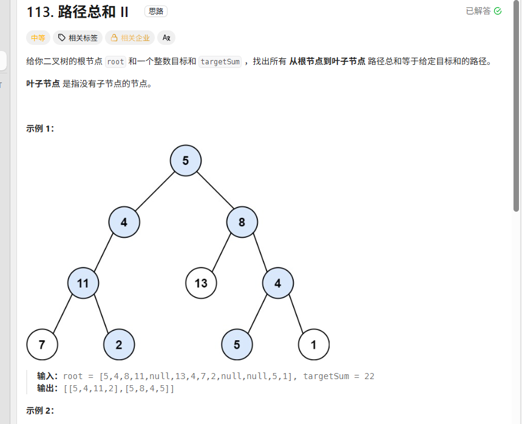


### 伪代码

```python
											1.迭代法
class Solution:
    def pathSum(self, root: TreeNode | None, targetSum: int) -> list[list[int]]:
        if not root:
            return []

        result=[]
        path=[]
        path.append(root.val)
        stack=[(root,root.val,path)]

        while stack:

            cur,sum,path=stack.pop()
            if not cur.left and not cur.right:
                if sum==targetSum:
                    result.append(path)

            if cur.left:
                new_path=path + [cur.left.val] 
                stack.append((cur.left,sum+cur.left.val,new_path))
            if cur.right:
                new_path=path + [cur.right.val] 
                stack.append((cur.right,sum+cur.right.val,new_path))     

        return result
    
    
    										2.递归法

class Solution:

    def traversal(self,root,result,path,sum,targetSum):

        if not root.left and not root.right:
            if sum==targetSum:
                result.append(path)

        if root.left:
            new_path=path+[root.left.val]
            self.traversal(root.left,result,new_path,sum+root.left.val,targetSum)
            
        if root.right:
            new_path=path+[root.right.val]
            self.traversal(root.right,result,new_path,sum+root.right.val,targetSum)           


    def pathSum(self, root: TreeNode | None, targetSum: int) -> list[list[int]]:
        if not root:
            return []
        result=[]
        path=[root.val]

        self.traversal(root,result,path,root.val,targetSum)
        return result
```


### 思路 

1.迭代法：注意无论是sum还是path都是要把当前值不要传到下一个里面影响了，因为左右节点都要加进去计算的

2.递归法：和迭代法一样注意他的sum和path的值不要改变

****

### 易错点：

```python
要保证该层的不要被更改 path以及sum都是这样的
```


### 知识点：

```python
 stack.append((cur.left, sum+cur.left.val, path.append(cur.left.val)))   #原来 25 26 行我是这样写的
   '''
错误点 1：path.append(...) 的返回值是 None

错误点 2：路径列表被“共享”了（隐蔽的逻辑错误）
这就是为什么我之前一直强调：一定要用 path + [新值] 生成一个新列表，而不是 path.append(...)。   
   
   '''


```


### 重写一遍之后还会犯的错

如果要全局sum,targetSum的话  ，可以再主函数里面self.sum=sum   还有self.targetsum=targetsum就可以了


## 106从中序和后续遍历序列构造二叉树

[106. 从中序与后序遍历序列构造二叉树 - 力扣（LeetCode）](https://leetcode.cn/problems/construct-binary-tree-from-inorder-and-postorder-traversal/)

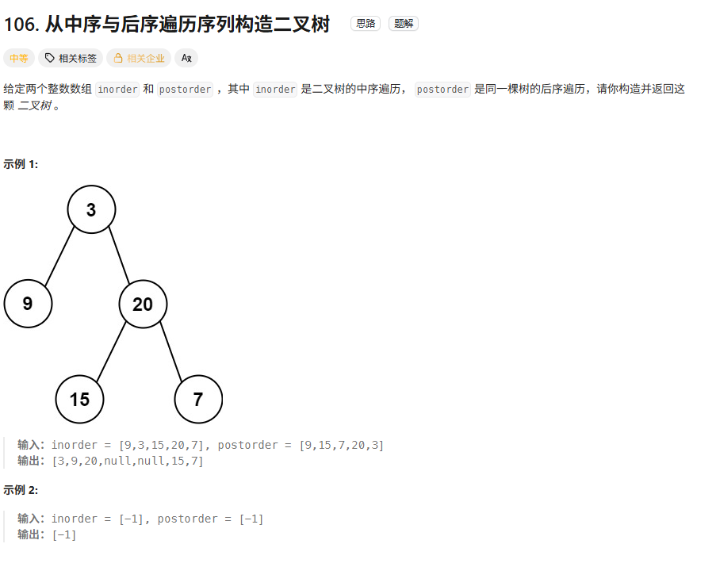


### 伪代码

```python

class Solution:
    def buildTree(self, inorder: List[int], postorder: List[int]) -> TreeNode:
        # 递归中止条件：树为空
        if not inorder or not postorder:
            return None

        # 根节点的值为后序遍历的最后一个元素值
        rootVal = postorder[-1]
        # 创建根节点
        root = TreeNode(rootVal)

        # 用根节点的值去中序数组中查找对应元素下标
        midIndex = inorder.index(rootVal)

        # 找出中序遍历的左子树和右子树
        # 左子树区间为 [0,midIndex),右子树区间为[midIndex+1，n-1]
        inorderLeft = inorder[:midIndex]
        inorderRight = inorder[midIndex + 1:]

        # 找出后序遍历的左子树和右子树
        # 后序遍历和中序遍历的左子树和右子树长度相等，所以可以通过中序遍历左右子树的长度来确定后序遍历左右子树的位置
        postorderLeft = postorder[: len(inorderLeft)]
        postorderRight = postorder[len(inorderLeft): len(inorder) - 1]

        # 递归遍历左子树
        root.left = self.buildTree(inorderLeft, postorderLeft)
        # 递归遍历右子树
        root.right = self.buildTree(inorderRight, postorderRight)

        return root

```


### 思路 

用后序确定根节点，然后用中序把他们分开，然后就知道根节点的左子树和右子树， 用后序根据长度也确定左子树和右子树 ，然后继续递归

****

### 易错点：

### 知识点：

```python
 

```


### 重写一遍之后还会犯的错


## 654最大二叉树

[654. 最大二叉树 - 力扣（LeetCode）](https://leetcode.cn/problems/maximum-binary-tree/description/)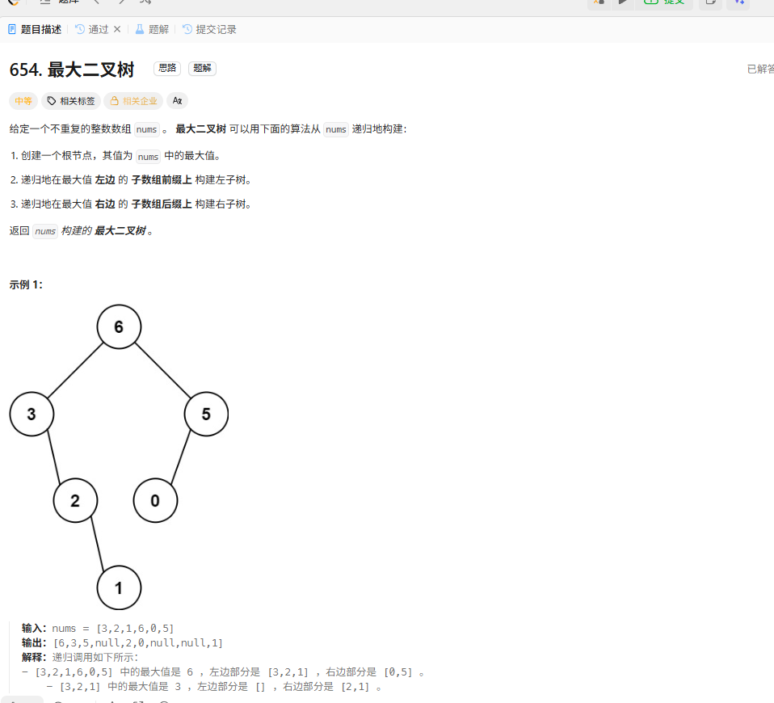


### 伪代码

```python
										1.递归法
class Solution:
    def traversal(self,left: int, right: int) -> TreeNode: #在这个左闭右开的区间进行递归

        if left>=right:
            return 

        #找到左left开，右闭right的区间里面的最大值
        max_index=left
        for i in range(left,right):
            if self.nums[i]>self.nums[max_index]:
                max_index=i
        
        root=TreeNode(self.nums[max_index])

        root.left=self.traversal(left,max_index)

        root.right=self.traversal(max_index+1,right)

        return root

    def constructMaximumBinaryTree(self, nums: list[int]) -> TreeNode | None:
        self.nums=nums
        return self.traversal(0,len(nums))

        
```


### 思路 

1.递归法：还是和上一题一样，递归思路： 把区间【left  right）左右两边的 最大值找到，然后TreeNode 他root  ，

然后下标left到max_index 作为root.left

下标max_index+1 到right+1作为root.right即可

****

### 易错点：

```python
root.left=self.traversal(left,max_index)self.traversal(left,max_index) 
    #回溯的时候是left和max_index 而不是0和max_index      

root.right=self.traversal(max_index+1,right)
	    #回溯的时候是left和max_index 而不是max_index+1和len（nums）        递归一样要有全局性！！！！！！！！！！！！！！！
```


### 知识点：

```python
 
#如果像这样分函数写的话 ，nums需要调用

        self.nums=nums
```


### 重写一遍之后还会犯的错


## 617合并二叉树

[617. 合并二叉树 - 力扣（LeetCode）](https://leetcode.cn/problems/merge-two-binary-trees/description/)

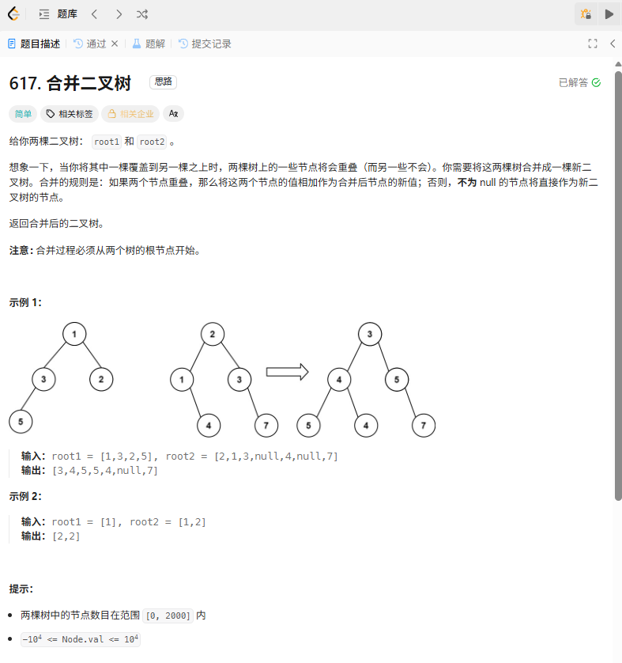


### 伪代码

```python
									1.递归法
class Solution:
    def merge(self,root1,root2):
        if not root1: #如果root1为空 直接返回root2，因为就算是空也可以直接返回得了
            return root2
        if not root2:
            return root1
        
        if  root1 and  root2: #如果都不为空那就继续递归，为空的话有一个直接就在上面返回了
            root=TreeNode(0)
            root.val=root1.val+root2.val

            root.left=self.merge(root1.left,root2.left)
            root.right=self.merge(root1.right,root2.right)

            return root

    def mergeTrees(self, root1: TreeNode | None, root2: TreeNode | None) -> TreeNode | None:
        return self.merge(root1,root2)
    
    
							
        
        
        
        									2.队列遍历法

class Solution:
    def mergeTrees(self, root1: Optional[TreeNode], root2: Optional[TreeNode]) -> Optional[TreeNode]:
        if not root1:
            return root2
        if not root2:
            return root1

        que = deque([root1, root2])

        while que:
            node1 = que.popleft()
            node2 = que.popleft()

            node1.val += node2.val #此时从队列里面成对出来的都是不为空的，并且一个node1一个node2

            if node1.left and node2.left: #如果左节点都存在
                que.append(node1.left)
                que.append(node2.left)
            if node1.right and node2.right: #如果右节点都存在
                que.append(node1.right)
                que.append(node2.right)

            if not node1.left and node2.left:#如果node1左节点不存在 node2存在，那就直接给node1
                node1.left = node2.left
            if not node1.right and node2.right:
                node1.right = node2.right

            #此时还有情况node1存在 node2不存在，那根本都不用写代码其实，直接返回的就是node1
            if  node1.left and not node2.left:
            if  node1.right and not node2.right:

        return root1


```


### 思路 

1.递归法和上一题思路差不多，两边都非空需要合并的再进行递归，不需要的直接return root即可

2.两边都非空、需要"继续深入合并子节点"的，才加入 que    否则只有一个存在的时候不进行合并，也不放入que当中

   node1是合并之后的结果的节点 如果都存在那就继续在que里面合并

****

### 易错点：

**忘了对特殊情况进行判断了：root1或root2为空的时候 是进行不了.val的操作的  所以要加这个并且这是终止条件，为空的时候就直接可以不再进行了**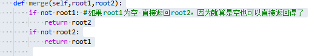

### 知识点：

```python
 

```


### 重写一遍之后还会犯的错


## 700二叉搜索树中的搜索

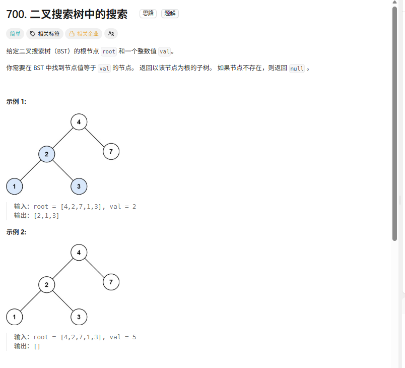

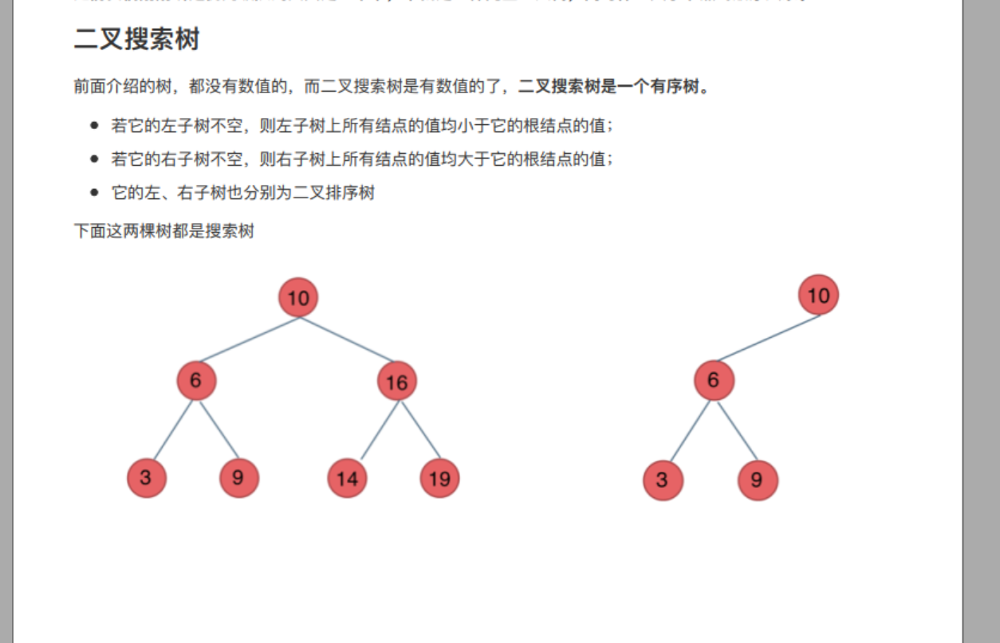


### 伪代码

```python
										1.许久未见的没有任何算法
class Solution:
    def searchBST(self, root: TreeNode | None, val: int) -> TreeNode | None:
        if not root:
            return []

        while root:
            if root.val>val:
                root=root.left
            elif root.val<val:
                root=root.right
            else: 
                return root
        return None
	
    
    										2.递归法
        
# Definition for a binary tree node.
# class TreeNode:
#     def __init__(self, val=0, left=None, right=None):
#         self.val = val
#         self.left = left
#         self.right = right
class Solution:
    def searchBST(self, root: TreeNode | None, val: int) -> TreeNode | None:  #
        if not root: #一直找，找的都没有叶子了不就直接return None10222
            return None
        
        if  root.val>val:
            return self.searchBST(root.left,val)
        elif root.val<val:
           return  self.searchBST(root.right,val)
        else: 
            return root
```


### 思路 

1.直接root.val比val大就让left等于root 然后一直搜索 root搜不到的时候直接return None

2.感觉这个递归法很有说法，就是虽然这几行但是终止条件，要return还是不return都不知道

****

### 易错点：

写递归的时候又忘记要return了 ，你看他的返回值类型，不是root就是none所以要return

### 知识点：

```python
 

```


### 重写一遍之后还会犯的错


## 98验证二叉搜索树

[98. 验证二叉搜索树 - 力扣（LeetCode）](https://leetcode.cn/problems/validate-binary-search-tree/description/)

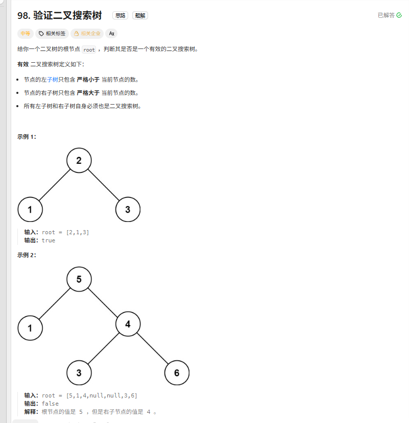


### 伪代码

```python
									1.统一迭代法再加一个pre去比较	
class Solution:
    def isValidBST(self, root: TreeNode | None) -> bool:
        if not root:
            return True  # 空树也是合法的二叉搜索树
        
        stack = [root]
        pre = None  # 记录中序遍历中前一个被访问的节点
        
        while stack:
            node = stack[-1]
            
            if node is not None:
                node = stack.pop()  # 弹出当前节点，准备把它的左右子节点和它自己重新压入

                if node.right:
                    stack.append(node.right)
                

                stack.append(node)
                stack.append(None)  # 这个 None 就是标记，表示“该节点已经访问过，等待处理结果”

                if node.left:
                    stack.append(node.left)
                    
            else:

                stack.pop()  # 弹出 None 标记
                node = stack.pop()  # 弹出真正的节点
                
                # ================ 核心改动在这里 ================
                # 原本这里写的是 result.append(node.val)
                # 现在我们要判断：当前节点是否大于前一个节点 因为是中序，所以左边的更小也就是说中序的数组是从小到大的
                if pre and node.val <= pre.val:
                    return False  # 不满足递增，不是 BST
                pre = node  # 更新 pre，记录当前节点
                # ===============================================
                
        return True
    
    
    								2.中序递归法
class Solution:
    def __init__(self):
        self.pre = None

    def isValidBST(self, root: Optional[TreeNode]) -> bool:
        if root is None:
            return True

        # 递归遍历左子树  一直找到左叶子才return true
        left = self.isValidBST(root.left)

        if self.pre is not None and self.pre.val >= root.val:  #比较在这里
            return False
        self.pre = root   #第一次记录的是最左叶子


        # 递归遍历右子树
        right = self.isValidBST(root.right)

        return left and right
```


### 思路 

1.统一迭代法：：相对于中序，我们这里就是用中序1遍历，然后记录pre是上一个节点 ，每次弹出真正的节点之后，就比较一下（虽然之前就说过这个pre的妙用，但是我还是感觉这个pre写的很好）

2.中序递归法：每个root都和pre去比较 ，pre也一直储存着中序的方法

****

### 易错点：

### 知识点：

1.二叉搜索树， 中序-左中右去遍历的话就是从小到大遍历的

2.pre的妙用

```python
        pre = None  # 记录中序遍历中前一个被访问的节点 
                if pre and node.val <= pre.val:
                    return False  # 不满足递增，不是 BST
                pre = node  # 更新 pre，记录当前节点
                
        这样就自动过滤第一个pre，然后第二个非none的pre开始去比较，
```


### 重写一遍之后还会犯的错


## 二叉搜索树的最小绝对差

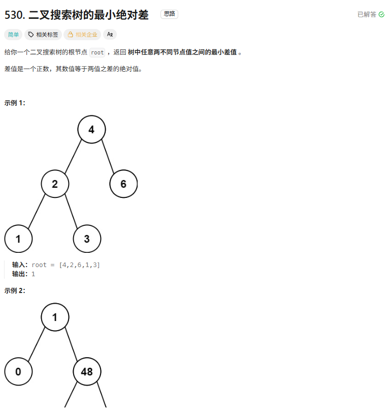

[530. 二叉搜索树的最小绝对差 - 力扣（LeetCode）](https://leetcode.cn/problems/minimum-absolute-difference-in-bst/)


### 伪代码

```python
								1.中序遍历法（更垃圾）

class Solution:
    def getMinimumDifference(self, root: Optional[TreeNode]) -> int:
        if not root:
            return
        result=[]
        stack=[root]
        min=float("inf")
        while stack:
            cur=stack[-1]

            if cur is not None:
                cur=stack.pop()
                
                if cur.right:
                    stack.append(cur.right)
                stack.append(cur)
                stack.append(None)
                if cur.left:
                    stack.append(cur.left)
            
            else :
                stack.pop()
                cur=stack.pop()
                result.append(cur.val)

        for i in range(0,len(result)-1):
            if result[i+1]-result[i]<min:
                min=result[i+1]-result[i]
        return min
    								2.中序遍历法

class Solution:
    def getMinimumDifference(self, root: Optional[TreeNode]) -> int:
        if not root:
            return
        result=[]
        stack=[root]
        minmin=float("inf")
        pre=None

        while stack:
            cur=stack[-1]

            if cur is not None:
                cur=stack.pop()

                if cur.right:
                    stack.append(cur.right)
                stack.append(cur)
                stack.append(None)
                if cur.left:
                    stack.append(cur.left)
            
            else :

                stack.pop()
                cur=stack.pop()
                if  pre:
                    minmin=min(minmin,cur.val-pre.val)
                pre=cur

        return minmin
    
    
    										3.中序递归法（就在中序加了pre比较）

class Solution:
    def dp(self,root):
        if not root:
            return 
        self.dp(root.left)
        #就在这里改了一下中序
        if self.pre is not None:
            self.min=min(self.min,root.val-self.pre)
        self.pre=root.val
        
        self.dp(root.right)

    def getMinimumDifference(self, root: Optional[TreeNode]) -> int:
        self.pre=None
        self.min=float("inf")
        
        self.dp(root)
        return self.min

```


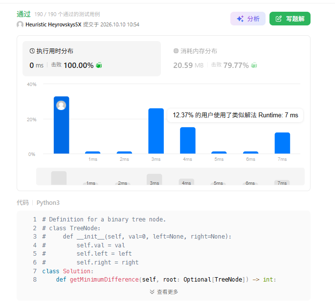

第一种中序遍历法：使用了result数组去记录下来整个二叉搜索树，最后再去遍历一遍比较浪费时间

第二种中序遍历法：直接用pre指针去记录上一个原本要加入到result当中的值，然后cur-pre与min比较即可

### 思路 

就是利用二叉搜索数的中序是一个递增的序列这个特性

1. 中序遍历法：把结果result之后直接比较即可

****

### 易错点：

### 知识点：

```python
 #第75行我原本写的 if self.pre：  但是0也会被当做None ，所以就要判断是否为空
        if self.pre is not None:
```


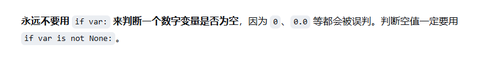


### 重写一遍之后还会犯的错


## 二叉搜索树中的众数

[501. 二叉搜索树中的众数 - 力扣（LeetCode）](https://leetcode.cn/problems/find-mode-in-binary-search-tree/description/)

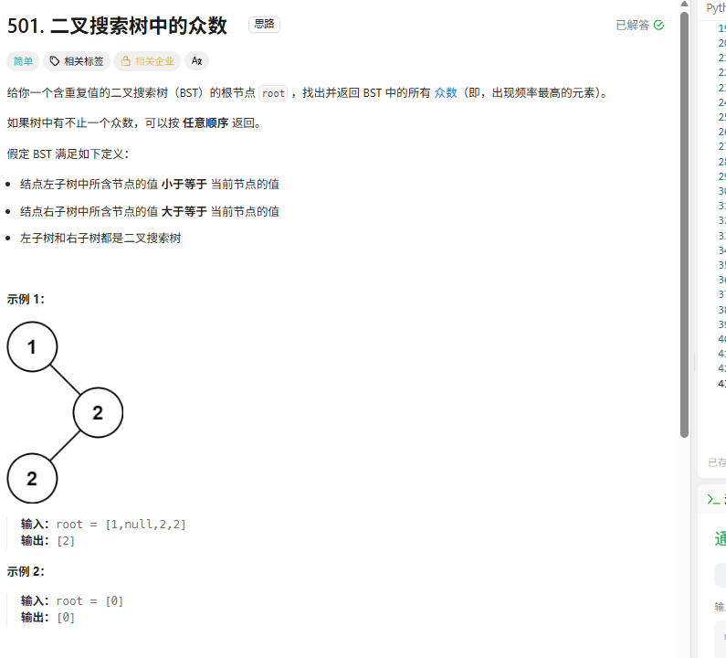


### 伪代码

```python
					1.完全的统一迭代法（改变：加了字典去记录，最后统计了一下个数）  这种方法适用于普通二叉树，二叉搜索树就要用它的特性
class Solution:
    def findMode(self, root: TreeNode | None) -> list[int]:
        if not root:
            return []

        freq_map=defaultdict(int)
        stack=[root]

        while stack:
            cur=stack[-1]

            if cur is not None:

                cur=stack.pop()

                if cur.right:
                    stack.append(cur.right)
                stack.append(cur)
                stack.append(None)
                if cur.left:
                    stack.append(cur.left)

            else:
                stack.pop()
                cur=stack.pop()
                freq_map[cur.val]+=1

        #通过字典统计个数
        result = []
        max_count = 0
        for val, count in freq_map.items():
            if count > max_count:
                max_count = count
                result = [val]       # 发现更大的频率，重新开始记录
            elif count == max_count:
                result.append(val)   # 频率相同，追加进去
        return result
  	  
    								     2二叉树的统一迭代法（利用了二叉树的有序性，实时更新结果）
    

class Solution:
    def findMode(self, root: TreeNode | None) -> list[int]:
        if not root:
            return []
        pre=None    #记录上一个的值
        result=[]  #用来记录返回的结果
        maxCount = 0        # 最大频率
        count = 0           # 当前元素出现频率
        stack=[root]

        while stack:
            cur=stack[-1]

            if cur is not None:

                cur=stack.pop()

                if cur.right:
                    stack.append(cur.right)
                stack.append(cur)
                stack.append(None)
                if cur.left:
                    stack.append(cur.left)
            else:
                stack.pop()
                cur=stack.pop()
                													#无论是迭代还是递归都是在这个地方加上新的东西即可
                if pre is None:
                    # 第一个节点
                    count = 1
                elif pre.val == cur.val:
                    # 与前一个节点值相同，频率+1
                    count += 1
                else:
                    # 与前一个节点值不同，频率重置为1
                    count = 1
                # 如果当前频率等于最大频率，加入结果集
                if count == maxCount:
                    result.append(cur.val)
                
                # 如果当前频率大于最大频率，更新最大频率并清空之前的结果
                if count > maxCount:
                    maxCount = count
                    result.clear()
                    result.append(cur.val)
                    
                pre = cur  # 更新前一个节点指针
        return result    
    
    												3.二叉搜索树的递归
from typing import Optional

class Solution:
    def dp(self, root):
        if not root:
            return
        
        # 左
        self.dp(root.left)
        
        # 中：就在这里处理频率统计逻辑									就在这里加了频率逻辑
        if self.pre is None:          # 第一个节点
            self.count = 1
        elif self.pre == root.val:    # 与前一个节点数值相同
            self.count += 1
        else:                         # 与前一个节点数值不同
            self.count = 1
            
        self.pre = root.val           # 更新前一个节点的值
        
        # 更新结果集
        if self.count == self.max_count:
            self.result.append(root.val)
            
        if self.count > self.max_count:
            self.max_count = self.count
            self.result.clear()       # 发现更大的频率，清空之前的结果
            self.result.append(root.val)

        # 右
        self.dp(root.right)

    def findMode(self, root: Optional[TreeNode]) -> list[int]:
        # 初始化状态变量（注意：这里 pre 存的是节点的值，而不是节点本身）
        self.pre = None
        self.count = 0
        self.max_count = 0
        self.result = []
        
        self.dp(root)
        return self.result
```


### 思路 

1.完全的统一迭代法（改变：加了字典去记录，最后统计了一下个数）  这种方法适用于普通二叉树，二叉搜索树就要用它的特性

二叉搜索树利用他的中序有序特性，

****

### 易错点：

### 知识点：

```python
 

```


### 重写一遍之后还会犯的错


## 二叉树的最近公共祖先

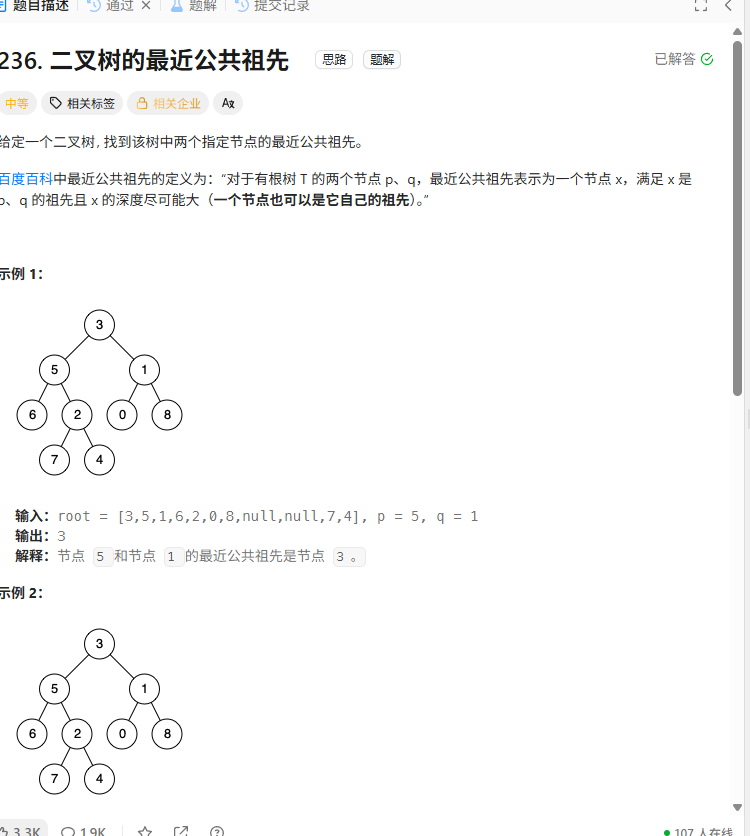

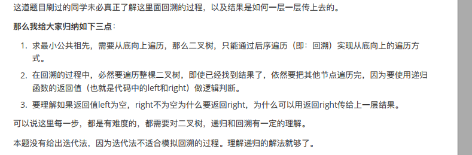

[236. 二叉树的最近公共祖先 - 力扣（LeetCode）](https://leetcode.cn/problems/lowest-common-ancestor-of-a-binary-tree/description/)

**后序遍历（左右中）就是天然的回溯过程，可以根据左右⼦树的返回值，来处理中节点的逻辑**。  

**后序遍历（左右中）就是天然的回溯过程，可以根据左右⼦树的返回值，来处理中节点的逻辑**。  **后序遍历（左右中）就是天然的回溯过程，可以根据左右⼦树的返回值，来处理中节点的逻辑**。  **后序遍历（左右中）就是天然的回溯过程，可以根据左右⼦树的返回值，来处理中节点的逻辑**。  **后序遍历（左右中）就是天然的回溯过程，可以根据左右⼦树的返回值，来处理中节点的逻辑**。  **后序遍历（左右中）就是天然的回溯过程，可以根据左右⼦树的返回值，来处理中节点的逻辑**。  **后序遍历（左右中）就是天然的回溯过程，可以根据左右⼦树的返回值，来处理中节点的逻辑**。  **后序遍历（左右中）就是天然的回溯过程，可以根据左右⼦树的返回值，来处理中节点的逻辑**。  

### 伪代码

```python
								#递归法  --（本质就是后续递归，可以看第二题的dp法）
class Solution:
    def lowestCommonAncestor(self, root: 'TreeNode', p: 'TreeNode', q: 'TreeNode') -> 'TreeNode':
        if not root:
            return  None
        if root ==q or root==p:
            return root
        
        left=self.lowestCommonAncestor(root.left,p,q)
        right=self.lowestCommonAncestor(root.right,p,q)

        #左右两边都返回了值，那就说明是情况1							这里就体现了天然的后序回溯算法 ，通过left和rigth返回值去写中值
        if left is not None and right is not None:
            return root
        
        if left is None and right is not None: #找到了右边
            return right
        elif left is not None and right is None:#找到了左边
            return left

        else :                              #都没找到
            return None

```


### 思路 


本质就是后序递归，第二题的后序遍历的递归法一致，都是先

```python
    left=self.lowestCommonAncestor(root.left,p,q)
    right=self.lowestCommonAncestor(root.right,p,q)
```

然后再去对中间的值进行处理

本体思路：终止条件： 到达最后也没找到，return	None     找到了就返回他的root


情况1：两个孙子在两边，返回的时候return 4     if left is not None and right is not None: 也就是这行代码

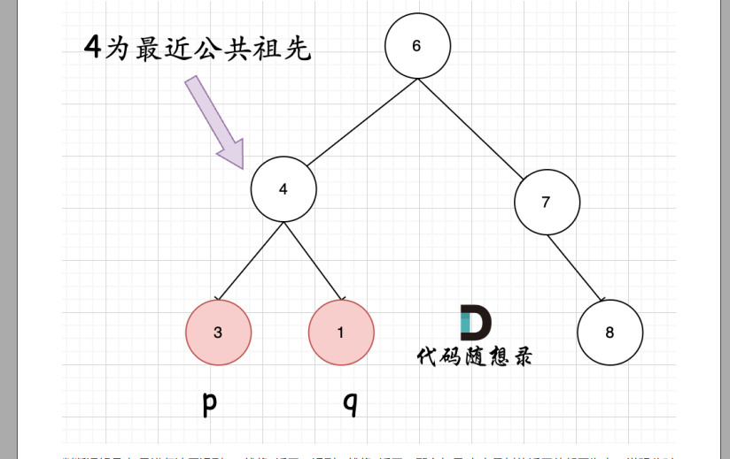

情况2： 自己是祖先， 找到了马上返回甚至都没发现p，那也是对的，就算没找到也可以直接返回q

​    if left is None and right is not None: #找到了右边

​      return right

​    elif left is not None and right is None:#找到了左边

​      return left

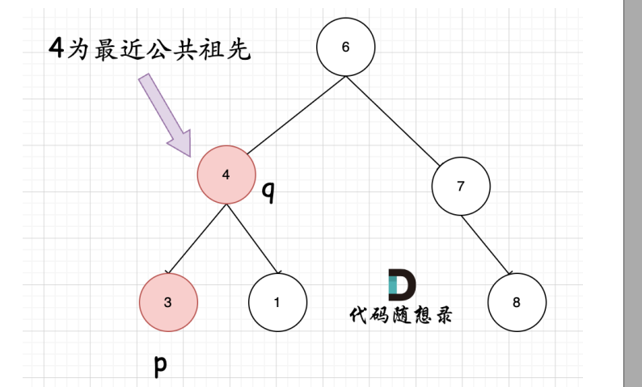


****

### 易错点：

### 知识点：

```python
 

```


### 重写一遍之后还会犯的错


## 二叉搜索树的最近公共祖先

[235. 二叉搜索树的最近公共祖先 - 力扣（LeetCode）](https://leetcode.cn/problems/lowest-common-ancestor-of-a-binary-search-tree/)

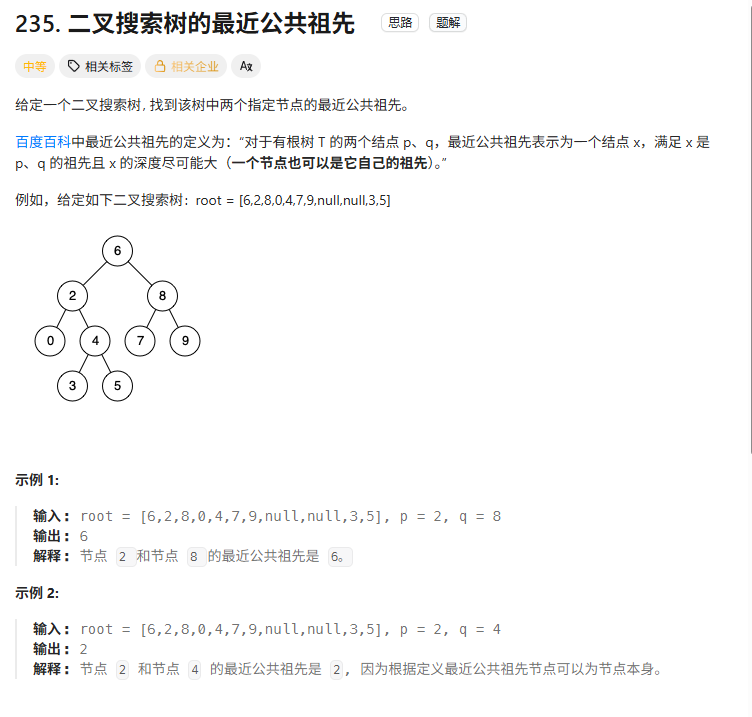


### 伪代码

```python
# Definition for a binary tree node.
# class TreeNode:
#     def __init__(self, x):
#         self.val = x
#         self.left = None
#         self.right = None

class Solution:
    def traversal(self, root: 'TreeNode', p: 'TreeNode', q: 'TreeNode') -> 'TreeNode':
        if not root:
            return None
        cur=root
        if cur.val>q.val and cur.val>p.val:						 #二叉搜索树有序即就往左边走
            left=self.traversal(root.left,p,q)
            if left is not None :
                return left

        if cur.val <q.val and cur.val<p.val:
            right =self.traversal(root.right,p,q)
            if right is not None:
                return right
        
        return cur #如果两个if 都没有进，要么就是在这两个之间，要么就是等于这两个其中一个，无论按种情况都可以直接返回

    def lowestCommonAncestor(self, root: 'TreeNode', p: 'TreeNode', q: 'TreeNode') -> 'TreeNode':
        return self.traversal(root,p,q)
```


### 思路 

利用二叉搜索树左边小于根，右边大于根的特性，		直接进行根的判断，往那边走   ，

****

### 易错点：

### 知识点：

```python
 

```


### 重写一遍之后还会犯的错
