# 动态规划

### 动态规划五部曲

1.**确定dp数组以及下标的含义**     比如爬到第i层楼梯，有dp[i]种⽅法  

2.**确定递推公式**        					如dp[i] = dp[i - 1] + dp[i - 2]  

3.dp数组如何初始化  

4.确定遍历顺序  

5.举例推导dp数组  

### 递归

1.什么时候结束也就是终止条件

2.什么时候return

3.要python在自己的函数里面调用自己，需要加self.


### Debug

找问题的最好⽅式就是把dp数组打印出来，看看究竟是不是按照⾃⼰思路推导的  

### 定义二维数组

```python
        dp = [[0] * n for _ in range(m)] # 定义一个m行 n列的二维数组   但是mn不能交换位置的
        dp=[[0]*len(nums2) for _ in range(0,len(nums1))]  #第一个循环一定要是列 ，  数组定义先行后列 循环定义先列后行
```


###  背包问题

2. 可以重复选 ：完全背包 一维数组的for都是正序        
3. 不可以重复选 ： 01背包一维数组 外层物品for正序 ，内层背包for倒序    
4. 考虑顺序 ： 排列 ：背包在外层for   物品在内层for
5. 不考虑顺序 ：组合  物品在外层for   ，背包在内层for


### dp数组何时取max何时+1即可

当dp数组定义为：text1 的前 i 个字符和 text2 的前 j 个字符中，最长公共子序列的长度

  因为他是子序列，可能不连续，所以要取max把他连续起来最大的dp数组，最后返回dp【m】【n】即可

```python
            if text1[i-1]==text2[j-1]:
                dp[i][j]=dp[i-1][j-1]+1
            else :
                dp[i][j]=max(dp[i-1][j],dp[i][j-1])
```


## 1.斐波那契数  

https://leetcode.cn/problems/fibonacci-number/


### 伪代码

```python
						1.递归法      				时间复杂度O(2^n)    空间复杂度： O(n)
class Solution:
    def fib(self, n: int) -> int:
        if n<2:  
            return n
        return self.fib(n-1)+self.fib(n-2)

        
        
        				2.常规代码法：           时间复杂度O(n)    空间复杂度： O(n)
        class Solution:
    def fib(self, N: int) -> int:

        if N <= 1:
            return N
        dp = [0] * (N + 1)    #空间复杂度在这 
        dp[0] = 0
        dp[1] = 1
        
        for i in range(2, N + 1): #时间复杂度在这
            dp[i] = dp[i - 1] + dp[i - 2] 
        return dp[N]
    
    
    					3.节约空间代码法：           时间复杂度O(n)    空间复杂度： O(1)
				
class Solution:
    def fib(self, n: int) -> int:
        if n < 2:
            return n
            
        dp = [0] * 30
        dp[0] = 0
        dp[1] = 1
        for i in range(2, n + 1):
            								# 正确的滚动更新
            dp[0], dp[1] = dp[1], dp[0] + dp[1]
            
        return dp[1] 
```

### 思路：

### 易错点：

1.要python在自己的函数里面调用自己，需要加self.

### 知识点：

这是递归的入门题： 递归有两个要素


### 时间复杂度


### 再写一遍犯的错


## 爬楼梯

[70. 爬楼梯 - 力扣（LeetCode）](https://leetcode.cn/problems/climbing-stairs/description/)


### 伪代码

```python
 									1.递归法（不可用 ）  --时间复杂度O(2^n)    空间复杂度： O(n)
class Solution:
    def climbStairs(self, n: int) -> int:

        if n==1: return 1
        if n==2 : return 2
        return self.climbStairs(n-1)+self.climbStairs(n-2)
            
        
 									2.常规代码法：           时间复杂度O(n)    空间复杂度： O(n)
class Solution:
    def climbStairs(self, n: int) -> int:
        if n<=2:
            return  n  #一定要进行这个初始情况判定
        dp=[0]*(n+1)
        dp[1]=1
        dp[2]=2
        if n<=1:
            return n
        
        for i in range(3,n+1):
            dp[i]=dp[i-1]+dp[i-2]
        return dp[n]
            
            
            						3.节约空间代码（只用dp【1】 和dp 【2】）   时间复杂度O(n)    空间复杂度： O(1)
class Solution:
    def climbStairs(self, n: int) -> int:
        dp=[0,1,2] 
        dp[1]=1
        dp[2]=2
        if n<=1:
            return n
        
        for i in range(3,n+1):
            dp[1],dp[2]=dp[2],dp[1]+dp[2]
        return dp[2]

```

### 思路：

变种的斐波那契数  ， 比如10阶台阶 = 8阶的时候+9阶的时候 的值  ，  你说8阶不可以 8+1+1 和 8 +2 两种呢， 因为8+1的时候再+1中间有9的过程了


### 易错点

1.初始化数组

再用代码法的时候，记得 初始化数组不然不能调用

```python
        dp=[0,1,2]   去初始化一个数组，
    
    # 创建长度为 n+1 的列表，初始值全为 0
        dp = [0] * (n + 1)
```


## 最小花费爬楼梯

[746. 使用最小花费爬楼梯 - 力扣（LeetCode）](https://leetcode.cn/problems/min-cost-climbing-stairs/description/)


### 伪代码

```python
											1.递归法 时间复杂度
class Solution:
    def minCostClimbingStairs(self, cost: list[int]) -> int:
        dp=[0]*(len(cost)+1) #楼顶数量是len(cost)+1  也就是cost后面的那个  这里是几个不是下标   要求的是下标是dp【len（cost）】也就是cost数组接触不到的天花板
        dp[0]=0
        dp[1]=0

        for i in range(2,len(cost)+1):  #走到cost+1位置需要的最少的花费
            dp[i]=min(dp[i-1]+cost[i-1],dp[i-2]+cost[i-2])
        return dp[len(cost)]

        
       									2.常规代码法  -使用
class Solution:
    def minCostClimbingStairs(self, cost: list[int]) -> int:
        dp=[0]*(len(cost)+1)#一共len（） 但是下标是从0 到len（cost）+1的
        dp[0]=0
        dp[1]=0

        for i in range(2,len(cost)+1):
            dp[i]=min(dp[i-1]+cost[i-1],dp[i-2]+cost[i-2])
        return dp[len(cost)]
            

									3. 节约时间复杂度法 
class Solution:
    def minCostClimbingStairs(self, cost: list[int]) -> int:

        dp=[0,0,0]

        for i in range(2,len(cost)+1): #要计算的下标是 len（cost） 所以右边界要+1
            dp[2]=min(dp[1]+cost[i-1],dp[0]+cost[i-2])
            dp[0]=dp[1]
            dp[1]=dp[2]

        return dp[1]
            

```


### 思路 

****

### 易错点：

1. 它是指当你站在第i台阶，口袋花了多少钱


`dp[i]` 代表的是**“你站在第 i 个台阶上时，你口袋里最少已经花了多少钱”**


2.

```python
            dp[0]=dp[1]
            dp[1]=min(dp[1]+cost[i-1],dp[2]+cost[i-2]) ❌️❌️❌️❌️  这样不就自己调用自己了吗
        
        
        
            dp[2]=min(dp[1]+cost[i-1],dp[0]+cost[i-2])  ✅️✅️✅️
            dp[0]=dp[1]
            dp[1]=dp[2]
```


### 知识点：


```python
 

```


## 62不同路径

[62. 不同路径 - 力扣（LeetCode）](https://leetcode.cn/problems/unique-paths/)


###  思路

**二维数组法：**

1.先初始化，第一行第一列全为1 

2.从第二行第二列开始遍历 ：  dp[i][j] = dp[i - 1][j] + dp[i][j - 1]

​	

**一维数组法：**

（dp【i】 表示的上一行的结果，）

1.先初始化第一行 全为1 

2.从第二行的第二列开始   dp[j]=dp[j]+dp[j-1]

**易错点**：dp[j-1] 从第二列开始存在 ，那		j-1		的值是多少  ，就是继承的上一行的dp【0】的值吗，没有改变都是1

### 伪代码

```python
										1.递归法（二维数组）  时间复杂度 O(m × n)  空间复杂度O(m × n)
class Solution:
    def uniquePaths(self, m: int, n: int) -> int:
        dp=[[0]*n for _ in range(0,m)] #记住如何定义二维数组  m行n列
        
        for i in range(0,n): #列填充 初始化第一行全是 1
            dp[0][i]=1
        for i in range(0,m): #行填充 初始化第一列也全是1
            dp[i][0]=1

        for i in range(1, m):#行  
            for j in range(1, n):#列
                dp[i][j] = dp[i - 1][j] + dp[i][j - 1]


        return dp[m - 1][n - 1]
										
        								2.递归法（一维数组法） 时间复杂度： O(m × n)  空间复杂度： O(n)
class Solution:
    def uniquePaths(self, m: int, n: int) -> int:
        dp=[1]*n #定义一维数组

        for i in range(1,m):
            for j in range(1,n):
                dp[j]=dp[j]+dp[j-1]
        return dp[-1]

        
        
```


## 不同路径II（没提交）

[63. 不同路径 II - 力扣（LeetCode）](https://leetcode.cn/problems/unique-paths-ii/description/)


###  思路

..**常规递归法 时间复杂度O(n × m)， 空间复杂度O(n × m)，**

1.定义二维数组 

2.给第一行和第一列初始化为1 ，碰到障碍后面的全部break

3.从第二列第二行开始遍历  **dp[i][j]=dp[i][j-1]+dp[i-1][j]**


**节约空间复杂度的代码 时间复杂度： O(n × m)，空间复杂度： O(m)**

就是每个dp【j】都是上一行的数值， dp[j-1]是左边的数值

1.定义一个n列的一维数组

2.初始化第一行 dp[i]=1，碰到障碍直接break

3.遍历每行每列，如果碰到障碍。直接dp【j】=0 如果j！=0 （不是第一列）  dp[j]=dp[j]+dp[j-1]


**易错点**：dp[j-1] 从第二列开始存在 ，那		j-1		的值是多少  ，就是继承的上一行的dp【0】的值吗，没有改变都是1

****


### 伪代码

```python
									1.常规递归法 时间复杂度O(n × m)， 空间复杂度O(n × m)，
class Solution:
    def uniquePathsWithObstacles(self, obstacleGrid: list[list[int]]) -> int:
        m=len(obstacleGrid)
        n=len(obstacleGrid[0])
        dp=[[0]* n for i in range(0,m)]

        #初始化
        for i in range(0,n):
            if obstacleGrid[0][i] ==1:
                break
            else :dp[0][i]=1
		#初始化
        for i in range(0,m):
            if obstacleGrid[i][0] ==1:
                break
            else : dp[i][0]=1
        
        for i in range(1,m):#m行  按照行填充
            for j in range(1,n):#n列
                if obstacleGrid[i][j] == 1:
                    dp[i][j] = 0     # 障碍格不可达
                else : 
                    dp[i][j]=dp[i][j-1]+dp[i-1][j]
        return dp[m-1][n-1]


								2. 节约空间复杂度的代码 时间复杂度： O(n × m)，空间复杂度： O(m)
class Solution:
    def uniquePathsWithObstacles(self, obstacleGrid: list[list[int]]) -> int:
        m=len(obstacleGrid)
        n=len(obstacleGrid[0])

        #定义一维数组 长度为n列
        dp=[0]*n 

        #初始化第一行
        for i in range(0,n):
            if obstacleGrid[0][i]==1:#有障碍
                break
            else: 
                dp[i]=1

           #开始遍历 
        for i in range(1,m):
            for j in range(0,n):
                if obstacleGrid[i][j]==1:
                    dp[j]=0
                elif j!=0:
                    dp[j]=dp[j]+dp[j-1]
        return dp[-1]
    
    
    
    
    
       							#我改成这样行吗 else :
                    dp[j]=dp[j]+dp[j-1]
class Solution:
    def uniquePathsWithObstacles(self, obstacleGrid: list[list[int]]) -> int:
        m=len(obstacleGrid)
        n=len(obstacleGrid[0])

        #定义一维数组 长度为n列
        dp=[0]*n 

        #初始化第一行
        for i in range(0,n):
            if obstacleGrid[0][i]==1:#有障碍
                break
            else: 
                dp[i]=1

        for i in range(1,m):
            for j in range(1,n):
                if obstacleGrid[i][j]==1:
                    dp[j]=0
                else :
                    dp[j]=dp[j]+dp[j-1]
        return dp[-1]

```


##整数拆分

[343. 整数拆分 - 力扣（LeetCode）](https://leetcode.cn/problems/integer-break/description/)


###  思路

**当前dp【i】 就是 i 的最大整数拆分**


### 伪代码

```python
class Solution:
    def integerBreak(self, n: int) -> int:
        dp=[0]*(n+1)
        dp[2]=1

        for i in range(3,n+1):
            for j in range(1,i//2+1):
                # 方案一：只拆成两个数 (j 和 i-j)，不再继续拆分
                option1= j*(i-j)
                #方案二：把 (i-j) 继续拆分，利用之前算好的 dp 表
                option2 = j*dp[i-j]

                dp[i]=max(dp[i],option1,option2)#因为遍历了所有的，dp[i]只取max

        return dp[n]
```


## 96不同的二叉搜索树

[96. 不同的二叉搜索树 - 力扣（LeetCode）](https://leetcode.cn/problems/unique-binary-search-trees/)


###  思路

dp[i] ： 1到i为节点组成的⼆叉搜索树的个数为dp[i] 


在这里n为3 以 1为头结点的话 i=3 j=1  左子树0 颗  右子树 2颗 

​					以 2为头结点的话 i=3 j=2  左子树1 颗  右子树 1颗 

​					以 3为头结点的话 i=3 j=3  左子树2颗  右子树 0颗 

**所以可以推导出递归公式**			

​					以 i 为头结点的话			  左子树j-1 颗  右子树 i-j颗   想加为  i- 1           j-1 +  i-j 


### 伪代码

```python
class Solution:                  #时间复杂度： O(n^2)   空间复杂度： O(n)
    def numTrees(self, n: int) -> int:
        dp=[0]*(n+1)
        dp[0]=1# 空树也是一棵树
        for i in range(1,n+1):#从1开始到n的      dp【i】的二叉树数量
            for j in range(1,i+1):#从1到 i 种情况的头结点  以j为头节点的二叉树种类
                dp[i]+=dp[j-1]*dp[i-j] #以j为头节点左子树有j-1个元素，右子树有i-j个

        return dp[n]


```


# 01背包（每件物品最多使用一次）


## 二维数组背包

**dp格子含义 `dp[i][j]`**：代表从 `0` 到 `i` 个物品中任取，放进容量为 `j` 的背包里，能获得的最大价值

所以第一列背包能容纳重量为0 就全是0  ，然后 第一行背包从0 到 0 任取物品也是0


一维数组 ：外层物品for正序         内层背包得**倒序**排序** （记住，是背包的维度得倒序，不管几维都得倒序）

二维数组 ：两层正序for循环     


**递推公式**：   第一个表示不选物品i （根本就没碰第 i  个物品）  第二个表示选物品 i 然后j减去这个物品的重量 +物品价值

```python
   dp[i][j] = max(dp[i - 1][j], dp[i - 1][j - weight[i]] + value[i])
```


**初始化的表格**


**最终填满的表格**


### 伪代码

```python
							# n为物品的数量  bagweight表示背包的容量

n, bagweight = map(int, input().split())

weight = list(map(int, input().split()))
value = list(map(int, input().split()))

dp = [[0] * (bagweight + 1) for _ in range(n)] #定于二维数组

for j in range(weight[0], bagweight + 1): #第一行初始化  从物品0 容量开始放物品0的价值
    dp[0][j] = value[0]

for i in range(1, n):#从第二行开始 表示物品 
    for j in range(0,bagweight + 1):#从第一列开始 表示容量
        if j < weight[i]:
            dp[i][j] = dp[i - 1][j] #背包容量比物品小 ，想拿都拿不了
        else:
            dp[i][j] = max(dp[i - 1][j], dp[i - 1][j - weight[i]] + value[i]) # 不取    取

print(dp[n - 1][bagweight])

```


关于二维数组的下标： 定义的时候要保证bagweight能够直接输出print(dp[n - 1][bagweight])  所以要+1 因为容量下标从0开始的，但是对于物品，是数组也是从0开始的，所以for循环的时候 1-n就完全够了

## 一维数组背包


1.**dp[j]含义：dp[j]表示：容量为j的背包，所背的物品价值可以最⼤为dp[j]**          和之前一样直接拷贝上一层的值即可


**2.递推公式：** 

第一个表示不选这个物品，所以直接把上面一层的结果记录下来    可以参考上面的二维图来理解

第二个表示选这个物品 ，所以还是这样

```python
dp[j] = max(dp[j], dp[j - weight[i]] + value[i]);
```


**3.一维背包得倒序排序** （记住，是背包的维度得倒序，不管几维都得倒序）


1.倒序的时候 算dp【2】的时候 **dp【1】初始化为0** 所以 0+15 ==15 


### 初始化表格


### 最终数组


### 伪代码

```python
n, bagweight = map(int, input().split())
weight = list(map(int, input().split()))
value = list(map(int, input().split()))

dp = [0] * (bagweight + 1)  # 创建一个动态规划数组dp，初始值为0      为啥要+1 ？?？？？？  因为dp【i】表示背包为 i 的容量的最大价值

dp[0] = 0  # 初始化dp[0] = 0,背包容量为0，价值最大为0

for i in range(n):  # 应该先遍历物品 也就是行 
    for j in range(bagweight, weight[i]-1, -1):  # 1.倒序遍历背包容量     2.weight[i]-1  是因为前面的都不需要判断，想放都放不了了
        dp[j] = max(dp[j], dp[j - weight[i]] + value[i]) # 取 ， 不取 j才是背包容量

print(dp[bagweight])

```


## 分割等和子集

[416. 分割等和子集 - 力扣（LeetCode）](https://leetcode.cn/problems/partition-equal-subset-sum/)


###  思路

1.**dp[j]含义：dp[j]表示：容量为j的背包，所背的物品价值可以最⼤为dp[j]**          和之前一样直接拷贝上一层的值即可

1.可以把数组的值都先看成背包容量，然后只不过恰好价值就是等于它的容量

3.结果判断： 就看数组之和的一半的背包容量 ，能否刚好装下最大价值为数组之和   能装下就可以return true

### 伪代码

```python
class Solution:
    def canPartition(self, nums: list[int]) -> bool:
        # 背包内总和
        total_sum = sum(nums)
        
        # 如果总和为奇数，无法平分为两个整数子集
        if total_sum % 2 == 1:
            return False
        
        target = total_sum // 2
        
        # 初始化 dp 数组，大小为 target + 1    为啥要+1 ？?？？？？  因为dp【i】表示背包为 i 的容量的最大价值
        # dp[j] 表示容量为 j 的背包能装下的最大重量（即子集和）      
        dp = [0] * (target + 1)
        

        for i in range(0,len(nums)):#遍历行 ，也就是先便利物品 也就是nums数组的每一个值
            for j in range(target, nums[i] - 1, -1): #遍历列 也就是遍历 背包容量  target要是比nums[i]还小，没必要去找了
                dp[j] = max(dp[j], dp[j - nums[i]] + nums[i]) #j才是背包容量
        
        # 集合中的元素正好可以凑成总和 target  1 5 5 11 数组 dp【target】 最后在11这一行也等于 11
        if dp[target] == target:
            return True
            
        return False
```


## 最后一块石头的重量II

[1049. 最后一块石头的重量 II - 力扣（LeetCode）](https://leetcode.cn/problems/last-stone-weight-ii/description/)


###  思路

1.**dp【j】 ： 背包容量为 j  ， 你能凑出的最接近 `target` 的那一堆石头的重量**

2. 和上一题基本类似，只不过不用要求一定==target ，最接近target即可

### 伪代码

```python
class Solution:
    def lastStoneWeightII(self, stones: list[int]) -> int:
        total_sum=sum(stones)
        target=total_sum//2 			#//到底剩下什么往floor取整
        dp=[0]*(target+1)

        for i in range(0,len(stones)):
            for j in range(target,stones[i]-1,-1):
                dp[j]=max(dp[j],dp[j-stones[i]]+stones[i])
        
        return total_sum-dp[target] -dp[target] #total_sum-dp[target]表示大的那块  因为 //是向下取整
    											# dp[target]表示小的那块
    
```


## 494目标和

[494. 目标和 - 力扣（LeetCode）](https://leetcode.cn/problems/target-sum/description/)


### 前置要求


**这题不需要列出来就判断多少个还是可以的，但是要列出来只能回溯搜索了**


###  思路


也就是加法的数值等于P

#### 回溯法：


#### dp法

**1.使用+号的数字总和 为P 也就是 bag_size = (total_sum + target) // 2  ，也就是找到想加为bag_size的数字**

**2.dp[j]表示：填满j（包括j）这么大容积的包，有dp[j]种方法**  比如下图 有一个1 那么就是dp【4】种方法 ，因为凑上这个1 本来就是这种方法


**3.递推公式：**


**4.剪枝判断**

1.X和sum 的和之余数为1肯定就是没有方案了

2.数组加起来都没target大，那么肯定也就是没方案了


### 伪代码

```python
    					1.dp法  时间复杂度： O(n × m)， n为正数个数， m为背包容量   空间复杂度： O(m)， m为背包容量

class Solution:
    def findTargetSumWays(self, nums: List[int], target: int) -> int:
        total_sum = sum(nums)
        
        # 1. 数学推导与边界判断
        # 如果目标值的绝对值大于总和，或者 (目标值 + 总和) 是奇数，绝对凑不出，返回 0
        if abs(target) > total_sum or (target + total_sum) % 2 == 1:
            return 0
            
        # 2. 转化为 0-1 背包问题
        # 推导出：需要从数组里挑出一些数，让它们的和等于 bag_size 也就是相加的部分  背包就是相加部分的组合
        bag_size = (target + total_sum) // 2
        
        # 3. 初始化 DP 数组
        # dp[j] 表示：凑出和为 j 的方案数（也就是组合数）
        dp = [0] * (bag_size + 1)
        
        # 凑出和为 0 的方案只有 1 种：什么都不选
        dp[0] = 1
        

        for i in range(len(nums)): # 外层循环：遍历每一个数字（物品）
            # 内层循环：遍历背包容量（必须倒序！）
            # 为什么倒序？为了保证每个数字只能用一次，且用到的是上一行的“历史数据”
            for j in range(bag_size, nums[i] - 1, -1):
                
                # 状态转移方程（核心）：
                # 等号右边的 dp[j] 是“不选当前数字”的方案数 之前的方案找到了等于 j 的方案，所以不取
                # dp[j - nums[i]] 是“选当前数字”的方案数   之前没找到j的方案， 所以是取
                dp[j] = dp[j] +dp[j - nums[i]]#第一个是不取（之前就有这多方案了），第二个取
                
        return dp[bag_size]
    
    
  												2.回溯法（但是超时了）


class Solution:

    def backtracking(self, nums: List[int], target: int, start_index: int):
        # 终止条件：如果当前和等于目标值，记录结果并返回
        if self.current_sum == target:
            self.result_count += 1
            return
            
        # 遍历选择列表
        for i in range(start_index, len(nums)):
            # 剪枝：如果当前和加上当前数字超过了目标值，因为数组已排序，后面的只会更大，直接 break
            if self.current_sum + nums[i] > target:
                break
                
            # 做选择
            self.current_sum += nums[i]
            
            # 递归进入下一层（i + 1 保证元素不重复使用）
            self.backtracking(nums, target, i + 1)
            
            # 撤销选择（回溯）
            self.current_sum -= nums[i]
    def findTargetSumWays(self, nums: List[int], target: int) -> int:
        self.result_count = 0
        self.current_sum = 0
        total_sum = sum(nums)
        
        # 如果目标和大于总和，或者 (总和+目标和) 为奇数，说明无法整除2，无解
        if target > total_sum or (total_sum + target) % 2 != 0:
            return 0
            
        # 转化为组合总和问题，求背包容量
        bag_size = (total_sum + target) // 2

        # 需要排序，为了后面的剪枝
        nums.sort()
        
        # 调用回溯函数
        self.backtracking(nums, bag_size, 0)
        
        return self.result_count


```


## 一和零

[474. 一和零 - 力扣（LeetCode）](https://leetcode.cn/problems/ones-and-zeroes/description/)


###  思路

**1.dp【i】【j】含义： 在i个0 j个1的情况下能拥有子集最大的个数**

背包维度就是要倒序，


### 伪代码

```python
# dp[i][j] 表示：最多有 i 个 0 和 j 个 1 时，能装下的最大子集长度

class Solution:
    def findMaxForm(self, strs: List[str], m: int, n: int) -> int:
        
        # 默认初始化为 0
        dp = [[0] * (n + 1) for _ in range(m + 1)]    #所以初始化的时候要覆盖dp【m】【n】即可
        
        # 外层循环：遍历每一个字符串（物品）
        for s in strs:
            zeroNum = s.count('0') # 计算当前字符串消耗的 0 的数量
            oneNum = len(s) - zeroNum # 计算当前字符串消耗的 1 的数量
            
            # 内层循环：遍历背包容量（必须倒序！）
            # 这里的 i 代表 0 的容量，j 代表 1 的容量
            for i in range(m, zeroNum - 1, -1):
                for j in range(n, oneNum - 1, -1):
                    # 状态转移方程：
                    # 不选当前字符串：dp[i][j]
                    # 选当前字符串：dp[i - zeroNum][j - oneNum] + 1
                    dp[i][j] = max(dp[i][j], dp[i - zeroNum][j - oneNum] + 1)
                    
        # 返回最多 m 个 0 和 n 个 1 时的最大子集长度
        return dp[m][n]
```


# 完全背包（每件物品可以重复使用）


组合数**（[1, 2] 和 [2, 1] 算同一种），所以外层必须是**物品**，内层是**容量。

排列数           									 所以外层必须是**容量**，内层是物品。

一维数组在01背包内层倒序，在完全背包内层正序


在完全背包问题里面的组合问题：

一维数组进行双重for循环的时候，两个for都是正序 ，外层物品，内层背包（组合）		外层背包，内层物品 （排列）

二维数组进行for都是正序 


初始化dp【0】 ：  

70爬楼梯 ：说的是方案所以dp【0】=1   所以取的时候不需要 +1 ,因为就是把方案平移过来了

零钱兑换：最少硬币  dp【0】=0  取的时候就需要之前的dp【j-i】+1

完全平方数：最少个数 dp【0】=0 取的时候就需要之前的dp【j-i】+1


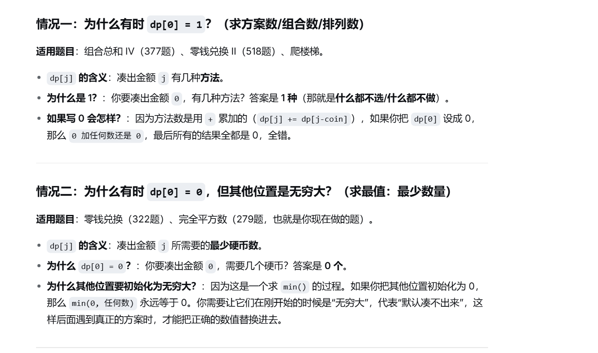


## 零钱兑换II

[518. 零钱兑换 II - 力扣（LeetCode）](https://leetcode.cn/problems/coin-change-ii/)


这道题求的是**组合数**（[1, 2] 和 [2, 1] 算同一种），所以外层必须是**物品**，内层是**容量**。


###  思路

#### 一维数组

**1.dp【j】： 容量为 j 的情况下 ，最多有多少种 组合**

2.这道题求的是**组合数**（[1, 2] 和 [2, 1] 算同一种），所以外层必须是**物品**，内层是**容量**。 如果反了之后 ，那就是排列了

3.和之前01背包不同的就是一维数组 里面的for循环 是正序的

4.  dp[0] = 1  初始化：凑成总金额 0 的组合数只有 1 种（即什么都不选） 最多初始第一个值 ，因为这是一维的


#### 二维数组

1.dp【i】【j】：**使用0到i的 个硬币**（即 `coins[0]` 到 `coins[i]`），凑出总金额 `j` 的组合数**

2.关于数组下标 以及初始化，因为要物品一共有len（coins）个，但是从0开始的，所以return dp【len（coins）-1】【amount】

### 伪代码

```python
									1. 一维数组

#dp【j】： 容量为 j 的情况下 ，最多有多少种 组合

class Solution:
    def change(self, amount: int, coins: List[int]) -> int:
        # dp[j] 表示：凑成总金额 j 的硬币组合数
        dp = [0] * (amount + 1)
        
        # 初始化：凑成总金额 0 的组合数只有 1 种（即什么都不选）
        dp[0] = 1
        
        # 外层循环：遍历物品（硬币）
        for i in range(0,len(coins)):
            # 内层循环：遍历背包容量
            # 注意：这里必须是从小到大（正序）遍历！
            # 容量 j 从coins【i】开始判断，因为容量得大于coins【i】 才能选择加还是不加 
            for j in range(coins[i], amount + 1):
                # 状态转移方程：求组合数用累加 (+=)
                dp[j] = dp[j] +dp[j - coins[i]] # 不取物品i   取物品i
                
        return dp[amount]
    
    
    
    								2.二维数组
class Solution:
    def change(self, amount: int, coins: list[int]) -> int:
        dp=[[0]*(amount+1) for _ in range(0,len(coins))]

        for j in range(0,(amount+1)): #这里从第一列开始初始化 只要j是coins【0】的倍数的话 ，就填1 
            if j %coins[0]==0:
                dp[0][j]=1


        for i in range(1,len(coins)):#第二行开始    物品
            for j in range(0,amount+1): #第一列开始 容量
                if coins[i]>j:#物品大于容量 直接不用考虑取还是不取，
                    dp[i][j]=dp[i-1][j]
                else :
                    dp[i][j]=dp[i-1][j]+dp[i][j-coins[i]] #第一个是不取 ，就直接继承正上方的方案个数  第二个取：就拿左方的方案个数
        return dp[len(coins)-1][amount]

    
```


## 组合综合IV


###  思路

1.**`dp[j]` 表示：从 `nums` 数组中挑选数字（每个数字可以使用无限次），使得它们的和恰好等于 `j` 的【排列方案总数】。**

2.此题相对于上一题来说就是换了for循环的顺序

3.一维数组进行双重for循环的时候，两个for都是正序 ，				外层物品，内层背包（组合）		外层背包，内层物品 （排列）

4.注意要加判断 ，j>=nums[i]: 不然数组会越界


### 伪代码

```python
									1.一维数组
class Solution:
    def combinationSum4(self, nums: list[int], target: int) -> int:
        ##if target>sum(nums): 这个是对于01背包的  因为对于完全背包是可以重复使用的
        ##    return 0 

        dp=[0]*(target+1)#一共target+1中背包容量
        dp[0]=1

        for j in range(1,target+1):
            for i in range(0,len(nums)):
                if j>=nums[i]:
                    dp[j]=dp[j]+dp[j-nums[i]]
        return dp[target]
        
        							2.二维数组 (不好写，不写了)
          
```


## 70爬楼梯

[70. 爬楼梯 - 力扣（LeetCode）](https://leetcode.cn/problems/climbing-stairs/description/)

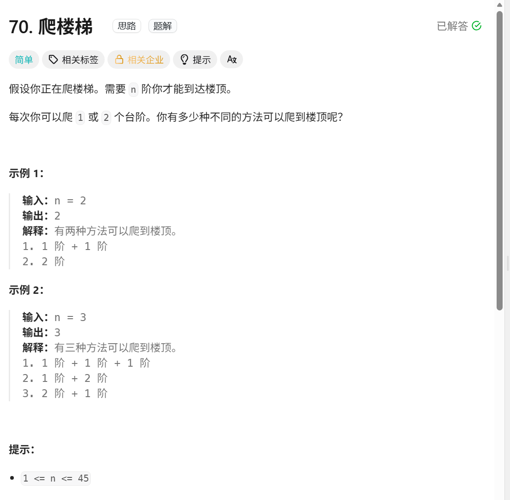


###  思路

1.dp【j】含义 ： 到达n节台阶最多含有dp【j】种方法

2. 可以重复选 ：完全背包 一维数组的for都是正序            
3. 考虑顺序 ： 排列 ：背包在外层for   物品在内层for

### 伪代码

```python
#dp【j】含义 ： 到达n节台阶最多含有dp【j】种方法
# 可以重复选 ：完全背包 ，排列 ：都是正序
class Solution:
    def climbStairs(self, n: int) -> int:
        dp=[0]*(n+1) #
        dp[0]=1


        for j in range(0,n+1):
            for i in range(1,3):
                if j-i>=0:
                    dp[j]=dp[j]+dp[j-i]
        return dp[n]

```

易错点： 初始化dp【0】=1  即什么都不选也是一种方案     ，dp【1】和dp【2】都别初始化，因为 dp[j]=dp[j]+dp[j-i] ，初始化了会影响后面结果（）列后面的结果


## 零钱兑换

[322. 零钱兑换 - 力扣（LeetCode）](https://leetcode.cn/problems/coin-change/)

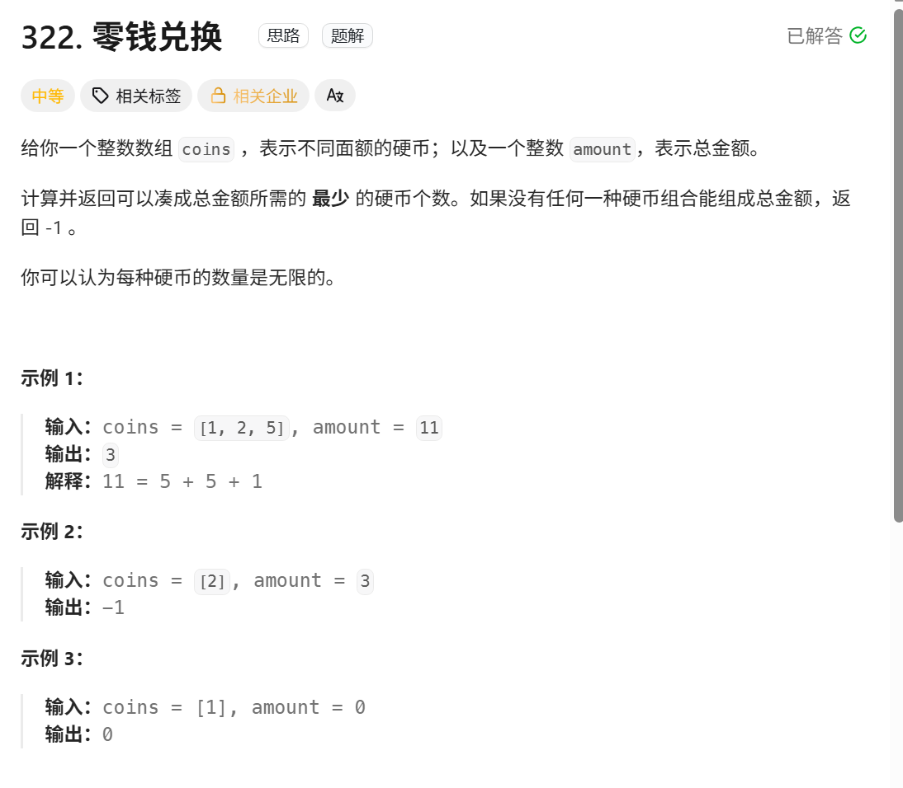


###  思路

1.dp【j】 含义 ： 凑成amount金额 最少的硬币个数

2.不限个数：完全背包   一维数组for都是正序

3.不管顺序：组合问题 ： 外层物品，内层背包

4.定义初始化数组的时候 ，因为是取min所以要定义为无穷大， 

5.方案最少硬币的时候 取要加1 因为dp含义是最少硬币个数， 之前也是最少硬币 ，加上这个1 

### 伪代码

```python
									1.组合 1.组合 1.组合 1.组合 1.组合
#dp【j】 含义 ： 凑成amount金额 最少的硬币个数
class Solution:
    def coinChange(self, coins: list[int], amount: int) -> int:
        dp=[float('inf')]*(amount+1)

        dp[0]=0

        for i in range(0,len(coins)):#组合外层物品
            for j in range(0,amount+1):#内层背包
                if j-coins[i]>=0:
                    dp[j]=min(dp[j],dp[j-coins[i]]+1)  # 不取 ，取 取的话要+1，因为这也是一个硬币 ，方案个数的话就不用加1
        # 5. 如果最终结果还是无穷大，说明没有组合能凑出，返回 -1
        if dp[amount] == float('inf'):
            return -1
        return dp[amount]
    
    
    							2.排列2.排列2.排列2.排列（仅仅就是把两个for循环代码换了个位置，仅此而已）
class Solution:
    def coinChange(self, coins: list[int], amount: int) -> int:
        dp=[float('inf')]*(amount+1)
        dp[0]=0

        for j in range(1,amount+1):
            for i in range(0,len(coins)):
                if j-coins[i]>=0:
                    dp[j]=min(dp[j],dp[j-coins[i]]+1)

        # 5. 如果最终结果还是无穷大，说明没有组合能凑出，返回 -1
        if dp[amount] == float('inf'):
            return -1
        return dp[amount]
```

易错点：

1.定义初始化数组的时候 ，因为是取min所以要定义为无穷大， 

2.方案最少硬币的时候 取要加1 因为dp含义是最少硬币个数， 之前也是最少硬币 ，加上这个1 

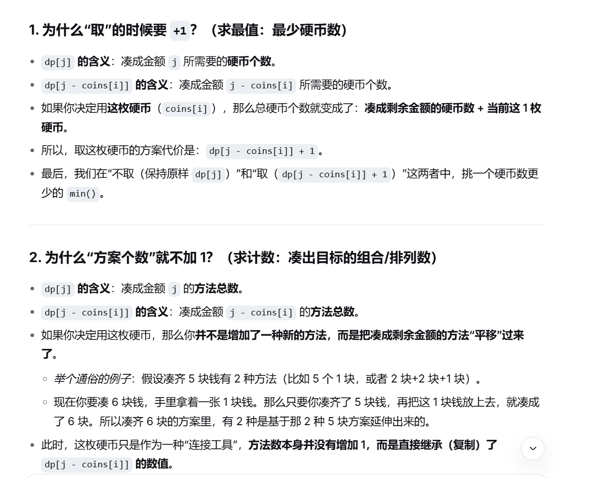


## 279 完全平方数

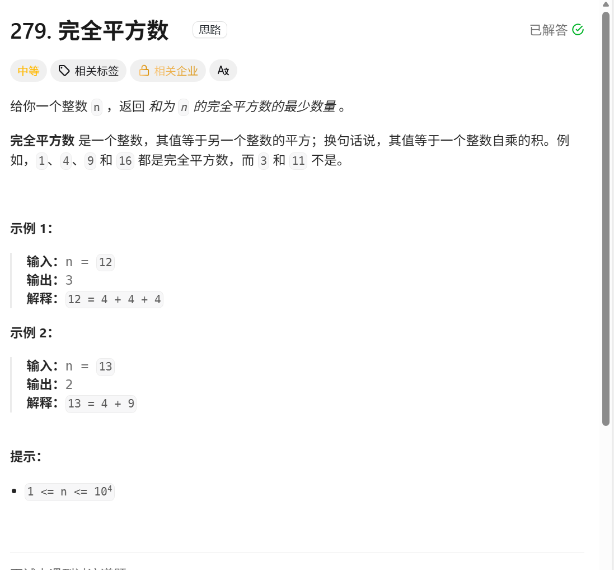


###  思路

**1.dp【j】 含义 ：和为n的完全平方最少数量**

**2.物品	i	 从1到 max_i   max_i = int(n ** ** **0.5)  也就是最大的根号值 就是物品**

**3.物品的价值是i	i*i**

### 伪代码

```python
#dp【j】 含义 ：和为n的完全平方最少数量
class Solution:
    def numSquares(self, n: int) -> int:
        dp=[float('inf')]*(n+1)

        dp[0]=0
        max_i = int(n ** 0.5)

        for  i in range(1,max_i+1):
            for j in range(1,n+1):
                if j>=i*i:
                    dp[j]=min(dp[j],dp[j-i*i]+1)  # 不取 ，取 然后 把这个最少数量+1
        return dp[n]

```


## 139单词拆分

[139. 单词拆分 - 力扣（LeetCode）](https://leetcode.cn/problems/word-break/)

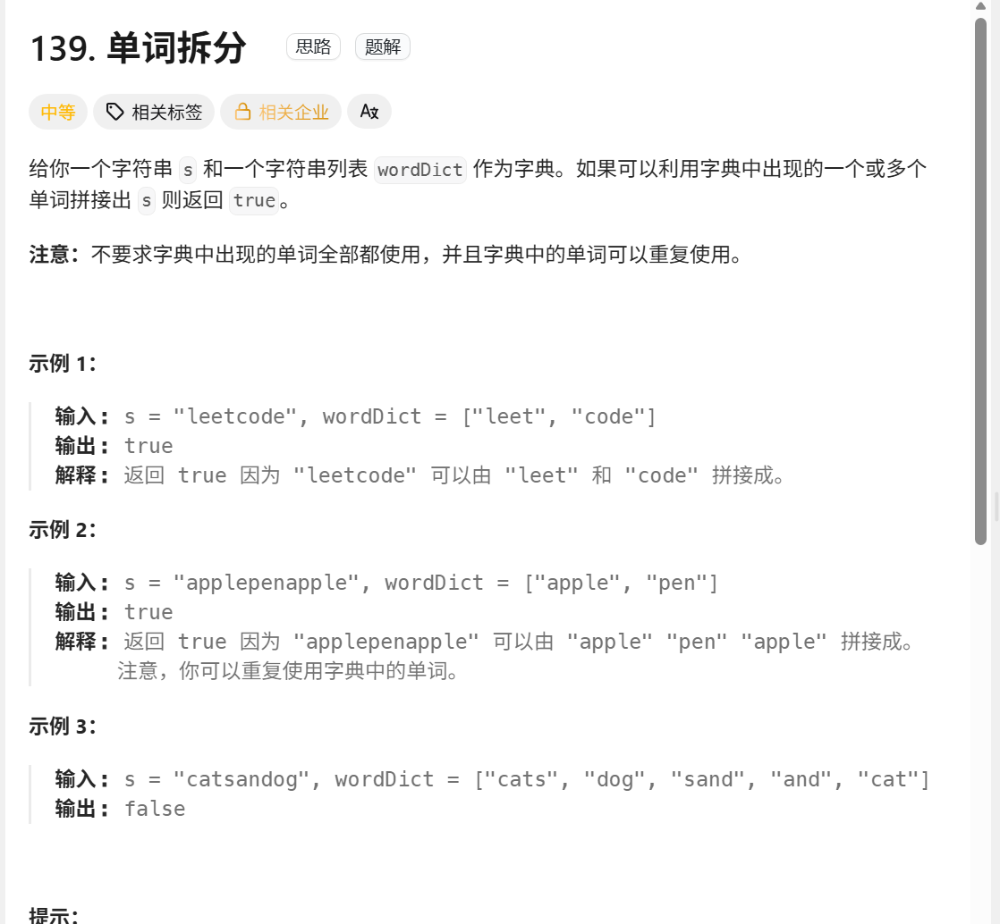


###  思路

1.**`dp[i]` 表示：字符串 `s` 的【前 `i` 个字符】（也就是 `s[0 : i]` 这个子串），能否被空格拆分成字典**

**s[i:j]  截取字符串 `s` 中，从索引 `i` 开始，一直截取到索引 `j` 之前（不包括 `j`）的这一段子串。**

2.**物品就是你在内层循环里，通过 `s[i:j]` 截取出来的那个“子串”。**

3.**背包就是字符串 `s` 的前缀长度**

4.但在 139 题里，**物品（单词）不是现成的数组，而是藏在字符串 `s` 里的。**

5.如果s[i:j]在 wordset里面 并且 dp【i】==True

### 伪代码

```python
											1.完全背包-排列
class Solution:
    def wordBreak(self, s: str, wordDict: List[str]) -> bool:
        wordset=set(wordDict)
        dp=[False]*(len(s)+1)
        dp[0]=True

        for j in range(1,len(s)+1):
            for i in range(0,j):
                if s[i:j] in  wordDict and dp[i]==True :
                    dp[j]=True
                    break
        return dp[len(s)]


										2.回溯算法 -----------但是会超时
class Solution:
    def wordBreak(self, s: str, wordDict: list[str]) -> bool:
        # 将列表转为集合，提高查找效率 O(1)
        wordSet = set(wordDict)
        # 在主函数中调用辅助函数
        return self._backtracking(s, wordSet, 0)
        
    def _backtracking(self, s: str, wordSet: set, startIndex: int) -> bool:
        # 递归终止条件
        if startIndex >= len(s):
            return True
            
        # 遍历所有可能的分割点
        for i in range(startIndex, len(s)):
            word = s[startIndex : i + 1]
            # 如果当前单词在字典中，且剩下的字符串也能拆分成功
            if word in wordSet and self._backtracking(s, wordSet, i + 1):
                return True
                
        return False
```


# 打劫问题

## 198打家劫舍

[198. 打家劫舍 - 力扣（LeetCode）](https://leetcode.cn/problems/house-robber/description/)

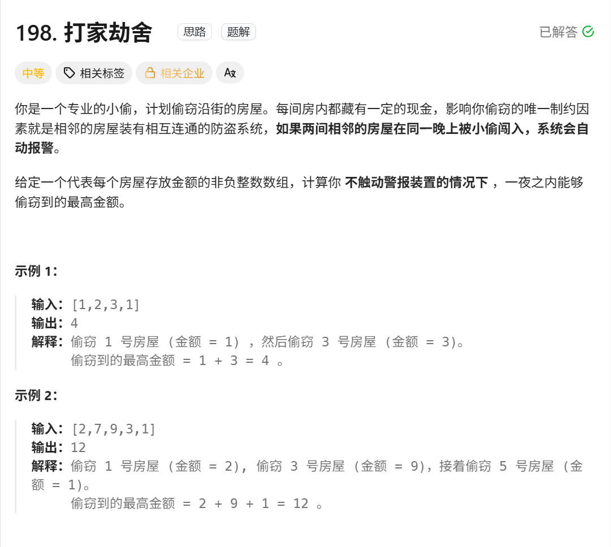


取最大能偷的金额一般都是   max


###  思路

1.取最大能偷的金额一般都是   max（不取，取）

2.dp[i]：考虑下标i（包括i）以内的所有房屋，最多可以偷窃的⾦额为dp[i]。

3.（注意这⾥是考虑，并不是⼀定要偷i-1房，这是很多同学容易混淆的点）  

### 伪代码

```python
#dp[i]：考虑下标i（包括i）以内的所有房屋，最多可以偷窃的⾦额为dp[i]。
class Solution:
    def rob(self, nums: List[int]) -> int:
        if len(nums)==0: return 0
        if len(nums)==1: return nums[0]    

        dp=[0]*(len(nums)+1)
        dp[0]=nums[0]
        dp[1]=max(nums[0],nums[1])
        for j in range(2,len(nums)):
            dp[j]=max(dp[j-1],dp[j-2]+nums[j]) #不偷， 偷

        return dp[len(nums)-1]           

        
```


## 213打家劫舍II

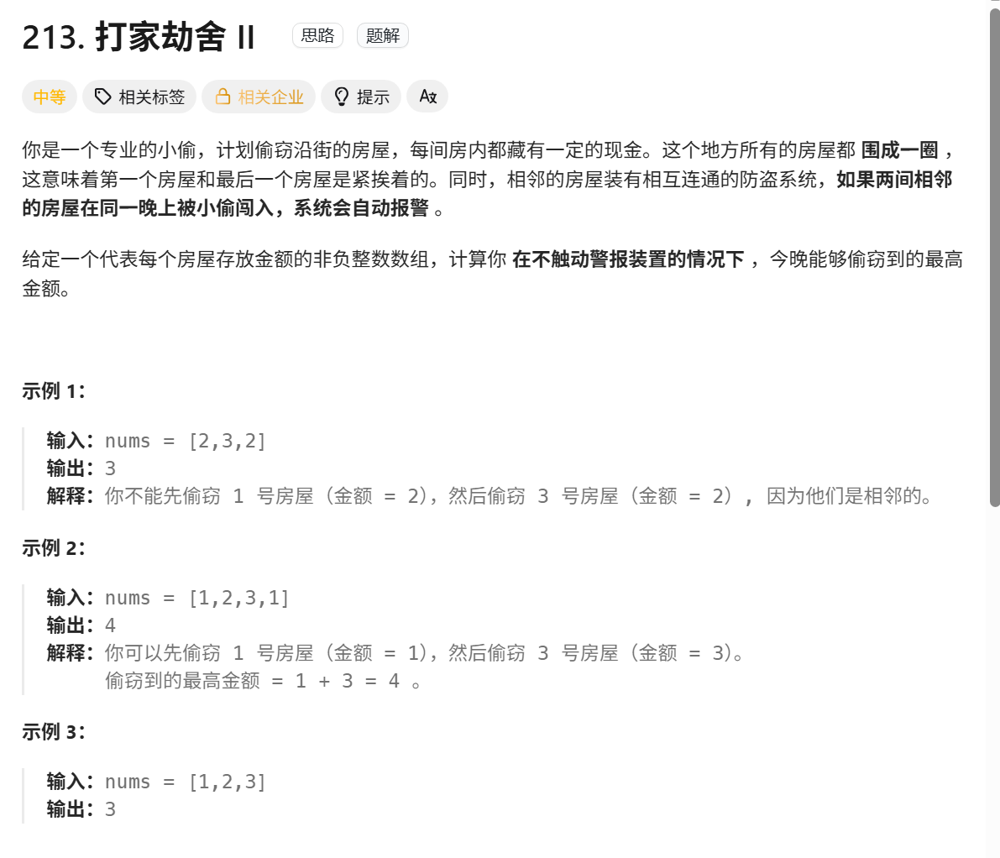


###  思路

1.**`dp[i]` 表示：从下标 `start` 开始，一直偷到下标 `i`（包含 `i`），所能偷窃到的最高金额**

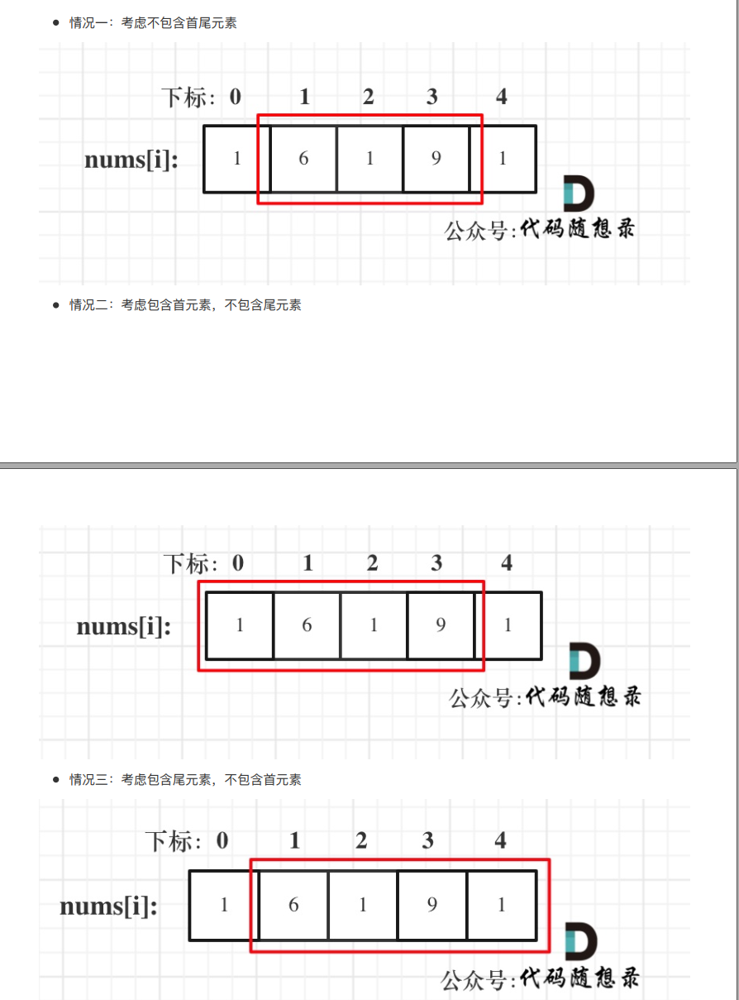

情况三和二包括了情况一    考虑首尾元素，但不一定要选他啊，所以是包含的情况一 


2.极端值判定， start==end ，也就是长度为2的时候

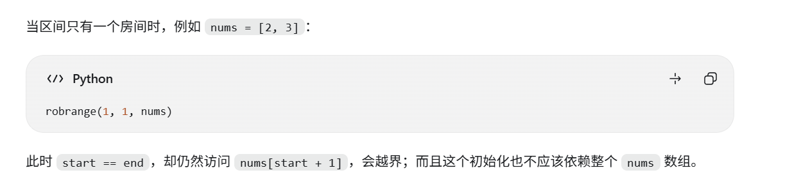

### 伪代码

```python
# dp[i] 表示：从下标 start 开始，一直偷到下标 i（包含 i），所能偷窃到的最高金额
class Solution:
    def robrange(self,start,end,nums):#数组下标
        if start==end:
            return nums[start]
        dp = [0] * len(nums)
        #dp=[0]*(end-start+1)  直接用数组长度得了懒得计算这么多了
        dp[start]=nums[start]
        dp[start+1]=max(nums[start],nums[start+1])
        for i in range(start+2,end+1):
            dp[i]=max(dp[i-1],dp[i-2]+nums[i])
        return dp[end]

    
    def rob(self, nums: list[int]) -> int:
        if len(nums)==0: return 0
        if len(nums)==1: return nums[0]    
        result1=self.robrange(0,len(nums)-2,nums) #包括首 
        result2=self.robrange(1,len(nums)-1,nums) #包括尾
        return max(result1,result2)
```


## 打家劫舍III

[337. 打家劫舍 III - 力扣（LeetCode）](https://leetcode.cn/problems/house-robber-iii/)

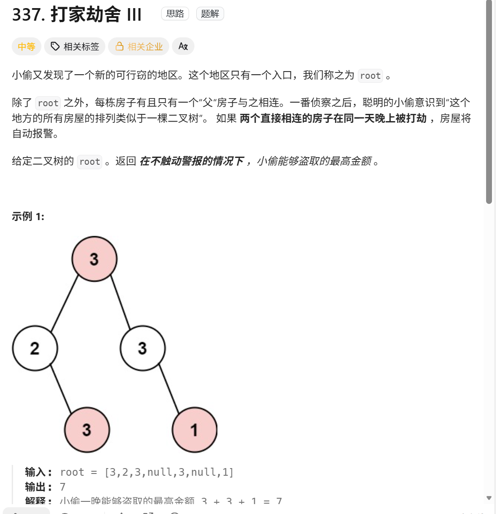

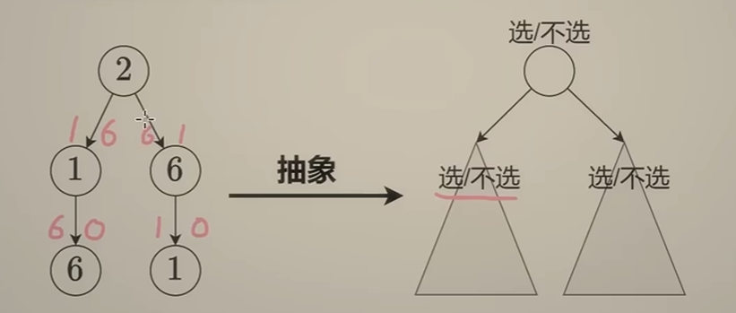

###  思路


1.用二叉树的后序遍历，返回一个元组，（偷该节点，不偷该节点）的最大价值

2.不偷该节点  ： 那就可以取左子树偷与不偷的最大值 +	右子树偷与不偷的最大值

2.偷该节点： 左不偷（不代表他就是0，只是代表左边子树不偷这个节点，）+右不偷 ，+ 该节点的值


### 伪代码

```python
											后序遍历 ： 左右中 
class Solution:
    def dfs(self,node):
        if node is None:
            return 0,0 
        l_rob,l_not_rob=self.dfs(node.left)  #左子树
        r_rob,r_not_rob=self.dfs(node.right) #右子树

        cur_rob=l_not_rob+r_not_rob+node.val 					#当前节点偷 ：左子树不偷 右子树不偷  当前节点偷
        cur_not_rob=max(l_rob,l_not_rob)+max(r_rob,r_not_rob)    #当前节点不偷  ： 那就左子树选择最大的   右子树也选择最大的

        return cur_rob,cur_not_rob

    def rob(self, root: TreeNode | None) -> int:
        result1, result2=self.dfs(root)
        result=max(result1,result2)
        return result
        
```


# 股票问题

## 买卖股票最佳时机（买卖一次）

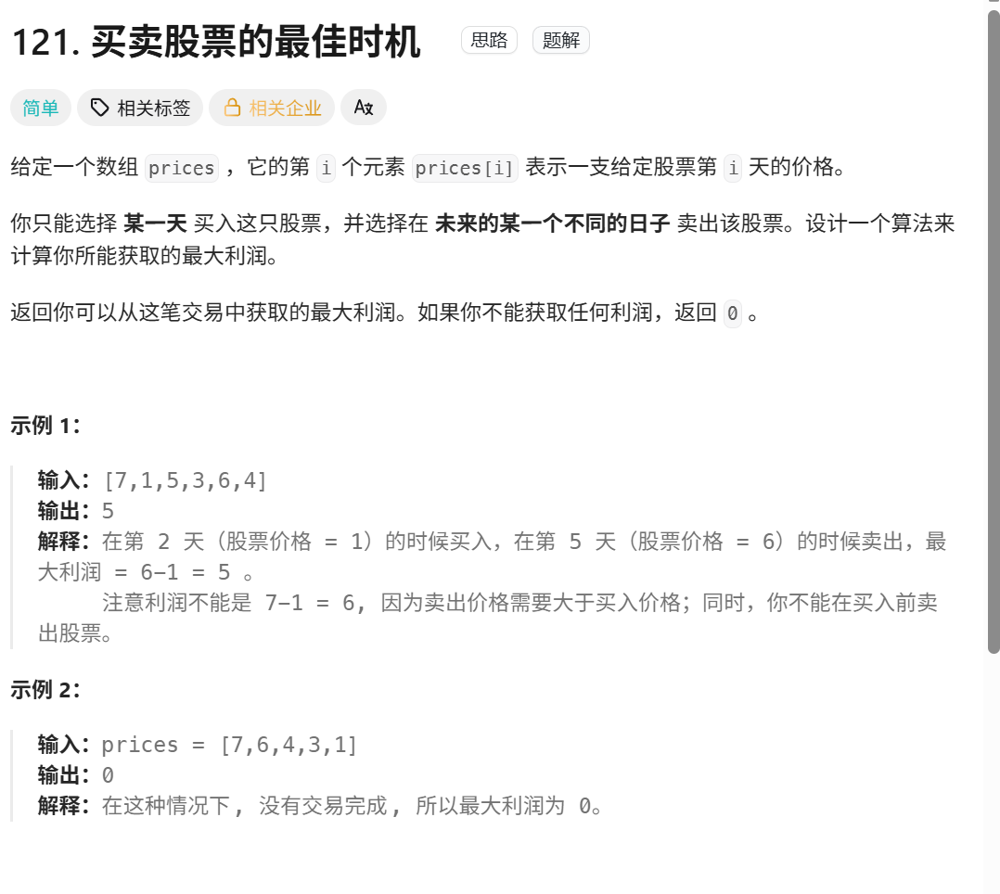

###  思路


1.dp数组：（其实这题用这个方法没必要呀）

**dp i 0   表示第 i 天持有股票的最大现金，dpi  1  表示第 i 天不持有股票的最大现金**

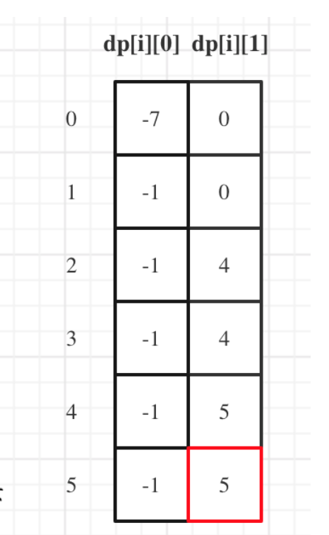

1.2 会发现后面的dp只与前面一个状态的dp有关，所以只用两个变量即可


**2.贪心**

​	**会问后面更新的low最小值就是参与result最大值的计算吗？不一定呀，因为还会进行result取max**

3. 暴力无话可说 ，一个for把他当成最小值，一个for把他当成最大值

### 伪代码

```python
													1.dp数组 时间复杂度O（N）  空间复杂度O（N） 
#dp【i】【0】  表示第 i 天持有股票的最大现金，  dp【i】【1】 表示第 i 天不持有股票的最大现金      注意是最大现金！！！！！！最大！！！！！！
class Solution:
    def maxProfit(self, prices: list[int]) -> int:
        if not prices:  # 防止空数组报错
            return 0
        dp=[[0]*2 for _ in range(0,len(prices))]

        dp[0][0]=-prices[0]  
        dp[0][1]=0

        for i in range(1,len(prices)):
            dp[i][0]=max(dp[i-1][0],-prices[i])  # 之前就持有    今天刚持有
            dp[i][1]=max(dp[i-1][1],dp[i-1][0]+prices[i]) # 之前就卖出  今天才卖出   dp【i】【1】 继承dp【i】【0】 状态
        return dp[len(prices)-1][1] 


    												1.2 两个dp 时间复杂度O（N）  空间复杂度O（1） 
  # dp0 代表持有股票的钱，dp1 代表不持有股票的钱
class Solution:
    def maxProfit(self, prices: list[int]) -> int:
        if not prices:
            return 0
        
        # dp0 代表持有股票的钱，dp1 代表不持有股票的最大钱
        dp0 = -prices[0]
        dp1 = 0
        
        for i in range(1, len(prices)):
            # 注意：这里必须用临时变量或者调整顺序，保证计算 dp1 时用的 dp0 还是昨天的
            dp1 = max(dp1, dp0 + prices[i])  #不持有股票     持有然后卖出
            dp0 = max(dp0, -prices[i])			# 持有股票 ， 如果持有的是当前股票 
            
        return dp1


												2.贪心
class Solution:
    def maxProfit(self, prices: list[int]) -> int:
        if not prices: 
            return 0
        result=0 #记录遍历到这个节点的时候的结果最大值
        low=prices[0] #记录遍历到的最小值			

        for i in range(1,len(prices)):
            low=min(low,prices[i]) #找到目前遍历到的最小值
            result=max(result,prices[i]-low)

        return result


												3.暴力搜索（但是会超时）
class Solution:
    def maxProfit(self, prices: list[int]) -> int:
        result=0

        for i in range(0,len(prices)):
            for j in range(i+1,len(prices)):
                result=max(result,prices[j]-prices[i])
        return result
```


## 买卖股票最佳时机II（无限买卖）

###  思路

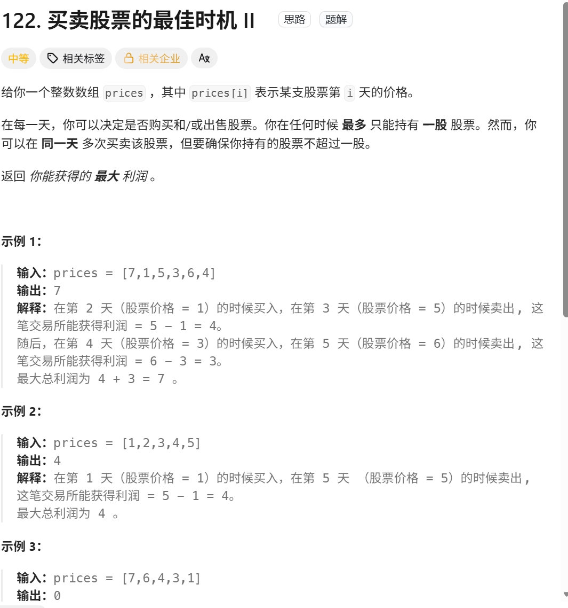

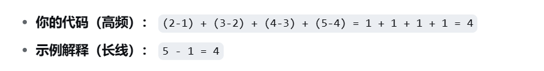

### 伪代码

```python
													1.DP数组法
#dp【i】【0】  表示第 i 天持有股票的最大现金，  dp【i】【1】 表示第 i 天不持有股票的最大现金      注意是最大现金！！！！！！最大！！！！！！
class Solution:
    def maxProfit(self, prices: list[int]) -> int:
        if not prices:  # 防止空数组报错
            return 0
        dp=[[0]*2 for _ in range(0,len(prices))]

        dp[0][0]=-prices[0]
        dp[0][1]=0

        for i in range(1,len(prices)):
            dp[i][0]=max(dp[i-1][0],dp[i-1][1]-prices[i]) #和之前唯一不同的就是 ：本题可以重复卖出 ，所以dp【i-1】【1】是最大利润
            dp[i][1]=max(dp[i-1][1],dp[i-1][0]+prices[i]) 
        return dp[len(prices)-1][1]
    
    												2.滚动数组法

  # dp0 代表持有股票的最大钱，dp1 代表不持有股票的最大钱
class Solution:
    def maxProfit(self, prices: list[int]) -> int:
        if not prices:
            return 0
        
        # dp0 代表持有股票的钱，dp1 代表不持有股票的最大钱
        dp0 = -prices[0]
        dp1 = 0
        
        for i in range(1, len(prices)):
            dp0 = max(dp0, dp1-prices[i])			# 之前持有股票 和  今天买入  取最大值 
            dp1 = max(dp1, dp0 + prices[i])  		#不持有股票     持有但是然后卖出 取最大值
            
        return dp1
    
    
    
    												3.贪心
class Solution:
    def maxProfit(self, prices: List[int]) -> int:
        profit = 0
        for i in range(1, len(prices)):
            tmp = prices[i] - prices[i - 1]
            if tmp > 0: profit += tmp
        return profit

```


## 买卖股票最佳时机III（买卖俩次）

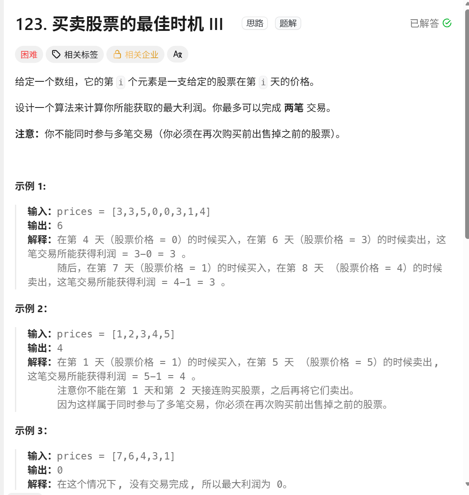

###  思路

1.别害怕其实就是专门写了 五个状态来表示


### 伪代码

```python


class Solution:
    def maxProfit(self, prices: List[int]) -> int:
        if not prices:
            return 0
            
        n = len(prices)
        # dp[i][j] 表示第 i 天，状态为 j 时的最大现金
        # j 的取值及含义：
        # 0: 没有操作
        # 1: 第一次持有股票
        # 2: 第一次不持有股票（完成了一次买卖）
        # 3: 第二次持有股票
        # 4: 第二次不持有股票（完成了两次买卖）
        dp = [[0] * 5 for _ in range(n)]
        
        # 初始化第 0 天的情况
        dp[0][1] = -prices[0] # 第一天买入，现金为负
        dp[0][3] = -prices[0] # 第一天买入并卖出再买入（虽然不赚，但允许此操作），现金为负
        
        for i in range(1, n):
            # 状态 0：一直没操作，现金为 0
            dp[i][0] = dp[i - 1][0]                                         							#继承之前的状态去执行
            
            # 状态 1：第一次持股。可能是昨天就持股，或者今天刚买入										  #继承之前的状态去执行
            dp[i][1] = max(dp[i - 1][1], dp[i - 1][0] - prices[i])
            
            # 状态 2：第一次不持股。可能是昨天就不持股，或者今天刚卖出										  #继承之前的状态去执行
            dp[i][2] = max(dp[i - 1][2], dp[i - 1][1] + prices[i])
            
            # 状态 3：第二次持股。可能是昨天就第二次持股，或者今天刚进行第二次买入							  #继承之前的状态去执行
            dp[i][3] = max(dp[i - 1][3], dp[i - 1][2] - prices[i])
            
            # 状态 4：第二次不持股。可能是昨天就第二次不持股，或者今天刚完成第二次卖出
            dp[i][4] = max(dp[i - 1][4], dp[i - 1][3] + prices[i])
            
        return dp[n - 1][4]
```


## 买卖股票最佳时机IV（买卖k次）

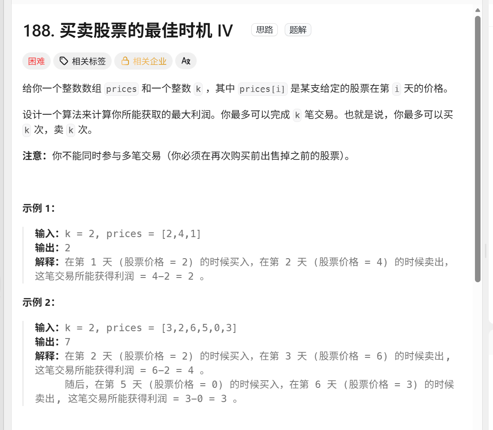

###  思路

其实和上一题买卖股票最佳时机III（买卖俩次） 是类似的，就相当于把上面的总结了一下  

就直接创建 dp = [[0] * (2 * k + 1) for _ in range(n)]数组  

### 伪代码

```python
from typing import List

class Solution:
    def maxProfit(self, k: int, prices: List[int]) -> int:
        if not prices:
            return 0
            
        n = len(prices)
        # 创建 (n x (2*k+1)) 的二维数组
        dp = [[0] * (2 * k + 1) for _ in range(n)]
        
        # 初始化第 0 天的持股状态（奇数状态）
        for j in range(1, 2 * k, 2):
            dp[0][j] = -prices[0]
            
        for i in range(1, n): #i是天数， j是后面的操作数
            dp[i][0] = dp[i - 1][0]
            
            for j in range(0, 2 * k - 1, 2):  #实在不理解可以带入k=2  也就是上一题的结果
                # 买入状态（奇数）
                dp[i][j + 1] = max(dp[i - 1][j + 1], dp[i - 1][j] - prices[i])
                # 卖出状态（偶数）
                dp[i][j + 2] = max(dp[i - 1][j + 2], dp[i - 1][j + 1] + prices[i])
                
        return dp[n - 1][2 * k]
```


## 最佳买卖股票时机含冷冻期

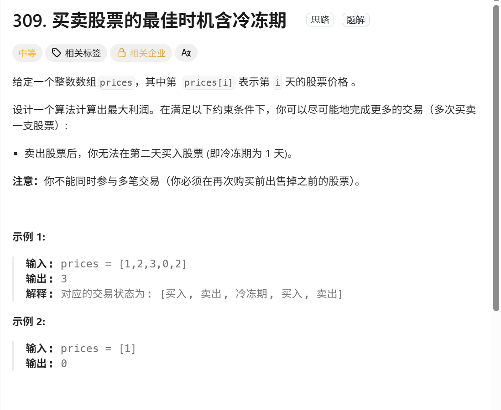

###  思路


这里的 `dp[i][x]` 代表的绝对是**“当前能获得的最大金额（最大利润）**  这里的 `dp[i][x]` 代表的绝对是**“当前能获得的最大金额（最大利润）**

1.持有股票的状态 ： 							1.之前就这个状态          2. 前一天是冷冻期，今天买        3.没有股票，也不处于冷冻期 ，今天买

2.不持有股票 且不持有冷冻期  ： 		 1.之前就这个状态       2.前一天是冷冻期

3.今天卖出股票                    ：        1. 前一天持有股票直接卖出

4.冷冻期                            ：         1.前一天刚卖出

### 伪代码

```python
							#这里的 dp[i][x] 代表的绝对是“当前能获得的最大金额（最大利润）

class Solution:
    def maxProfit(self, prices: List[int]) -> int:
        n = len(prices)
        if n == 0:
            return 0
        
        # 创建 n 行 4 列的二维数组，初始值全为 0
        dp = [[0] * 4 for _ in range(n)]
        
        # 初始化第 0 天
        dp[0][0] = -prices[0] # 持有股票
        
        for i in range(1, n):
            # 1. 持有股票的状态
            # 昨天就持有 / 昨天是状态3今天买入 / 昨天是状态1今天买入
            dp[i][0] = max(dp[i - 1][0], max(dp[i - 1][3] - prices[i], dp[i - 1][1] - prices[i]))
            
            # 2. 不持有股票，且不处于冷冻期（保持卖出状态）
            dp[i][1] = max(dp[i - 1][1], dp[i - 1][3])
            
            # 3. 今天卖出股票（明天将进入冷冻期）
            dp[i][2] = dp[i - 1][0] + prices[i]
            
            # 4. 处于冷冻期（昨天刚卖出）
            dp[i][3] = dp[i - 1][2]
            
        # 最后一天的最大利润 = 取最后一天状态 1、2、3 中的最大值
        return max(dp[n - 1][3], max(dp[n - 1][1], dp[n - 1][2]))
```


## 买卖股票最佳时机含手续费

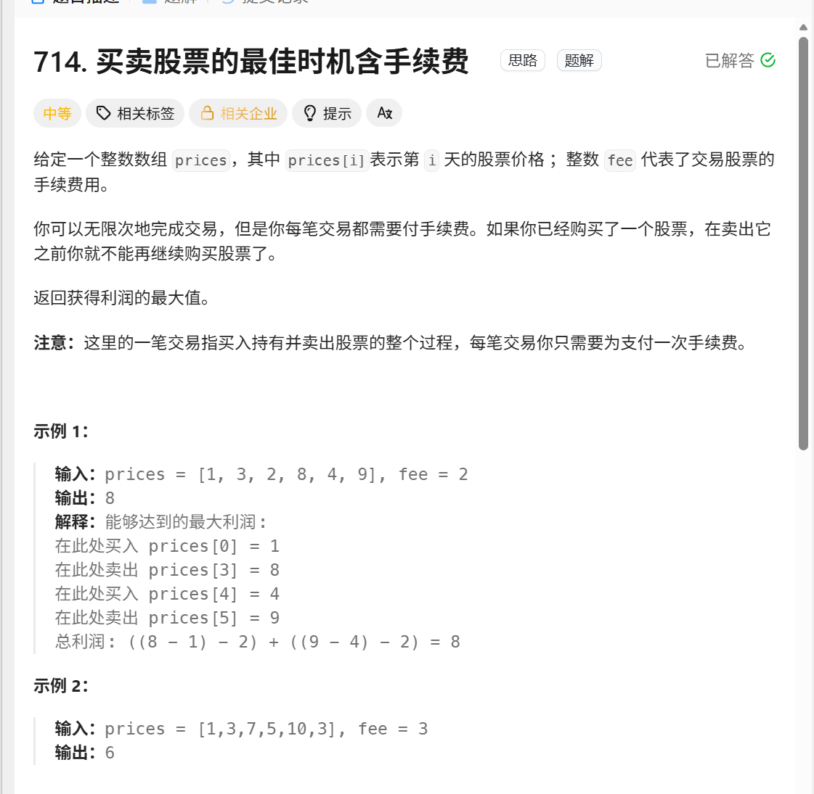

###  思路

就直接买卖股票最佳时机II（无限买卖）			-fee 即可

### 伪代码

```python
class Solution:
    def maxProfit(self, prices: List[int], fee: int) -> int:
        if not prices:  # 防止空数组报错
            return 0
        dp=[[0]*2 for _ in range(0,len(prices))]

        dp[0][0]=-prices[0]
        dp[0][1]=0

        for i in range(1,len(prices)):
            dp[i][0]=max(dp[i-1][0],dp[i-1][1]-prices[i]) #和之前唯一不同的就是 ：本题可以重复卖出 ，所以dp【i-1】【1】是最大利润
            dp[i][1]=max(dp[i-1][1],dp[i-1][0]+prices[i]-fee) 
        return dp[len(prices)-1][1]
```


# 字符串问题

## 一个数组

## 最长递增子序列

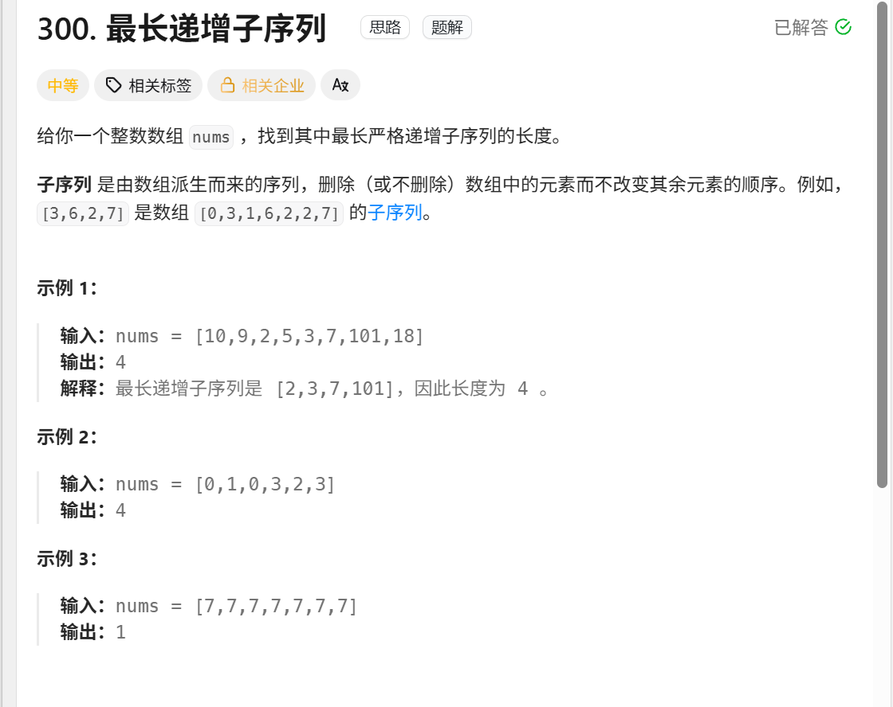

###  思路

1.#dp【i】含义：当前，包括 i的最大递增子序列

2.外层for遍历数组   内层for 遍历 i之前的所有值 看看i比numj大  ，最后取max的dp 【i】  

3.每一层 dp【i】都是最大的 ， 所以拿一个变量与之比较result

### 伪代码

```python
#dp【i】含义：当前，包括 i的最大递增子序列
class Solution:
    def lengthOfLIS(self, nums: list[int]) -> int:
        # 1. 边界情况处理：空数组直接返回 0
        if not nums:
            return 0
            
        dp=[1]*len(nums)
        dp[0]=1
        max_result=1#记录最大值


        for i in range(0,len(nums)):#外层循环遍历数组
            for j in range(0,i):    #内层循环遍历 i之前的所有dp找最大值
                if nums[i]>nums[j]:
                    dp[i]=max(dp[i],dp[j]+1)

            max_result=max(dp[i],max_result)
        return max_result

```


## 最长连续递增子序列

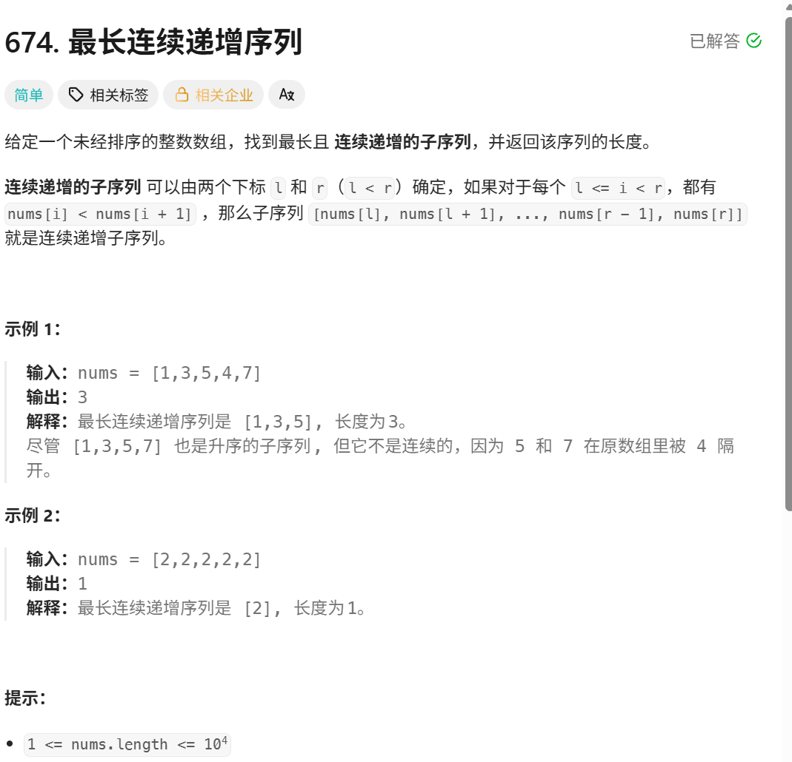

###  思路

1.dp[i] :当前最大的连续递增子序列

2.递增公式: dp【i】 =max（result，dp【i】）他原来的是dp【i】=1 嘛，如果 dp 【i-1 】已经开始递增了，那不就开始叠加了吗

3.每次都result进行一个比较取最大值

### 伪代码

```python
														1.动态规划

#dp[i] :当前最大的连续递增子序列
class Solution:
    def findLengthOfLCIS(self, nums: list[int]) -> int:
        dp=[1]*len(nums)
        result=1

        for i in range(1,len(nums)):
            if nums[i]>nums[i-1]:
                dp[i]=max(dp[i],dp[i-1]+1)
            result=max(result,dp[i])

        return  result


													2.贪心（但是也是最简单的代码的）
class Solution:
    def findLengthOfLCIS(self, nums: list[int]) -> int:
        tem_result=1
        result=1

        for i in range(1,len(nums)):
            if nums[i]>nums[i-1]: #一直大就一直加
                tem_result+=1
            else:
                tem_result=1 #一小于重置
            result=max(result,tem_result)

        return result
                    

        
```


## 两个数组、

```python
        for i in range(1,len(text1)+1):
            for j in range(1,len(text2)+1):
                if text1[i-1]==text2[j-1]:				 #如果相同  
                    dp[i][j]=dp[i-1][j-1]+1   
                else :
                    dp[i][j]=max(dp[i-1][j],dp[i][j-1]) #如果不同
```


## 最长重复子数组

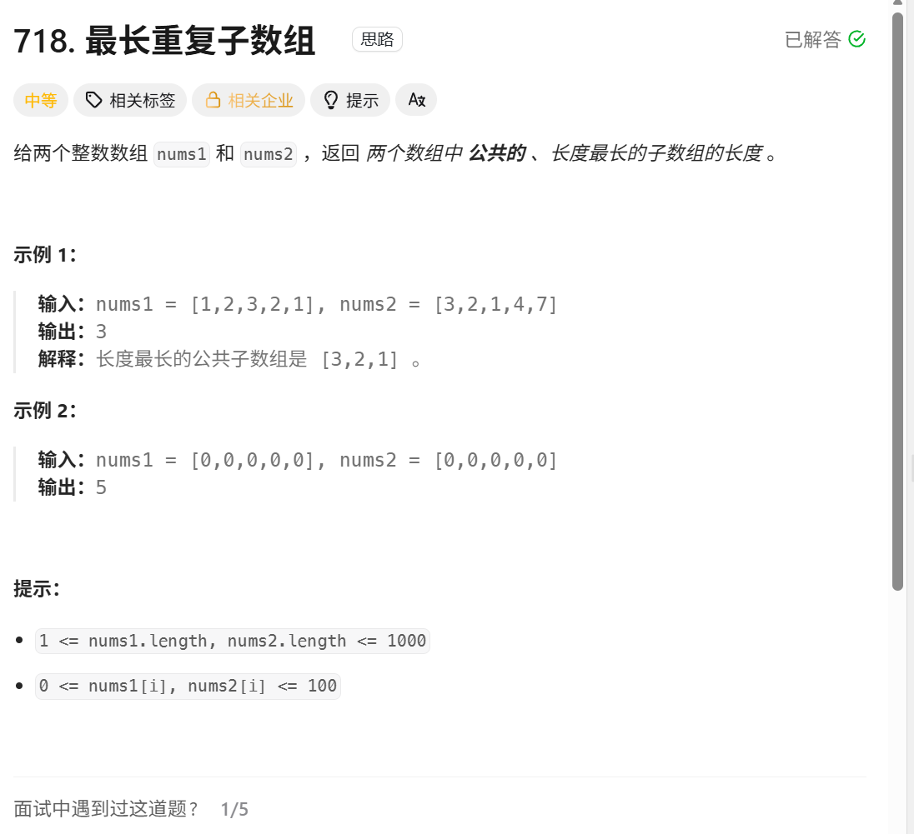

###  思路

1.dp[i][j] 表示：以 nums1 中第 i 个元素和 nums2 中第 j 个元素作为结尾（即这两个元素必须相等），所能构成的最长公共子数组的长度。

2. 递推公式   dp【i】【j】= dp【i-1】【j-1】+1

   3. 子数组要连续？ 所以只能+1  dp[i][j] = dp[i - 1][j - 1] + 1   从上一个状态推来
   
      

### 伪代码

```python
								1.常规递推  时间复杂度： O(n × m)， n 为A⻓度， m为B⻓度  空间复杂度： O(n × m)
#dp[i][j] 表示：以 nums1 中第 i 个元素和 nums2 中第 j 个元素作为结尾（即这两个元素必须相等），所能构成的最长公共子数组的长度。
class Solution:
    def findLength(self, nums1: list[int], nums2: list[int]) -> int:

        dp=[[0]*len(nums2) for _ in range(0,len(nums1))]  #第一个循环一定要是列 ，  数组定义先行后列 循环定义先列后行
        result=0
        for i in range(0,len(nums1)):
            for j in range(0,len(nums2)):
                
                if nums1[i]==nums2[j]:
                    if i==0 or j==0:		#一定要注意后面的代码会不会超过起始边界
                        dp[i][j]=1
                    else:
                        dp[i][j]=dp[i-1][j-1]+1

                result=max(result,dp[i][j])
        return result
    
    
    
    								2.  dp数组长度为n+1  和m+1的代码 （因为有索引i-1，j-1，所以这样方便）

class Solution:
    def findLength(self, nums1: List[int], nums2: List[int]) -> int:
        m, n = len(nums1), len(nums2)
        
        # 创建 (m+1) x (n+1) 的二维数组，全部初始化为 0
        # 注意：Python 中一定要用列表推导式，不能用 [[0]*(n+1)]*(m+1)
        dp = [[0] * (n + 1) for _ in range(m + 1)]
        
        result = 0
        
        # 从 1 开始遍历，直到 len()，所以结束条件要 +1
        for i in range(1, m + 1):
            for j in range(1, n + 1):
                # 注意：因为多了一行一列，所以取原数组元素时要 i-1 和 j-1
                if nums1[i - 1] == nums2[j - 1]:
                    dp[i][j] = dp[i - 1][j - 1] + 1 
                
                # 只有在匹配成功时，dp[i][j] 才会大于 0，更新最大值
                result=max(result,dp[i][j])
                    
        return result
    	
```


## 最长公共子序列

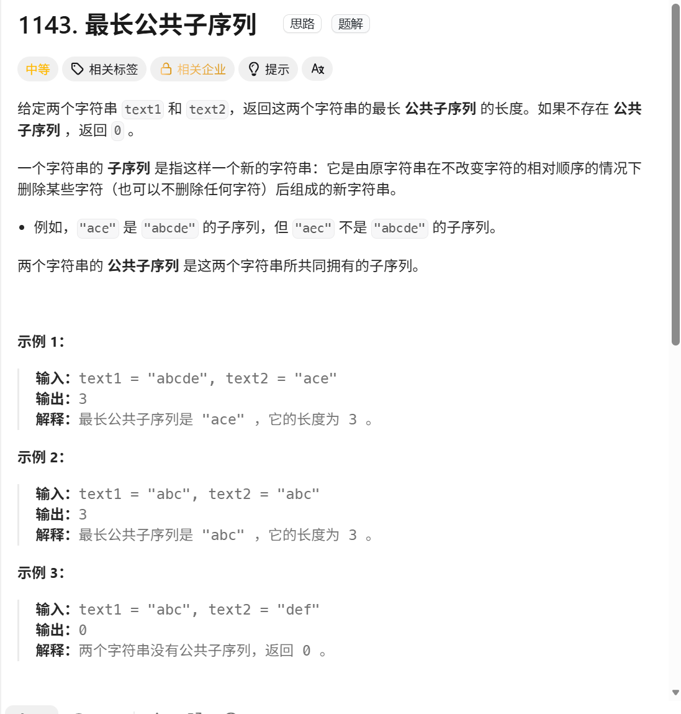

###  思路

**1.dp[i][j] :text1 的前 i 个字符和 text2 的前 j 个字符中，最长公共子序列的长度**

2.递推公式： 如下图，dpi j 可以由以下表示 ， 从三个维度冲来

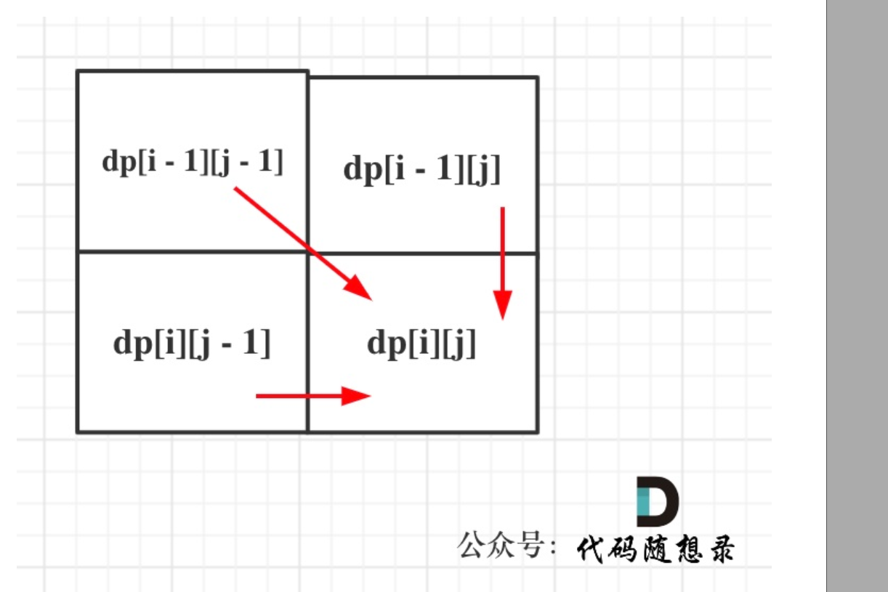

### 伪代码

```python
									dp数组长度为n+1  和m+1的代码 （因为有索引i-1，j-1，所以这样方便）
#dp[i][j] :text1 的前 i 个字符和 text2 的前 j 个字符中，最长公共子序列的长度
class Solution:
    def longestCommonSubsequence(self, text1: str, text2: str) -> int:

        dp=[[0]* (len(text2)+1) for _ in range(0,len(text1)+1)] #+1 也可以说是方便返回

        for i in range(1,len(text1)+1):
            for j in range(1,len(text2)+1):
                if text1[i-1]==text2[j-1]:
                    dp[i][j]=dp[i-1][j-1]+1
                else :
                    dp[i][j]=max(dp[i-1][j],dp[i][j-1])

        return dp[len(text1)][len(text2)]
```


## 不相交的线

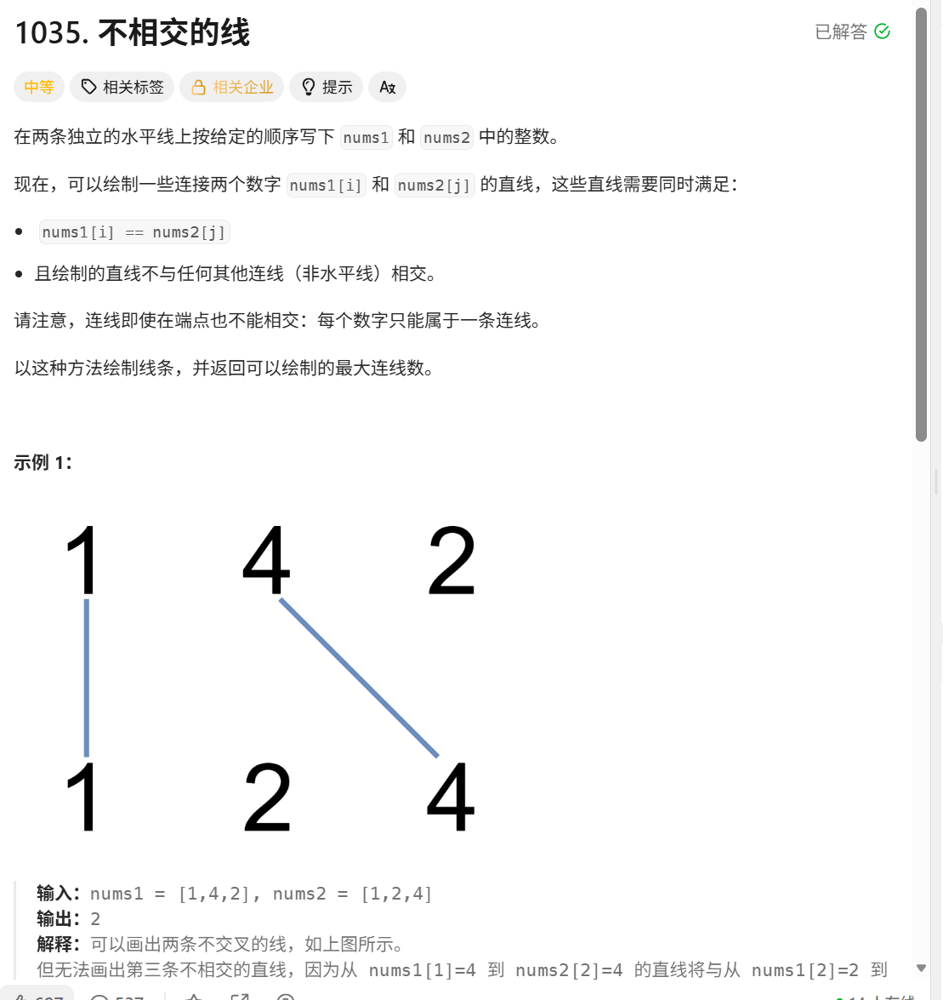

###  思路

这一题思路和上一题一模一样，代码也一模一样

一开始我还在想，如果一开始第一个数组是斜的，但是如果一开始不是最长的结果的斜的，他最后会被取max给对冲掉 dp[i][j]=max(dp[i-1][j],dp[i][j-1])  也就是第12行对冲

### 伪代码

```python
									dp数组长度为n+1  和m+1的代码 （因为有索引i-1，j-1，所以这样方便）
#dp[i][j] :text1 的前 i 个字符和 text2 的前 j 个字符中，最长公共子序列的长度
class Solution:
    def maxUncrossedLines(self, nums1: list[int], nums2: list[int]) -> int:
        dp=[[0]*(len(nums2)+1) for _ in range(0,len(nums1)+1)]

        for i in range(1,len(nums1)+1):
            for j in range(1,len(nums2)+1):
                if nums1[i-1]==nums2[j-1]:
                    dp[i][j]=dp[i-1][j-1]+1
                else:
                    dp[i][j]=max(dp[i-1][j],dp[i][j-1])
        return dp[len(nums1)][len(nums2)]
```


## 最大子序和（一维）

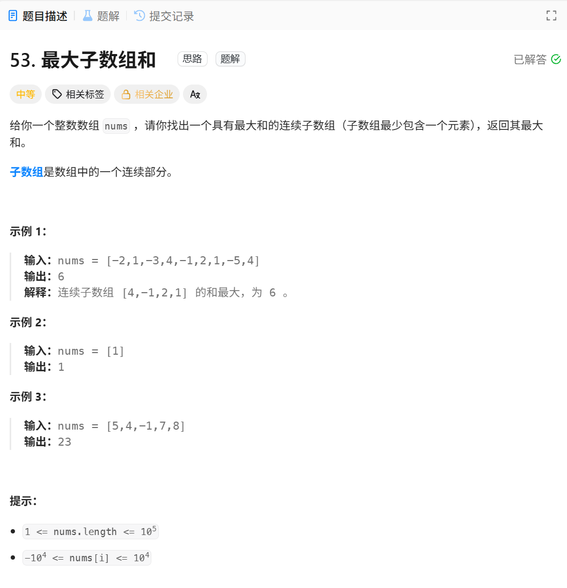

子数组是数组中的一个连续部分

子数组是数组中的一个连续部分

子数组是数组中的一个连续部分

###  思路


**1.dp【i】表示以 nums[i] 作为结尾的连续子数组，所能获得的最大和。**

**2.递推公式：  dp[i]=max(dp[i-1]+nums[i],nums[i])		要么继承之前的，要么自己作为做大和的起点 **         因为子数组一定有一个作为结尾的，他遍历了所有以这个结尾的 

### 伪代码

```python
#dp【i】表示以 nums[i] 作为结尾的连续子数组，所能获得的最大和。


class Solution:
    def maxSubArray(self, nums: list[int]) -> int:
        if not nums:
            return 0
        dp=[0]*len(nums) 
        dp[0] = nums[0]
        result=dp[0]
        
        for i in range(1,len(nums)):
            dp[i]=max(dp[i-1]+nums[i],nums[i])# 要么继承之前的，要么自己作为做大和的起点  因为子数组一定有一个作为结尾的，他遍历了所有以这个结尾的 
            result=max(result,dp[i])
        return result
```


## 判断子序列

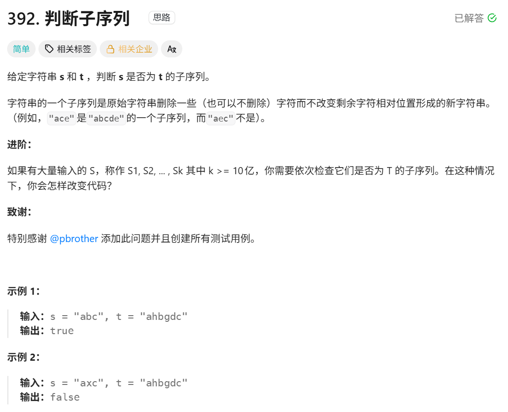

###  思路

1.思路还是和公共最大子序和一样 ，就是最后判断一下 dp【m】【n】 是不是等于s的长度，因为不就是要判断s是不是t的子序列嘛所以就判断即可

**2.dp[i][j] : 以nums1的i和nums2的j 结尾的 的最大的公共序列长度** 

3.递推公式： 如下图，dpi j 可以由以下表示 ， 从三个维度冲来


### 伪代码

```python
#dp[i][j] : 以nums1的i和nums2的j 结尾的 的最大的公共序列长度 
class Solution:
    def isSubsequence(self, s: str, t: str) -> bool:
        dp=[[0]*(len(t)+1)  for _ in range(0,(len(s)+1))]

        for i in range(1,len(s)+1):
            for j in range(1,len(t)+1):
                if s[i-1]==t[j-1]:
                    dp[i][j]=dp[i-1][j-1]+1
                else:
                    dp[i][j]=max(dp[i-1][j],dp[i][j-1])
        
        if dp[len(s)][len(t)]==len(s):
            return True
        else :
            return False

```


## 不同的子序列

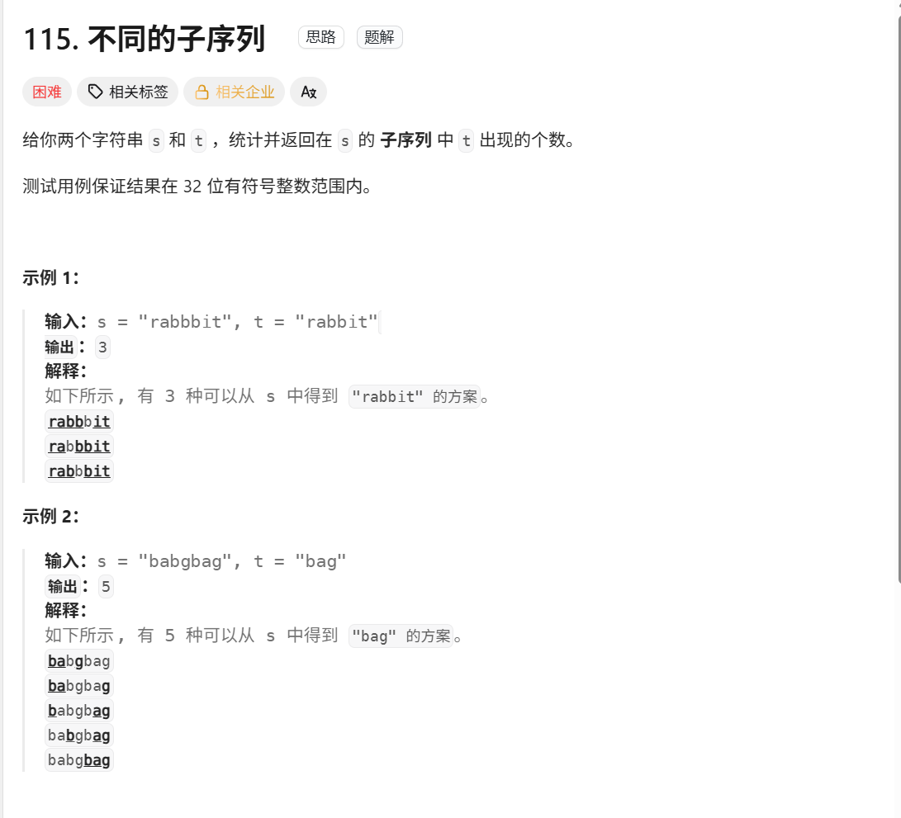

###  思路

1.**`dp[i][j]` 的含义：** 我们只看 `s` 的前 `i` 个字符（相当于拿一把剪刀，把 `s` 剪短），要从里面挑字符凑出 `t` 的前 `j` 个字符

2.递推公式：

```python
# 情况1：匹配上了。分为“用当前 s 的字符去凑” + “不用当前 s 的字符去凑”
# 左边的 dp[i-1][j-1] 是“用”，因为t的最后一个和s的目前这个对上了 
#右边的 dp[i-1][j] 是“不用” s扔掉了当前下标为i的字符（不用感觉就是继承一下最大值而已）
                    dp[i][j]=dp[i-1][j-1]+dp[i-1][j]
# 情况2：没匹配上。当前 s 的字符没用，只能看前面 s 的前缀能不能凑出 t，就是继承最大值
                    dp[i][j]=dp[i-1][j]
```


### 伪代码

```python
#dp 【i】【j】含义   在 s 字符串的前 i 个字符中，挑选出子序列，能够拼成 t 字符串的前 j 个字符，一共有多少种拼法（方案数）
class Solution:
    def numDistinct(self, s: str, t: str) -> int:
        dp=[[0]*(len(t)+1) for _ in range(0,len(s)+1)]
        
        # 初始化：
        # 1. 当 t 为空串时 (j=0)，s 中任何前缀（包括空串）都只有 1 种方法凑出空串（就是什么都不选）
        for i in range(0,len(s)+1):
            dp[i][0]=1
        # 2. 当 s 为空串，t 不为空时 (i=0, j>0)，方案数肯定是 0（默认就是0，不需要写）

        for i in range(1,len(s)+1):
            for j in  range(1,len(t)+1):

                if s[i-1]==t[j-1]:
# 情况1：匹配上了。分为“用当前 s 的字符去凑” + “不用当前 s 的字符去凑”
# 左边的 dp[i-1][j-1] 是“用”，因为t的最后一个和s的目前这个对上了 
#右边的 dp[i-1][j] 是“不用” s扔掉了当前下标为i的字符（不用感觉就是继承一下最大值而已）
                    dp[i][j]=dp[i-1][j-1]+dp[i-1][j]
                else:  # 情况2：没匹配上。当前 s 的字符没用，只能看前面 s 的前缀能不能凑出 t，就是继承最大值
                    dp[i][j]=dp[i-1][j]

        return dp[len(s)][len(t)]
```


## 两个字符串的删除操作

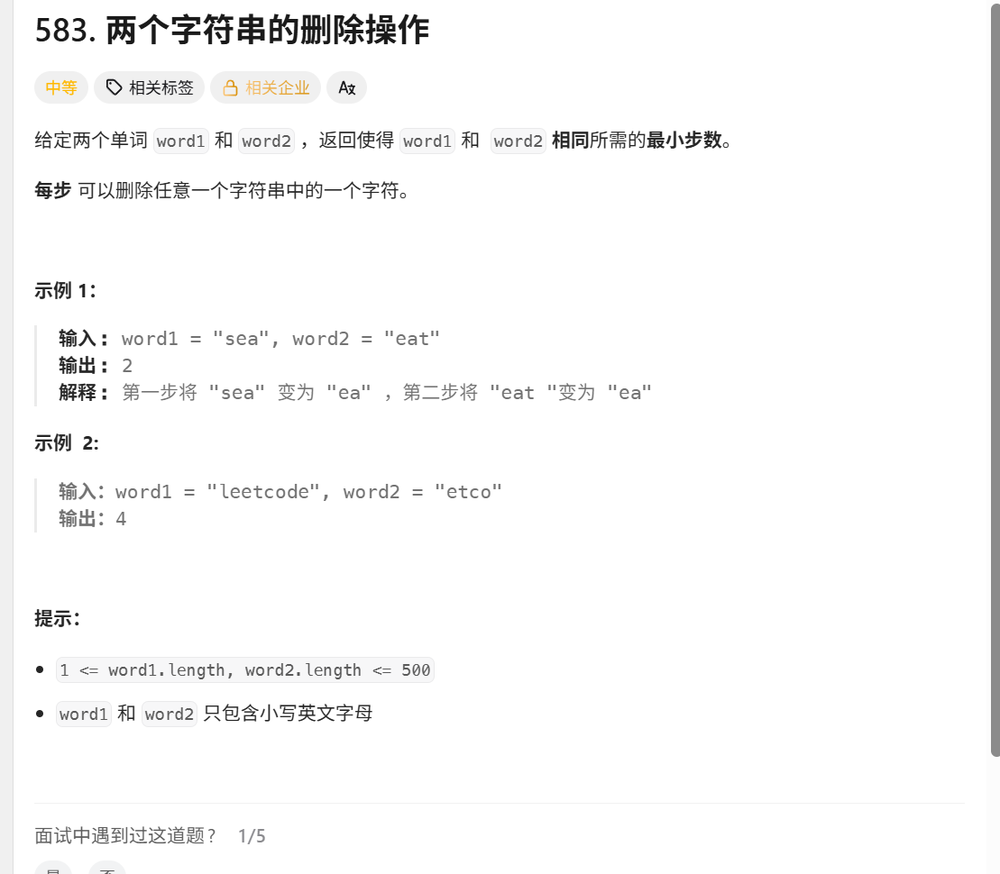

###  思路

**1.dp含义 ：在word1 的前i个字符 和word2 的前j个字符 对齐需要的最小步数**

2 .如果遍历的字符相同    word1[i-1]==word2[j-1]:  那么就不用进行操作，  dp[i][j]=dp[i-1][j-1]  继承数量即可

3.如果遍历的字符不同   从左边继承或者上方继承最小值然后 +1  

 #dp[i-1][j]+1表示删除了word1 也就是i-1，dp[i][j-1]+1表示删除了word2 也就是j-1

### 伪代码

```python
#dp含义 ：在word1 的前i个字符 和word2 的前j个字符 对齐需要的最小步数
class Solution:
    def minDistance(self, word1: str, word2: str) -> int:
        dp=[[0]*(len(word2)+1) for _ in range(0,len(word1)+1)]

        for i in range(0,len(word1)+1):#第一列  word2 为 0 也就是空字符 ，word1只能一直删
            dp[i][0]=i

        for j in range(0,len(word2)+1):#第一行 word1 为 0 也就是空字符 ，word2只能一直删
            dp[0][j]=j        
        
        for i in range(1,len(word1)+1):
            for j in range(1,len(word2)+1):
                if word1[i-1]==word2[j-1]:
                    dp[i][j]=dp[i-1][j-1]
                else:
                    dp[i][j]=min(dp[i-1][j]+1,dp[i][j-1]+1) #dp[i-1][j]+1表示删除了word1 也就是i-1，dp[i][j-1]+1表示删除了word2 也就是j-1
                     #题目只能删除操作 所以没有dp【i】【j】+1
        return dp[len(word1)][len(word2)]

```


## 编辑距离

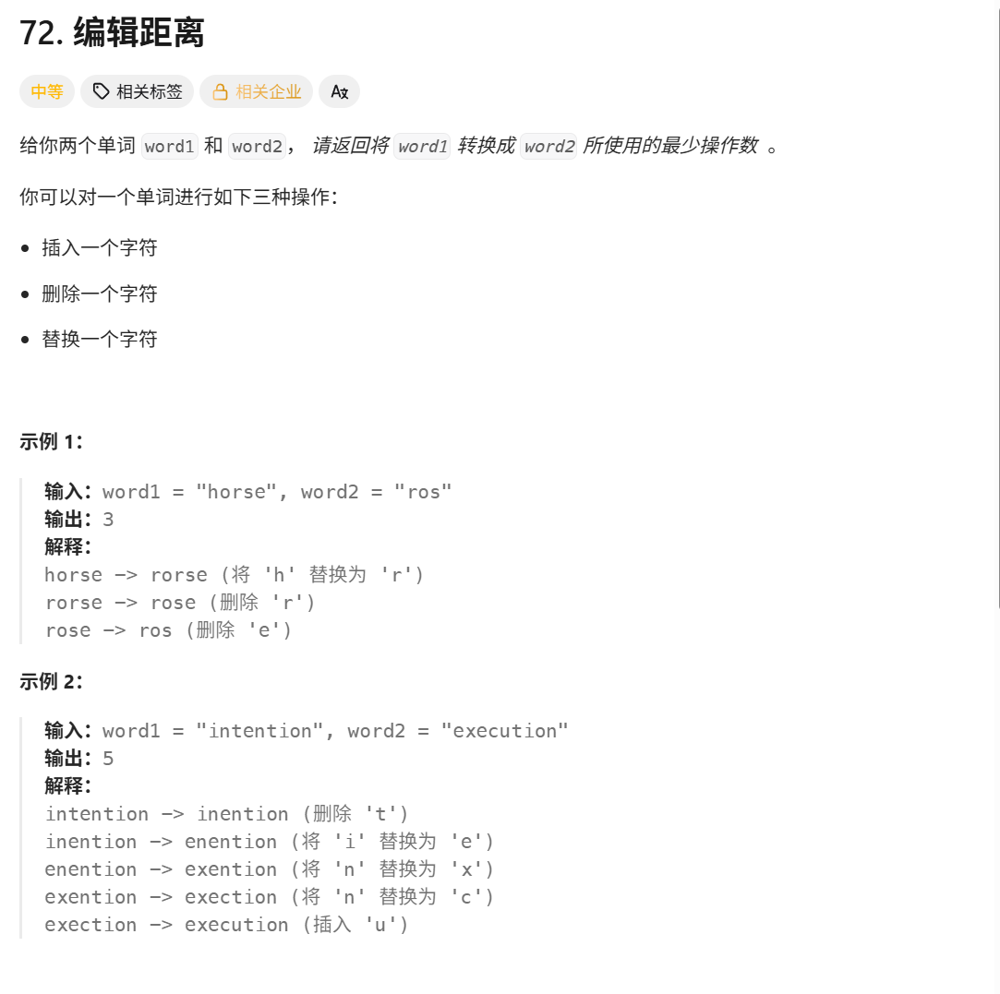

###  思路

和上一题字符串删除操作基本类似

1.dp含义 ：在word1 的前i个字符 和word2 的前j个字符 对齐需要的最小步数


递推公式：

1. dp[i][j]=dp[i-1][j-1]          i和j字符一样 ，直接继承dp[i-1][j-1] 无需操作

2.  dp[i][j] = min(dp[i - 1][j - 1], dp[i - 1][j], dp[i][j - 1]) + 1

   #dp[i - 1][j - 1]  替换操作： 把i和j字符其中一个换成相同的
   #dp[i - 1][j]      删除操作： 删掉了 i字符  看下dp[i - 1][j] 最少操作数
   #dp[i][j - 1]      删除操作：（向 word1 中插入）  删掉了j字符  看下dp[i][j - 1]  最少操作数 

   

### 伪代码

```python
#dp含义 ：在word1 的前i个字符 和word2 的前j个字符 对齐需要的最小步数
class Solution:
    def minDistance(self, word1: str, word2: str) -> int:
        dp=[[0]*(len(word2)+1) for _ in range(0,len(word1)+1)]
		
        #初始化
        for i in range(0,len(word1)+1):#第一列  word2 为 0 也就是空字符 ，word1只能一直删
            dp[i][0]=i
        for j in range(0,len(word2)+1):#第一行 word1 为 0 也就是空字符 ，word2只能一直删
            dp[0][j]=j        
        
        for i in range(1,len(word1)+1):
            for j in range(1,len(word2)+1):
                if word1[i-1]==word2[j-1]:
                    dp[i][j]=dp[i-1][j-1]#i和j字符一样 ，直接继承dp[i-1][j-1]
                else:
                    dp[i][j] = min(dp[i - 1][j - 1], dp[i - 1][j], dp[i][j - 1]) + 1
#dp[i - 1][j - 1]  替换操作： 把i和j字符其中一个换成相同的
#dp[i - 1][j]      删除操作： 删掉了 i字符  看下dp[i - 1][j] 最少操作数
#dp[i][j - 1]      删除操作：（向 word1 中插入）  删掉了j字符  看下dp[i][j - 1]  最少操作数 
        return dp[len(word1)][len(word2)]
```


## 回文子串

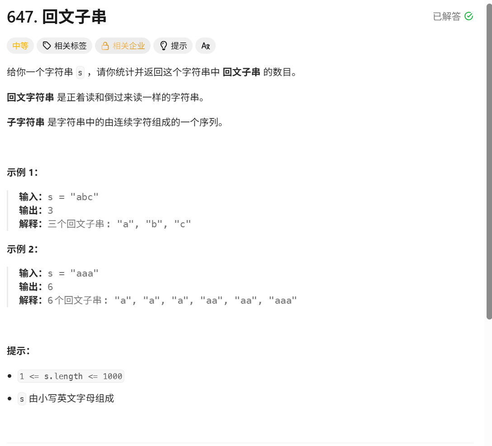

aba：  前面的a和后面的a都算两个 回文子串


###  思路

1.dp[i][j] 表示：字符串 s 在下标区间 [i, j] （即从第 i 个字符到第 j 个字符，包含两端）的子串，是否是回文串


2.递推公式：   if j - i <= 1: 那就是说明是一个或者两个字符，肯定是回文  ，result+1

​						elif  除了当前 i 和 j相同 ，左右两个都是True的话，那也是回文 ，result+1


### 伪代码

```python
#i一直在最左侧没动  ，j一直往右侧遍历 ，所以每一次的回文都是不同的  result每次都—+1
#dp[i][j] 表示：字符串 s 在下标区间 [i, j] （即从第 i 个字符到第 j 个字符，包含两端）的子串，是否是回文串
class Solution:
    def countSubstrings(self, s: str) -> int:
        n = len(s)
        dp = [[False] * n for _ in range(n)]
        result = 0
        for i in range(n - 1, -1, -1):
            for j in range(i, n):
                if s[i] == s[j]:
                    if j - i <= 1:
                        # 长度 1 或 2：首尾相同就一定是回文。
                        dp[i][j] = True
                        result += 1
                    elif dp[i + 1][j - 1]:
                        # 长度大于 2：首尾相同，内部也必须是回文。
                        dp[i][j] = True
                        result += 1
        return result
```


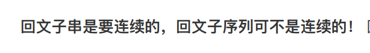


## 最长回文子序列

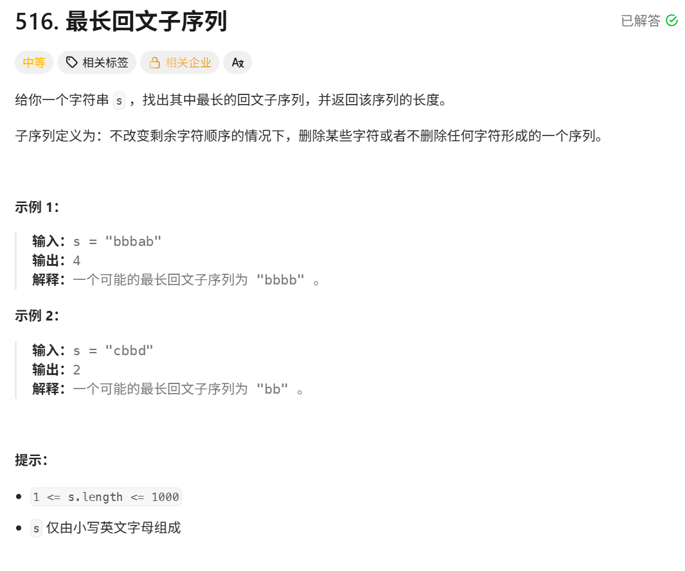


###  思路

1.dp ij :下标i到j 中可能包含的最长的回文子序列

因为这是回文子序列，是不连续的 ，可以包含的最长的回文子序列


递推公式：

if  s[i]==s[j]:  那么直接继承之前的最长回文子序列 dp[i][j]=dp[i+1][j-1]+2

else          ：  在  dp[i][j]=max(dp[i+1][j],dp[i][j-1]) 里面找最大  

### 伪代码

```python
#dp ij :下标i到j 中可能包含的最长的回文子序列
class Solution:
    def longestPalindromeSubseq(self, s: str) -> int:
        dp=[[0]* len(s) for _ in range(0,len(s))]
        # 2. 初始化对角线：单个字符本身就是长度为 1 的回文子序列
        for i in range(len(s)):
            dp[i][i] = 1

        for i in range(len(s)-1,-1,-1):
            for j in range(i+1,len(s)):
                if s[i]==s[j]:
                    dp[i][j]=dp[i+1][j-1]+2 			#继承之前的回文子序列  最长序列数+2 
                else:
                    dp[i][j]=max(dp[i+1][j],dp[i][j-1]) #继承之前的最大dp[i+1][j]  或者dp[i][j-1]
                    
        return dp[0][len(s)-1]

```


感觉就是求的不连续就是取max   ，   连续的就是继承+1


最少操作个数：dp取min


回文子序列 ： 不连续，所以直接一直取max

回文子串： 连续，所以继承

不同的子序列：也是继承因为是统计出现的个数

判断子序列 ：也是计算多少个与之相同

编辑距离： 都说最小的个数了，肯定min

两个字符串删除 ： 都说最小个数了，肯定min
