# 动态规划

### 动态规划五部曲

1.**确定dp数组以及下标的含义**     比如爬到第i层楼梯，有dp[i]种⽅法  

2.**确定递推公式**        					如dp[i] = dp[i - 1] + dp[i - 2]  

3.dp数组如何初始化  

4.确定遍历顺序  

5.举例推导dp数组  

### 递归

1.什么时候结束也就是终止条件

2.什么时候return

3.要python在自己的函数里面调用自己，需要加self.


### Debug

找问题的最好⽅式就是把dp数组打印出来，看看究竟是不是按照⾃⼰思路推导的  

### 定义二维数组

```python
        dp = [[0] * n for _ in range(m)] # 定义一个m行 n列的二维数组   但是mn不能交换位置的
```

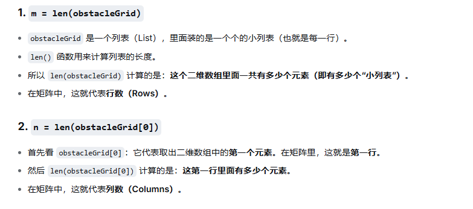


## 1.斐波那契数  

https://leetcode.cn/problems/fibonacci-number/

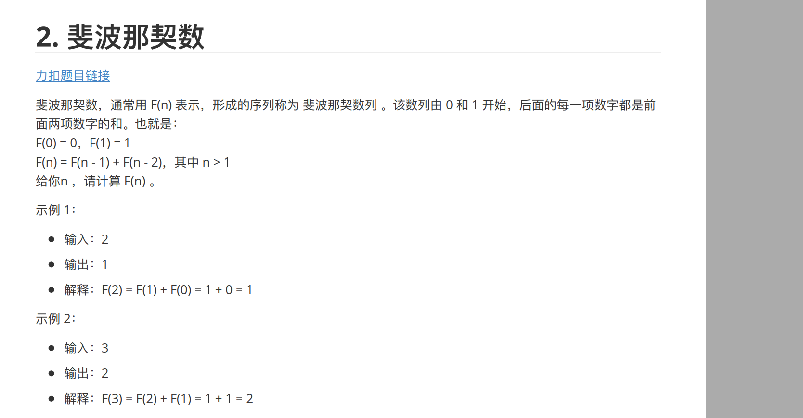


### 伪代码

```python
						1.递归法      				时间复杂度O(2^n)    空间复杂度： O(n)
class Solution:
    def fib(self, n: int) -> int:
        if n<2:  
            return n
        return self.fib(n-1)+self.fib(n-2)

        
        
        				2.常规代码法：           时间复杂度O(n)    空间复杂度： O(n)
        class Solution:
    def fib(self, N: int) -> int:

        if N <= 1:
            return N
        dp = [0] * (N + 1)    #空间复杂度在这 
        dp[0] = 0
        dp[1] = 1
        
        for i in range(2, N + 1): #时间复杂度在这
            dp[i] = dp[i - 1] + dp[i - 2] 
        return dp[N]
    
    
    					3.节约空间代码法：           时间复杂度O(n)    空间复杂度： O(1)
				
class Solution:
    def fib(self, n: int) -> int:
        if n < 2:
            return n
            
        dp = [0] * 30
        dp[0] = 0
        dp[1] = 1
        for i in range(2, n + 1):
            								# 正确的滚动更新
            dp[0], dp[1] = dp[1], dp[0] + dp[1]
            
        return dp[1] 
```

### 思路：

### 易错点：

1.要python在自己的函数里面调用自己，需要加self.

### 知识点：

这是递归的入门题： 递归有两个要素


### 时间复杂度

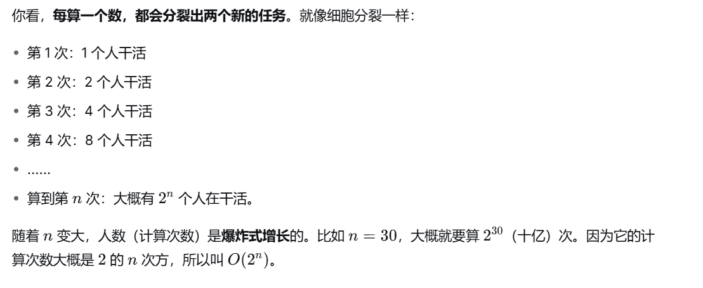

### 再写一遍犯的错


## 爬楼梯

[70. 爬楼梯 - 力扣（LeetCode）](https://leetcode.cn/problems/climbing-stairs/description/)

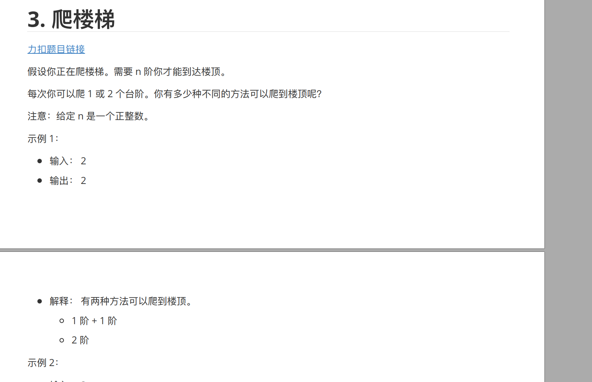


### 伪代码

```python
 									1.递归法（不可用 ）  --时间复杂度O(2^n)    空间复杂度： O(n)
class Solution:
    def climbStairs(self, n: int) -> int:

        if n==1: return 1
        if n==2 : return 2
        return self.climbStairs(n-1)+self.climbStairs(n-2)
            
        
 									2.常规代码法：           时间复杂度O(n)    空间复杂度： O(n)
class Solution:
    def climbStairs(self, n: int) -> int:
        if n<=2:
            return  n  #一定要进行这个初始情况判定
        dp=[0]*(n+1)
        dp[1]=1
        dp[2]=2
        if n<=1:
            return n
        
        for i in range(3,n+1):
            dp[i]=dp[i-1]+dp[i-2]
        return dp[n]
            
            
            						3.节约空间代码（只用dp【1】 和dp 【2】）   时间复杂度O(n)    空间复杂度： O(1)
class Solution:
    def climbStairs(self, n: int) -> int:
        dp=[0,1,2] 
        dp[1]=1
        dp[2]=2
        if n<=1:
            return n
        
        for i in range(3,n+1):
            dp[1],dp[2]=dp[2],dp[1]+dp[2]
        return dp[2]

```

### 思路：

变种的斐波那契数  ， 比如10阶台阶 = 8阶的时候+9阶的时候 的值  ，  你说8阶不可以 8+1+1 和 8 +2 两种呢， 因为8+1的时候再+1中间有9的过程了


### 易错点

1.初始化数组

再用代码法的时候，记得 初始化数组不然不能调用

```python
        dp=[0,1,2]   去初始化一个数组，
    
    # 创建长度为 n+1 的列表，初始值全为 0
        dp = [0] * (n + 1)
```


## 最小花费爬楼梯

[746. 使用最小花费爬楼梯 - 力扣（LeetCode）](https://leetcode.cn/problems/min-cost-climbing-stairs/description/)

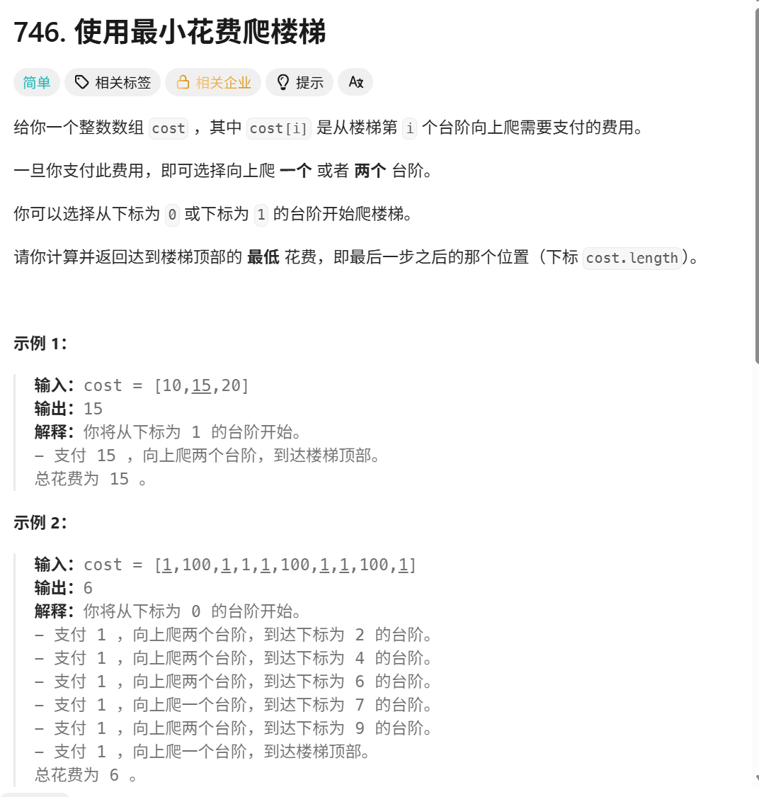

### 伪代码

```python
											1.递归法 时间复杂度
class Solution:
    def minCostClimbingStairs(self, cost: list[int]) -> int:
        dp=[0]*(len(cost)+1) #楼顶数量是len(cost)+1  也就是cost后面的那个  这里是几个不是下标   要求的是下标是dp【len（cost）】也就是cost数组接触不到的天花板
        dp[0]=0
        dp[1]=0

        for i in range(2,len(cost)+1):  #走到cost+1位置需要的最少的花费
            dp[i]=min(dp[i-1]+cost[i-1],dp[i-2]+cost[i-2])
        return dp[len(cost)]

        
       									2.常规代码法  -使用
class Solution:
    def minCostClimbingStairs(self, cost: list[int]) -> int:
        dp=[0]*(len(cost)+1)#一共len（） 但是下标是从0 到len（cost）+1的
        dp[0]=0
        dp[1]=0

        for i in range(2,len(cost)+1):
            dp[i]=min(dp[i-1]+cost[i-1],dp[i-2]+cost[i-2])
        return dp[len(cost)]
            

									3. 节约时间复杂度法 
class Solution:
    def minCostClimbingStairs(self, cost: list[int]) -> int:

        dp=[0,0,0]

        for i in range(2,len(cost)+1): #要计算的下标是 len（cost） 所以右边界要+1
            dp[2]=min(dp[1]+cost[i-1],dp[0]+cost[i-2])
            dp[0]=dp[1]
            dp[1]=dp[2]

        return dp[1]
            

```


### 思路 

****

### 易错点：

1. 它是指当你站在第i台阶，口袋花了多少钱

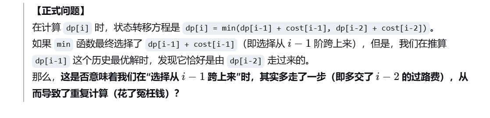

`dp[i]` 代表的是**“你站在第 i 个台阶上时，你口袋里最少已经花了多少钱”**


2.

```python
            dp[0]=dp[1]
            dp[1]=min(dp[1]+cost[i-1],dp[2]+cost[i-2]) ❌️❌️❌️❌️  这样不就自己调用自己了吗
        
        
        
            dp[2]=min(dp[1]+cost[i-1],dp[0]+cost[i-2])  ✅️✅️✅️
            dp[0]=dp[1]
            dp[1]=dp[2]
```


### 知识点：


```python
 

```


## 62不同路径

[62. 不同路径 - 力扣（LeetCode）](https://leetcode.cn/problems/unique-paths/)

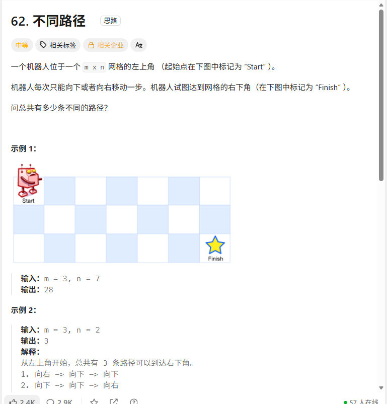


###  思路

**二维数组法：**

1.先初始化，第一行第一列全为1 

2.从第二行第二列开始遍历 ：  dp[i][j] = dp[i - 1][j] + dp[i][j - 1]

​	

**一维数组法：**

（dp【i】 表示的上一行的结果，）

1.先初始化第一行 全为1 

2.从第二行的第二列开始   dp[j]=dp[j]+dp[j-1]

**易错点**：dp[j-1] 从第二列开始存在 ，那		j-1		的值是多少  ，就是继承的上一行的dp【0】的值吗，没有改变都是1

### 伪代码

```python
										1.递归法（二维数组）  时间复杂度 O(m × n)  空间复杂度O(m × n)
class Solution:
    def uniquePaths(self, m: int, n: int) -> int:
        dp=[[0]*n for _ in range(0,m)] #记住如何定义二维数组  m行n列
        
        for i in range(0,n): #列填充 初始化第一行全是 1
            dp[0][i]=1
        for i in range(0,m): #行填充 初始化第一列也全是1
            dp[i][0]=1

        for i in range(1, m):#行  
            for j in range(1, n):#列
                dp[i][j] = dp[i - 1][j] + dp[i][j - 1]


        return dp[m - 1][n - 1]
										
        								2.递归法（一维数组法） 时间复杂度： O(m × n)  空间复杂度： O(n)
class Solution:
    def uniquePaths(self, m: int, n: int) -> int:
        dp=[1]*n #定义一维数组

        for i in range(1,m):
            for j in range(1,n):
                dp[j]=dp[j]+dp[j-1]
        return dp[-1]

        
        
```


## 不同路径II（没提交）

[63. 不同路径 II - 力扣（LeetCode）](https://leetcode.cn/problems/unique-paths-ii/description/)

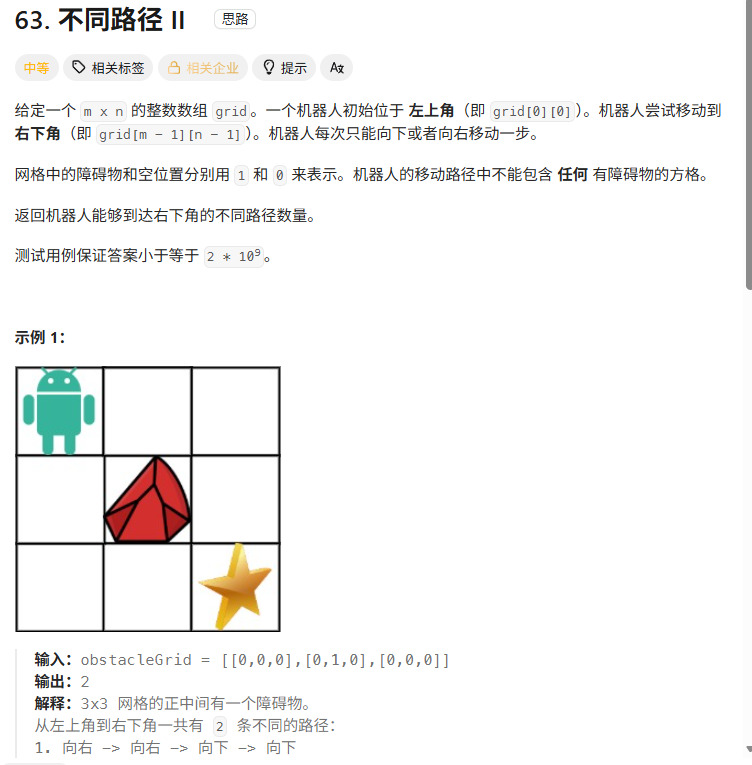


###  思路

..**常规递归法 时间复杂度O(n × m)， 空间复杂度O(n × m)，**

1.定义二维数组 

2.给第一行和第一列初始化为1 ，碰到障碍后面的全部break

3.从第二列第二行开始遍历  **dp[i][j]=dp[i][j-1]+dp[i-1][j]**


**节约空间复杂度的代码 时间复杂度： O(n × m)，空间复杂度： O(m)**

就是每个dp【j】都是上一行的数值， dp[j-1]是左边的数值

1.定义一个n列的一维数组

2.初始化第一行 dp[i]=1，碰到障碍直接break

3.遍历每行每列，如果碰到障碍。直接dp【j】=0 如果j！=0 （不是第一列）  dp[j]=dp[j]+dp[j-1]


**易错点**：dp[j-1] 从第二列开始存在 ，那		j-1		的值是多少  ，就是继承的上一行的dp【0】的值吗，没有改变都是1

****


### 伪代码

```python
									1.常规递归法 时间复杂度O(n × m)， 空间复杂度O(n × m)，
class Solution:
    def uniquePathsWithObstacles(self, obstacleGrid: list[list[int]]) -> int:
        m=len(obstacleGrid)
        n=len(obstacleGrid[0])
        dp=[[0]* n for i in range(0,m)]

        #初始化
        for i in range(0,n):
            if obstacleGrid[0][i] ==1:
                break
            else :dp[0][i]=1
		#初始化
        for i in range(0,m):
            if obstacleGrid[i][0] ==1:
                break
            else : dp[i][0]=1
        
        for i in range(1,m):#m行  按照行填充
            for j in range(1,n):#n列
                if obstacleGrid[i][j] == 1:
                    dp[i][j] = 0     # 障碍格不可达
                else : 
                    dp[i][j]=dp[i][j-1]+dp[i-1][j]
        return dp[m-1][n-1]


								2. 节约空间复杂度的代码 时间复杂度： O(n × m)，空间复杂度： O(m)
class Solution:
    def uniquePathsWithObstacles(self, obstacleGrid: list[list[int]]) -> int:
        m=len(obstacleGrid)
        n=len(obstacleGrid[0])

        #定义一维数组 长度为n列
        dp=[0]*n 

        #初始化第一行
        for i in range(0,n):
            if obstacleGrid[0][i]==1:#有障碍
                break
            else: 
                dp[i]=1

           #开始遍历 
        for i in range(1,m):
            for j in range(0,n):
                if obstacleGrid[i][j]==1:
                    dp[j]=0
                elif j!=0:
                    dp[j]=dp[j]+dp[j-1]
        return dp[-1]
    
    
    
    
    
       							#我改成这样行吗 else :
                    dp[j]=dp[j]+dp[j-1]
class Solution:
    def uniquePathsWithObstacles(self, obstacleGrid: list[list[int]]) -> int:
        m=len(obstacleGrid)
        n=len(obstacleGrid[0])

        #定义一维数组 长度为n列
        dp=[0]*n 

        #初始化第一行
        for i in range(0,n):
            if obstacleGrid[0][i]==1:#有障碍
                break
            else: 
                dp[i]=1

        for i in range(1,m):
            for j in range(1,n):
                if obstacleGrid[i][j]==1:
                    dp[j]=0
                else :
                    dp[j]=dp[j]+dp[j-1]
        return dp[-1]

```


##整数拆分

[343. 整数拆分 - 力扣（LeetCode）](https://leetcode.cn/problems/integer-break/description/)

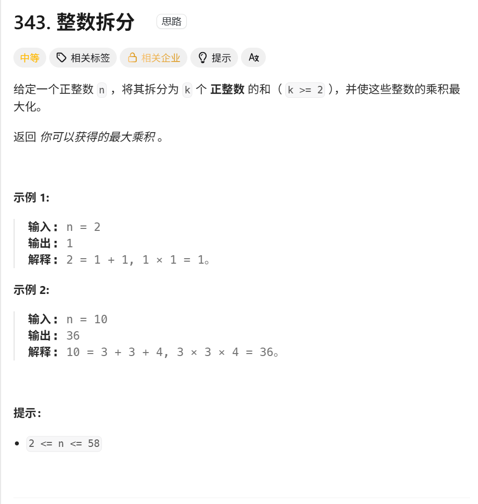


###  思路

**当前dp【i】 就是 i 的最大整数拆分**

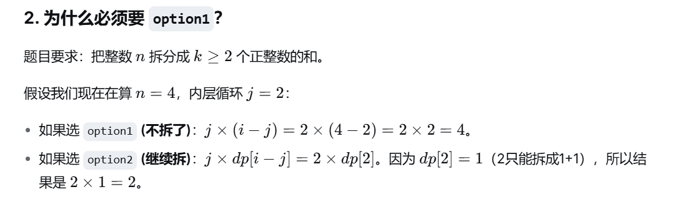

### 伪代码

```python
class Solution:
    def integerBreak(self, n: int) -> int:
        dp=[0]*(n+1)
        dp[2]=1

        for i in range(3,n+1):
            for j in range(1,i//2+1):
                # 方案一：只拆成两个数 (j 和 i-j)，不再继续拆分
                option1= j*(i-j)
                #方案二：把 (i-j) 继续拆分，利用之前算好的 dp 表
                option2 = j*dp[i-j]

                dp[i]=max(dp[i],option1,option2)#因为遍历了所有的，dp[i]只取max

        return dp[n]
```


## 96不同的二叉搜索树

[96. 不同的二叉搜索树 - 力扣（LeetCode）](https://leetcode.cn/problems/unique-binary-search-trees/)

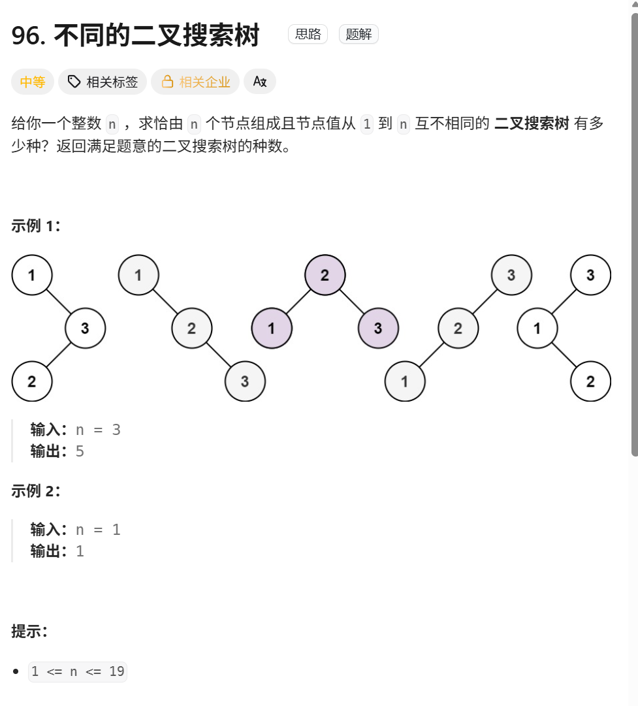


###  思路

dp[i] ： 1到i为节点组成的⼆叉搜索树的个数为dp[i] 


在这里n为3 以 1为头结点的话 i=3 j=1  左子树0 颗  右子树 2颗 

​					以 2为头结点的话 i=3 j=2  左子树1 颗  右子树 1颗 

​					以 3为头结点的话 i=3 j=3  左子树2颗  右子树 0颗 

**所以可以推导出递归公式**			

​					以 i 为头结点的话			  左子树j-1 颗  右子树 i-j颗   想加为  i- 1           j-1 +  i-j 

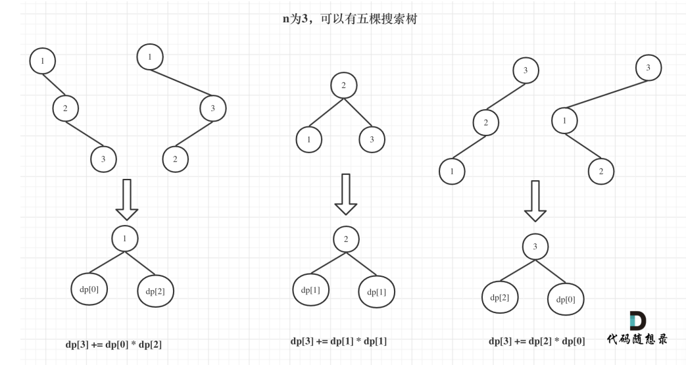


### 伪代码

```python
class Solution:                  #时间复杂度： O(n^2)   空间复杂度： O(n)
    def numTrees(self, n: int) -> int:
        dp=[0]*(n+1)
        dp[0]=1# 空树也是一棵树
        for i in range(1,n+1):#从1开始到n的      dp【i】的二叉树数量
            for j in range(1,i+1):#从1到 i 种情况的头结点  以j为头节点的二叉树种类
                dp[i]+=dp[j-1]*dp[i-j] #以j为头节点左子树有j-1个元素，右子树有i-j个

        return dp[n]


```


# 01背包（每件物品最多使用一次）


## 二维数组背包

**dp格子含义 `dp[i][j]`**：代表从 `0` 到 `i` 个物品中任取，放进容量为 `j` 的背包里，能获得的最大价值

所以第一列背包能容纳重量为0 就全是0  ，然后 第一行背包从0 到 0 任取物品也是0


一维数组 ：外层物品for正序         内层背包得**倒序**排序** （记住，是背包的维度得倒序，不管几维都得倒序）

二维数组 ：两层正序for循环     


**递推公式**：   第一个表示不选物品i （根本就没碰第 i  个物品）  第二个表示选物品 i 然后j减去这个物品的重量 +物品价值

```python
   dp[i][j] = max(dp[i - 1][j], dp[i - 1][j - weight[i]] + value[i])
```


**初始化的表格**


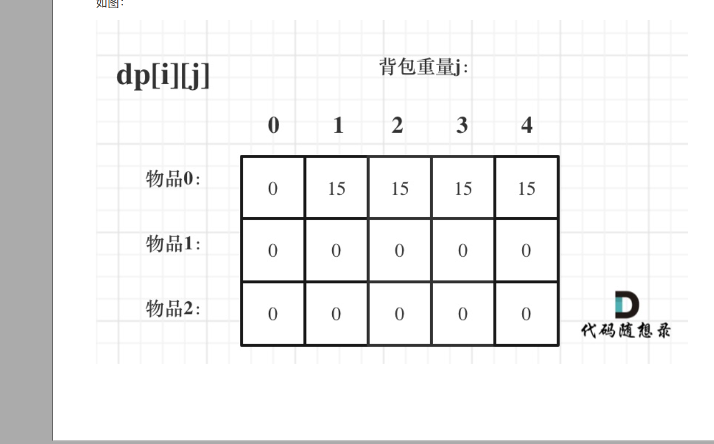


**最终填满的表格**

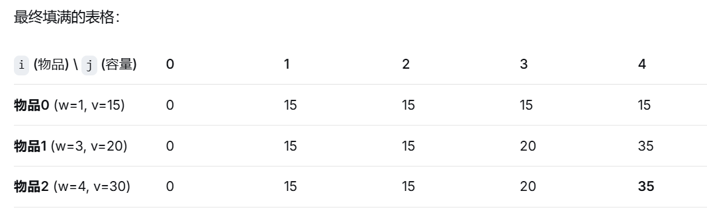

### 伪代码

```python
							# n为物品的数量  bagweight表示背包的容量

n, bagweight = map(int, input().split())

weight = list(map(int, input().split()))
value = list(map(int, input().split()))

dp = [[0] * (bagweight + 1) for _ in range(n)] #定于二维数组

for j in range(weight[0], bagweight + 1): #第一行初始化  从物品0 容量开始放物品0的价值
    dp[0][j] = value[0]

for i in range(1, n):#从第二行开始 表示物品 
    for j in range(0,bagweight + 1):#从第一列开始 表示容量
        if j < weight[i]:
            dp[i][j] = dp[i - 1][j] #背包容量比物品小 ，想拿都拿不了
        else:
            dp[i][j] = max(dp[i - 1][j], dp[i - 1][j - weight[i]] + value[i]) # 不取    取

print(dp[n - 1][bagweight])

```


关于二维数组的下标： 定义的时候要保证bagweight能够直接输出print(dp[n - 1][bagweight])  所以要+1 因为容量下标从0开始的，但是对于物品，是数组也是从0开始的，所以for循环的时候 1-n就完全够了

## 一维数组背包


1.**dp[j]含义：dp[j]表示：容量为j的背包，所背的物品价值可以最⼤为dp[j]**          和之前一样直接拷贝上一层的值即可


**2.递推公式：** 

第一个表示不选这个物品，所以直接把上面一层的结果记录下来    可以参考上面的二维图来理解

第二个表示选这个物品 ，所以还是这样

```python
dp[j] = max(dp[j], dp[j - weight[i]] + value[i]);
```


**3.一维背包得倒序排序** （记住，是背包的维度得倒序，不管几维都得倒序）

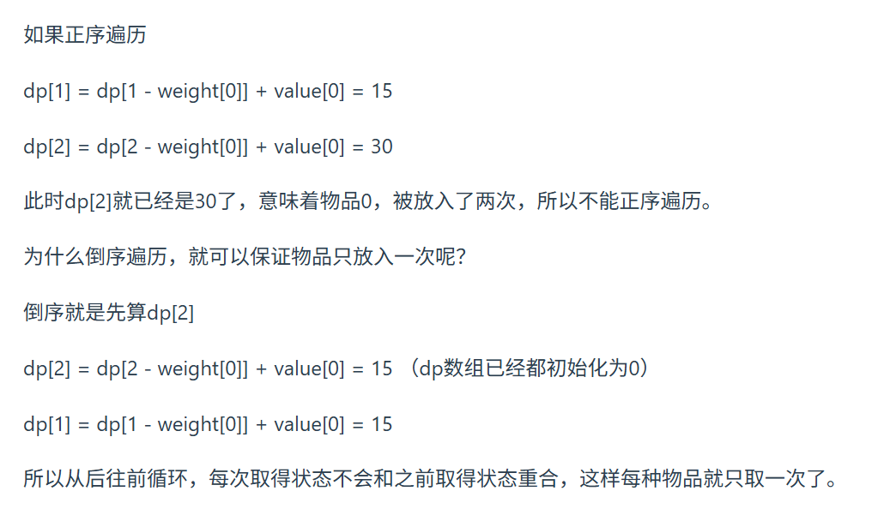

1.倒序的时候 算dp【2】的时候 **dp【1】初始化为0** 所以 0+15 ==15 


### 初始化表格

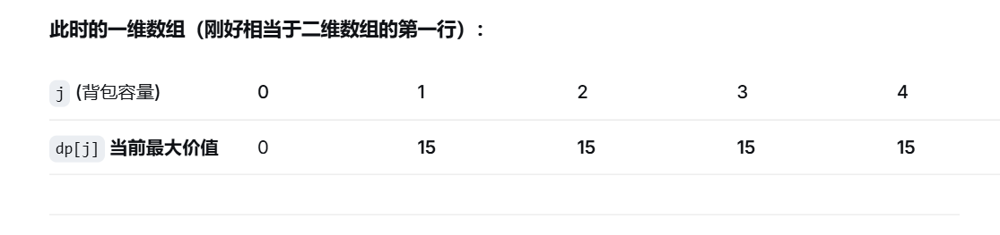


### 最终数组

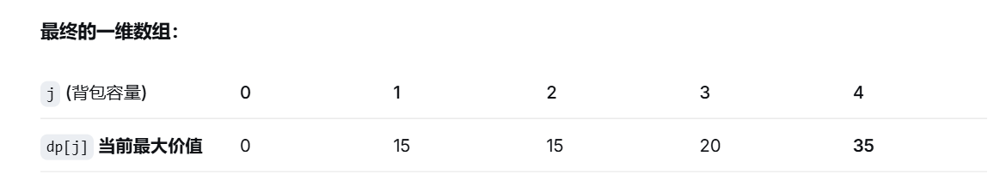

### 伪代码

```python
n, bagweight = map(int, input().split())
weight = list(map(int, input().split()))
value = list(map(int, input().split()))

dp = [0] * (bagweight + 1)  # 创建一个动态规划数组dp，初始值为0      为啥要+1 ？?？？？？  因为dp【i】表示背包为 i 的容量的最大价值

dp[0] = 0  # 初始化dp[0] = 0,背包容量为0，价值最大为0

for i in range(n):  # 应该先遍历物品 也就是行 
    for j in range(bagweight, weight[i]-1, -1):  # 1.倒序遍历背包容量     2.weight[i]-1  是因为前面的都不需要判断，想放都放不了了
        dp[j] = max(dp[j], dp[j - weight[i]] + value[i]) # 取 ， 不取 j才是背包容量

print(dp[bagweight])

```


## 分割等和子集

[416. 分割等和子集 - 力扣（LeetCode）](https://leetcode.cn/problems/partition-equal-subset-sum/)

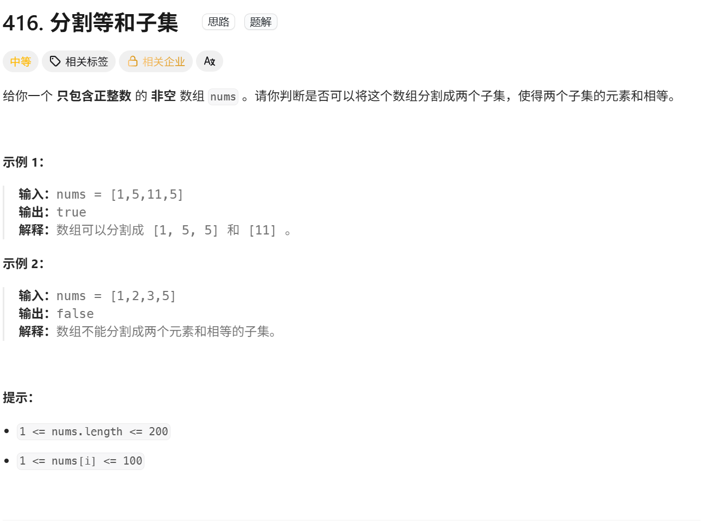


###  思路

1.**dp[j]含义：dp[j]表示：容量为j的背包，所背的物品价值可以最⼤为dp[j]**          和之前一样直接拷贝上一层的值即可

1.可以把数组的值都先看成背包容量，然后只不过恰好价值就是等于它的容量

3.结果判断： 就看数组之和的一半的背包容量 ，能否刚好装下最大价值为数组之和   能装下就可以return true

### 伪代码

```python
class Solution:
    def canPartition(self, nums: list[int]) -> bool:
        # 背包内总和
        total_sum = sum(nums)
        
        # 如果总和为奇数，无法平分为两个整数子集
        if total_sum % 2 == 1:
            return False
        
        target = total_sum // 2
        
        # 初始化 dp 数组，大小为 target + 1    为啥要+1 ？?？？？？  因为dp【i】表示背包为 i 的容量的最大价值
        # dp[j] 表示容量为 j 的背包能装下的最大重量（即子集和）      
        dp = [0] * (target + 1)
        

        for i in range(0,len(nums)):#遍历行 ，也就是先便利物品 也就是nums数组的每一个值
            for j in range(target, nums[i] - 1, -1): #遍历列 也就是遍历 背包容量  target要是比nums[i]还小，没必要去找了
                dp[j] = max(dp[j], dp[j - nums[i]] + nums[i]) #j才是背包容量
        
        # 集合中的元素正好可以凑成总和 target  1 5 5 11 数组 dp【target】 最后在11这一行也等于 11
        if dp[target] == target:
            return True
            
        return False
```


## 最后一块石头的重量II

[1049. 最后一块石头的重量 II - 力扣（LeetCode）](https://leetcode.cn/problems/last-stone-weight-ii/description/)

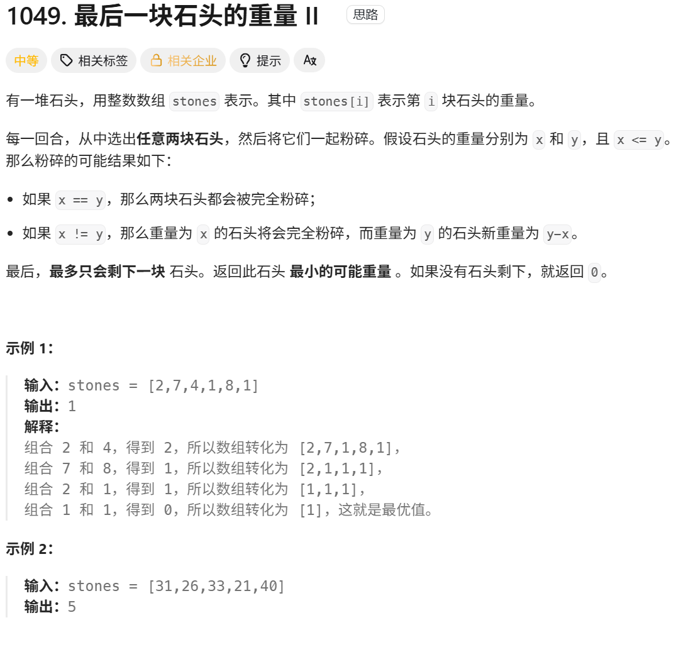


###  思路

1.**dp【j】 ： 背包容量为 j  ， 你能凑出的最接近 `target` 的那一堆石头的重量**

2. 和上一题基本类似，只不过不用要求一定==target ，最接近target即可

### 伪代码

```python
class Solution:
    def lastStoneWeightII(self, stones: list[int]) -> int:
        total_sum=sum(stones)
        target=total_sum//2 			#//到底剩下什么往floor取整
        dp=[0]*(target+1)

        for i in range(0,len(stones)):
            for j in range(target,stones[i]-1,-1):
                dp[j]=max(dp[j],dp[j-stones[i]]+stones[i])
        
        return total_sum-dp[target] -dp[target] #total_sum-dp[target]表示大的那块  因为 //是向下取整
    											# dp[target]表示小的那块
    
```


## 494目标和

[494. 目标和 - 力扣（LeetCode）](https://leetcode.cn/problems/target-sum/description/)

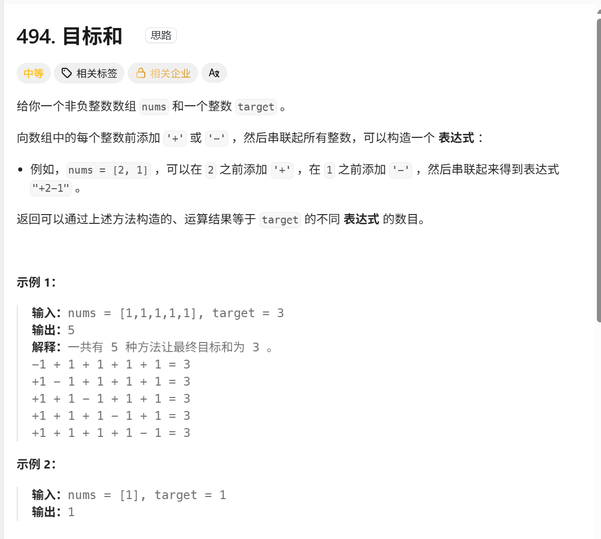


### 前置要求

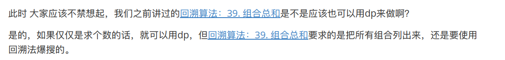

**这题不需要列出来就判断多少个还是可以的，但是要列出来只能回溯搜索了**


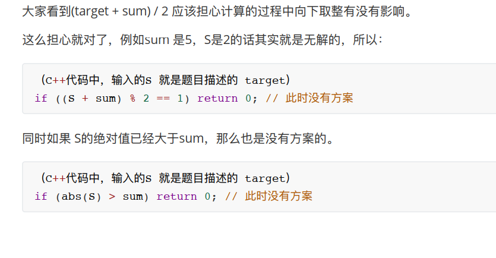

###  思路

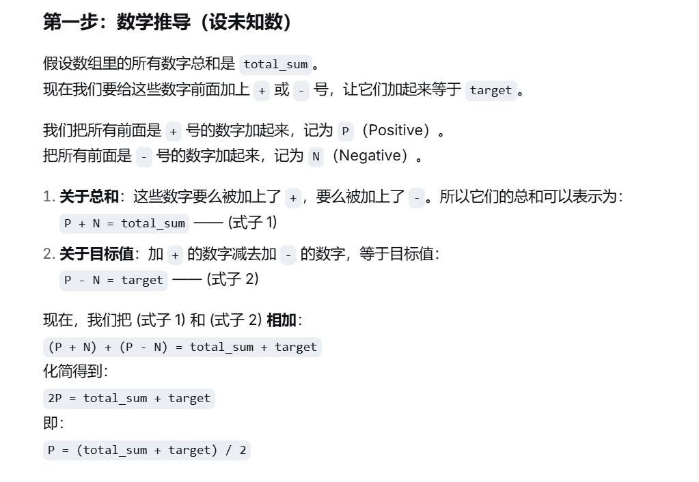

也就是加法的数值等于P

#### 回溯法：


#### dp法

**1.使用+号的数字总和 为P 也就是 bag_size = (total_sum + target) // 2  ，也就是找到想加为bag_size的数字**

**2.dp[j]表示：填满j（包括j）这么大容积的包，有dp[j]种方法**  比如下图 有一个1 那么就是dp【4】种方法 ，因为凑上这个1 本来就是这种方法

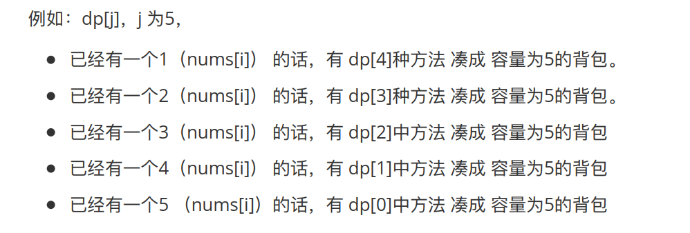

**3.递推公式：**


**4.剪枝判断**

1.X和sum 的和之余数为1肯定就是没有方案了

2.数组加起来都没target大，那么肯定也就是没方案了

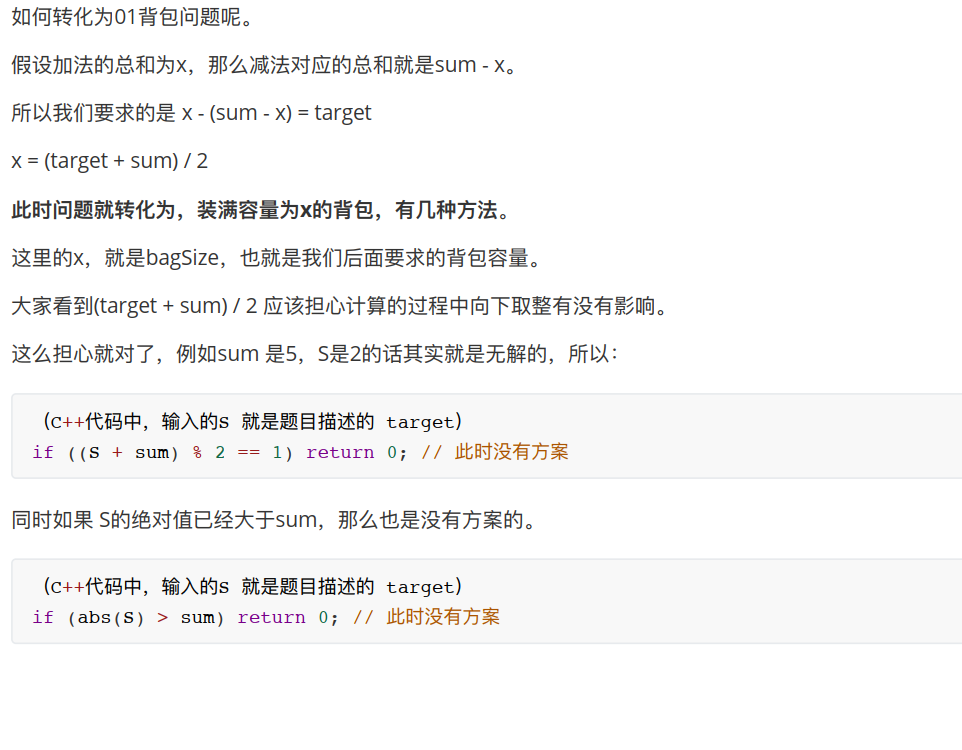

### 伪代码

```python
    					1.dp法  时间复杂度： O(n × m)， n为正数个数， m为背包容量   空间复杂度： O(m)， m为背包容量

class Solution:
    def findTargetSumWays(self, nums: List[int], target: int) -> int:
        total_sum = sum(nums)
        
        # 1. 数学推导与边界判断
        # 如果目标值的绝对值大于总和，或者 (目标值 + 总和) 是奇数，绝对凑不出，返回 0
        if abs(target) > total_sum or (target + total_sum) % 2 == 1:
            return 0
            
        # 2. 转化为 0-1 背包问题
        # 推导出：需要从数组里挑出一些数，让它们的和等于 bag_size 也就是相加的部分  背包就是相加部分的组合
        bag_size = (target + total_sum) // 2
        
        # 3. 初始化 DP 数组
        # dp[j] 表示：凑出和为 j 的方案数（也就是组合数）
        dp = [0] * (bag_size + 1)
        
        # 凑出和为 0 的方案只有 1 种：什么都不选
        dp[0] = 1
        

        for i in range(len(nums)): # 外层循环：遍历每一个数字（物品）
            # 内层循环：遍历背包容量（必须倒序！）
            # 为什么倒序？为了保证每个数字只能用一次，且用到的是上一行的“历史数据”
            for j in range(bag_size, nums[i] - 1, -1):
                
                # 状态转移方程（核心）：
                # 等号右边的 dp[j] 是“不选当前数字”的方案数 之前的方案找到了等于 j 的方案，所以不取
                # dp[j - nums[i]] 是“选当前数字”的方案数   之前没找到j的方案， 所以是取
                dp[j] = dp[j] +dp[j - nums[i]]#第一个是不取（之前就有这多方案了），第二个取
                
        return dp[bag_size]
    
    
  												2.回溯法（但是超时了）


class Solution:

    def backtracking(self, nums: List[int], target: int, start_index: int):
        # 终止条件：如果当前和等于目标值，记录结果并返回
        if self.current_sum == target:
            self.result_count += 1
            return
            
        # 遍历选择列表
        for i in range(start_index, len(nums)):
            # 剪枝：如果当前和加上当前数字超过了目标值，因为数组已排序，后面的只会更大，直接 break
            if self.current_sum + nums[i] > target:
                break
                
            # 做选择
            self.current_sum += nums[i]
            
            # 递归进入下一层（i + 1 保证元素不重复使用）
            self.backtracking(nums, target, i + 1)
            
            # 撤销选择（回溯）
            self.current_sum -= nums[i]
    def findTargetSumWays(self, nums: List[int], target: int) -> int:
        self.result_count = 0
        self.current_sum = 0
        total_sum = sum(nums)
        
        # 如果目标和大于总和，或者 (总和+目标和) 为奇数，说明无法整除2，无解
        if target > total_sum or (total_sum + target) % 2 != 0:
            return 0
            
        # 转化为组合总和问题，求背包容量
        bag_size = (total_sum + target) // 2

        # 需要排序，为了后面的剪枝
        nums.sort()
        
        # 调用回溯函数
        self.backtracking(nums, bag_size, 0)
        
        return self.result_count


```


## 一和零

[474. 一和零 - 力扣（LeetCode）](https://leetcode.cn/problems/ones-and-zeroes/description/)

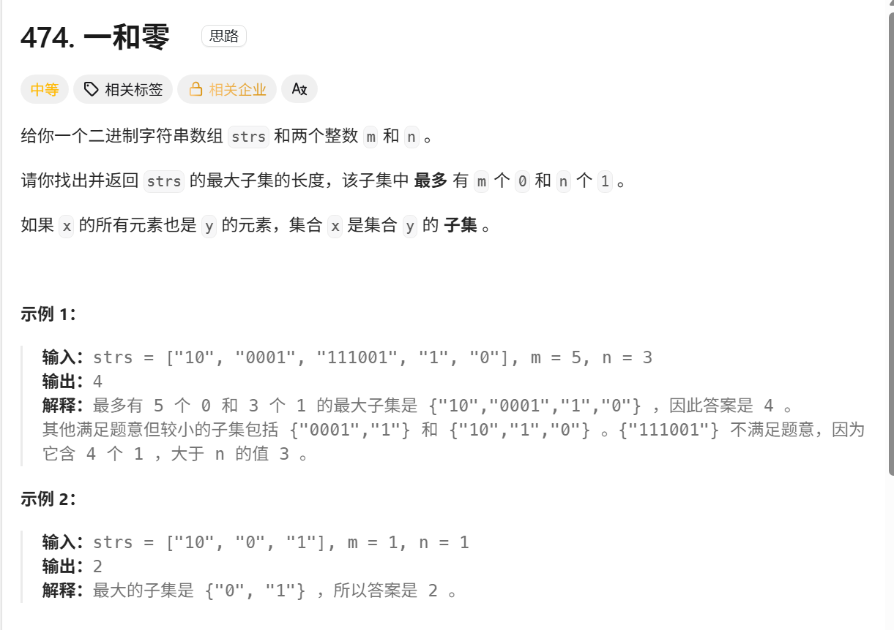


###  思路

**1.dp【i】【j】含义： 在i个0 j个1的情况下能拥有子集最大的个数**

背包维度就是要倒序，

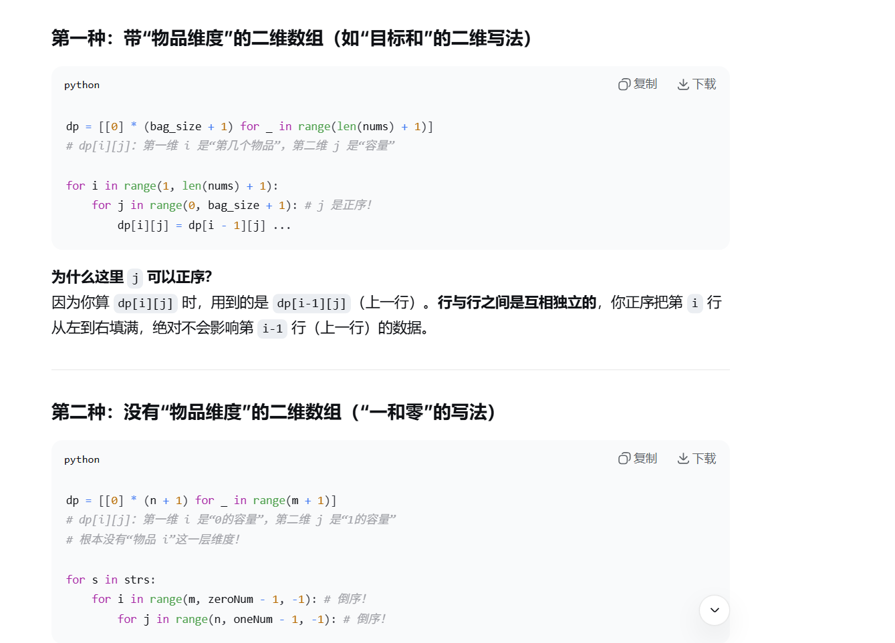


### 伪代码

```python
# dp[i][j] 表示：最多有 i 个 0 和 j 个 1 时，能装下的最大子集长度

class Solution:
    def findMaxForm(self, strs: List[str], m: int, n: int) -> int:
        
        # 默认初始化为 0
        dp = [[0] * (n + 1) for _ in range(m + 1)]    #所以初始化的时候要覆盖dp【m】【n】即可
        
        # 外层循环：遍历每一个字符串（物品）
        for s in strs:
            zeroNum = s.count('0') # 计算当前字符串消耗的 0 的数量
            oneNum = len(s) - zeroNum # 计算当前字符串消耗的 1 的数量
            
            # 内层循环：遍历背包容量（必须倒序！）
            # 这里的 i 代表 0 的容量，j 代表 1 的容量
            for i in range(m, zeroNum - 1, -1):
                for j in range(n, oneNum - 1, -1):
                    # 状态转移方程：
                    # 不选当前字符串：dp[i][j]
                    # 选当前字符串：dp[i - zeroNum][j - oneNum] + 1
                    dp[i][j] = max(dp[i][j], dp[i - zeroNum][j - oneNum] + 1)
                    
        # 返回最多 m 个 0 和 n 个 1 时的最大子集长度
        return dp[m][n]
```


# 完全背包（每件物品可以重复使用）


组合数**（[1, 2] 和 [2, 1] 算同一种），所以外层必须是**物品**，内层是**容量。

排列数           									 所以外层必须是**容量**，内层是物品。


在完全背包问题里面的组合问题：

一维数组进行双重for循环的时候，两个for都是正序 ，外层物品，内层背包（组合）		外层背包，内层物品 （排列）

二维数组进行for都是正序 


## 零钱兑换II

[518. 零钱兑换 II - 力扣（LeetCode）](https://leetcode.cn/problems/coin-change-ii/)

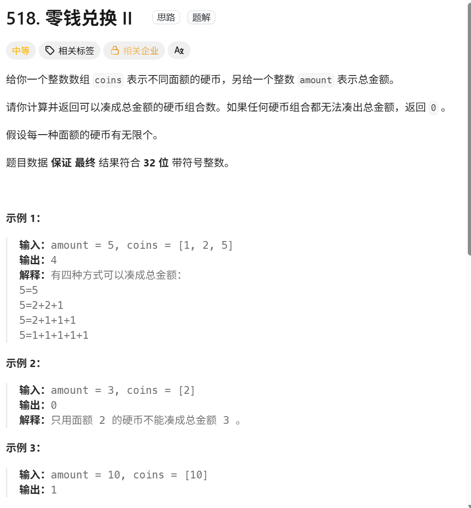

这道题求的是**组合数**（[1, 2] 和 [2, 1] 算同一种），所以外层必须是**物品**，内层是**容量**。


###  思路

#### 一维数组

**1.dp【j】： 容量为 j 的情况下 ，最多有多少种 组合**

2.这道题求的是**组合数**（[1, 2] 和 [2, 1] 算同一种），所以外层必须是**物品**，内层是**容量**。 如果反了之后 ，那就是排列了

3.和之前01背包不同的就是一维数组 里面的for循环 是正序的

4.  dp[0] = 1  初始化：凑成总金额 0 的组合数只有 1 种（即什么都不选） 最多初始第一个值 ，因为这是一维的


#### 二维数组

1.dp【i】【j】：**使用0到i的 个硬币**（即 `coins[0]` 到 `coins[i]`），凑出总金额 `j` 的组合数**

2.关于数组下标 以及初始化，因为要物品一共有len（coins）个，但是从0开始的，所以return dp【len（coins）-1】【amount】

### 伪代码

```python
									1. 一维数组

#dp【j】： 容量为 j 的情况下 ，最多有多少种 组合

class Solution:
    def change(self, amount: int, coins: List[int]) -> int:
        # dp[j] 表示：凑成总金额 j 的硬币组合数
        dp = [0] * (amount + 1)
        
        # 初始化：凑成总金额 0 的组合数只有 1 种（即什么都不选）
        dp[0] = 1
        
        # 外层循环：遍历物品（硬币）
        for i in range(0,len(coins)):
            # 内层循环：遍历背包容量
            # 注意：这里必须是从小到大（正序）遍历！
            # 容量 j 从coins【i】开始判断，因为容量得大于coins【i】 才能选择加还是不加 
            for j in range(coins[i], amount + 1):
                # 状态转移方程：求组合数用累加 (+=)
                dp[j] = dp[j] +dp[j - coins[i]] # 不取物品i   取物品i
                
        return dp[amount]
    
    
    
    								2.二维数组
class Solution:
    def change(self, amount: int, coins: list[int]) -> int:
        dp=[[0]*(amount+1) for _ in range(0,len(coins))]

        for j in range(0,(amount+1)): #这里从第一列开始初始化 只要j是coins【0】的倍数的话 ，就填1 
            if j %coins[0]==0:
                dp[0][j]=1


        for i in range(1,len(coins)):#第二行开始    物品
            for j in range(0,amount+1): #第一列开始 容量
                if coins[i]>j:#物品大于容量 直接不用考虑取还是不取，
                    dp[i][j]=dp[i-1][j]
                else :
                    dp[i][j]=dp[i-1][j]+dp[i][j-coins[i]] #第一个是不取 ，就直接继承正上方的方案个数  第二个取：就拿左方的方案个数
        return dp[len(coins)-1][amount]

    
```


## 组合综合IV

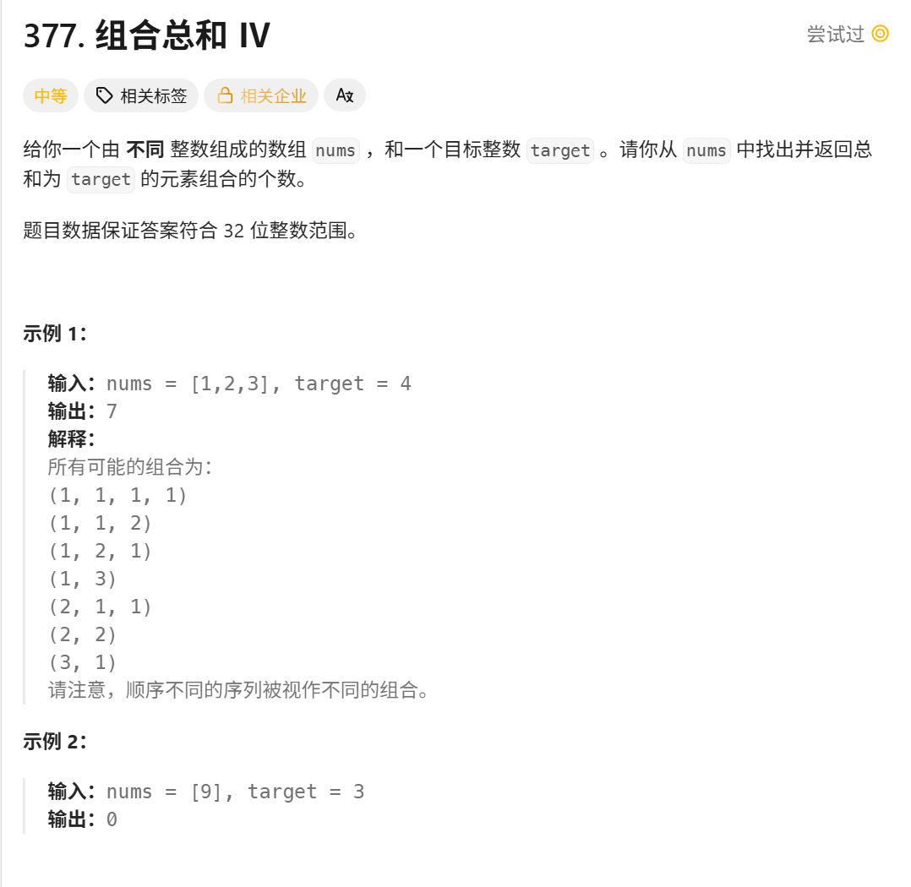


###  思路

1.**`dp[j]` 表示：从 `nums` 数组中挑选数字（每个数字可以使用无限次），使得它们的和恰好等于 `j` 的【排列方案总数】。**

2.此题相对于上一题来说就是换了for循环的顺序

3.一维数组进行双重for循环的时候，两个for都是正序 ，				外层物品，内层背包（组合）		外层背包，内层物品 （排列）

4.注意要加判断 ，j>=nums[i]: 不然数组会越界


### 伪代码

```python
									1.一维数组
class Solution:
    def combinationSum4(self, nums: list[int], target: int) -> int:
        ##if target>sum(nums): 这个是对于01背包的  因为对于完全背包是可以重复使用的
        ##    return 0 

        dp=[0]*(target+1)#一共target+1中背包容量
        dp[0]=1

        for j in range(1,target+1):
            for i in range(0,len(nums)):
                if j>=nums[i]:
                    dp[j]=dp[j]+dp[j-nums[i]]
        return dp[target]
        
        							2.二维数组 (不好写，不写了)
          
```


