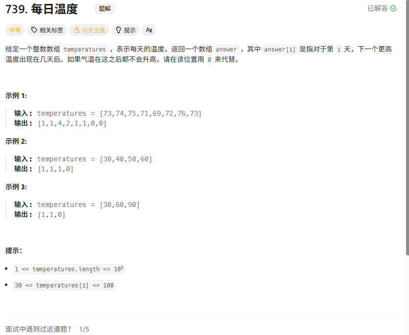
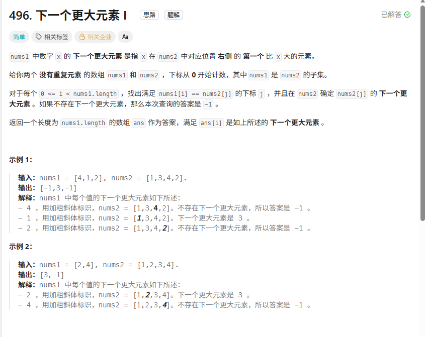
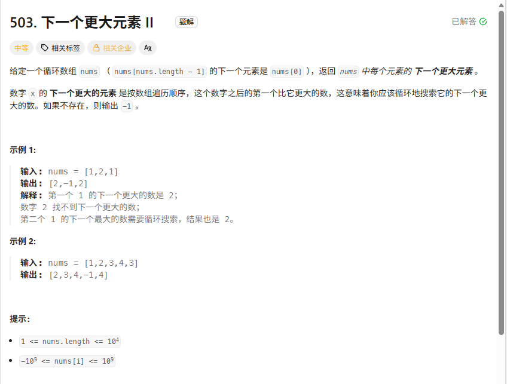
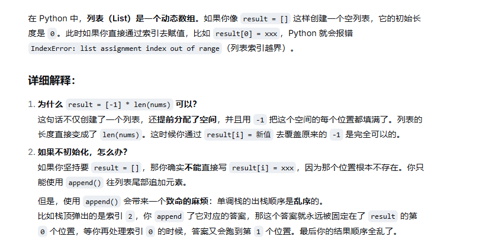
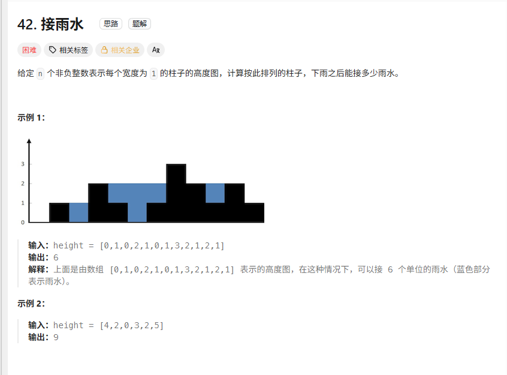
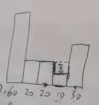
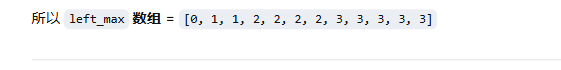
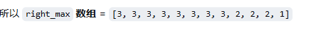
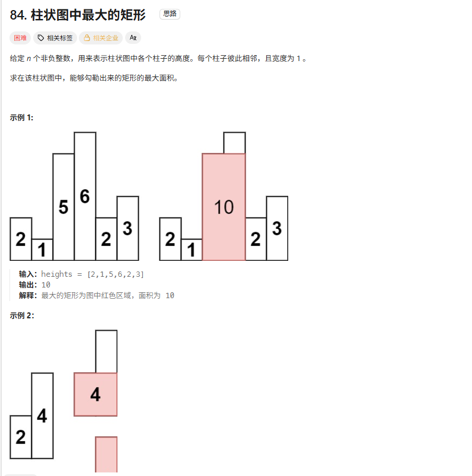

# 单调栈

通常是⼀维数组，要寻找任⼀个元素的右边或者左边第⼀个⽐⾃⼰⼤或者⼩的元素的位置，此时我们就要想到可以
⽤单调栈了。时间复杂度为O(n)。  


增是指从入口到栈底顺序

单调递增---寻找比自己大的后面的元素

单调递减---寻找比自己小的元素的位置

```python
       #很经典的为什么要从1开始以及怎么从1开始的问题
   		 left_max[0] = height[0]  
        for i in range(1,n):      # 不能从0开始否则代码报错
            left_max[i]=max(left_max[i-1],height[i])
```


## 739每日温度



###  思路

单调栈所以是单调 的栈  ，要去保证栈里面的是单调的 ，单调递增---

### 伪代码

```python
#保持栈是单调递增 ，stack储存的是下标
class Solution:
    def dailyTemperatures(self, temperatures: list[int]) -> list[int]:
        result= [0]*len(temperatures)
        stack=[0] 

        for i in range(1,len(temperatures)):
            if temperatures[i]<temperatures[stack[-1]]: #新加入的比栈顶元素小,那就直接加进去
                stack.append(i)
            elif temperatures[i]==temperatures[stack[-1]]: #新加入的比栈顶元素相等,那就直接加进去
                stack.append(i)
            else : #新加入的比栈顶元素大 ，那就开始储存result
                while stack and temperatures[i]>temperatures[stack[-1]]: 
                    #有可能一次弹出多个，所以while判断
                    result[stack[-1]]=i-stack[-1] # 说明找到了最近的比stack-1大的值
                    stack.pop()
                stack.append(i)#完全搞完了再放到这里
        return result

        
```


、


## 下一个更大的元素I

[496. 下一个更大元素 I - 力扣（LeetCode）](https://leetcode.cn/problems/next-greater-element-i/description/)

###  思路

1.用map记录 ，第一个key值为nums2里面的数值 ，第二个为在nums2中比key值大的数字

2.num2继续用单调栈遍历，只不过是用umap记录结果罢了

### 伪代码

```python
class Solution:
    def nextGreaterElement(self, nums1: list[int], nums2: list[int]) -> list[int]:

        stack=[0] 
        umap = defaultdict(lambda: -1) #第一个key放 寻找的值 ，第二个放nums2中比寻找的值大的值
        result=[]

        for i in range(1,len(nums2)):#遍历nums2
            if nums2[i] < nums2[stack[-1]]:
                stack.append(i)
            if nums2[i] > nums2[stack[-1]]:
                while stack and nums2[i] > nums2[stack[-1]]:
                    umap[nums2[stack[-1]]]=nums2[i] #唯二区别在于用umap记录key寻找的值，value在nums2中比寻找的值大的值
                    stack.pop()
                stack.append(i)
        
        for i in range(0,len(nums1)):
            result.append(umap[nums1[i]]) 

        return result

```


## 下一个更大的元素II

[503. 下一个更大元素 II - 力扣（LeetCode）](https://leetcode.cn/problems/next-greater-element-ii/description/)




### 知识点：

如果result没有result=[-1]*len(nums)像这样初始化，就只能使用append这样的，不能直接result【】==xxxx



###  思路

对于题目的理解： 

  1 2 3 4 9 8 7 6  正常来说就是返回 2 3 4 9 -1 -1 -1   ，这道题循环所以返回 2 3 4 9 9 9 9 

1.既然要循环 那我直接  for i in range(1,len(nums)*2): 然后用idex=i%len(nums) 来确定在数组里的索引 （这是啥唯二区别）

2.循环 for i in range(1,len(nums)*2):

### 伪代码

```python
class Solution:
    def nextGreaterElements(self, nums: list[int]) -> list[int]:
        result=[-1]*len(nums)
        stack=[0]


        for i in range(1,len(nums)*2): #唯一区别在这里
            
            idex=i%len(nums) #唯二区别在这里

            if nums[idex]<=nums[stack[-1]]:
                stack.append(idex)
            if nums[idex]>nums[stack[-1]]:
                while stack and nums[idex]>nums[stack[-1]]:
                    result[stack[-1]]=nums[idex]
                    stack.pop()
                stack.append(idex)
        return result

        
```


## 接雨水




###  思路

我自己代码思路问题：

1. 接的雨水本来以为直接min(height[stack[-1]]-height[j],height[i]-height[j]) 取最小即可，然后每一个都计算就不乘宽度，但是如果像这样，就会漏掉10的第二组雨水了，所以还是得差值乘下标，雨水在代码里是横着算的，在这里右边的20 没有雨水计算，因为取的是min

2. 还要在while里面再去判断一下stack是否存在

3. 和之前的每日温度差不多 ，就加了一个cha的存在

4. 栈底最后一个j直接pop掉 ，要算它的雨水，你需要找它**左边**的柱子。可是它左边没有柱子了（栈空了），没有左边的墙，水就漏光了，怎么可能接得住水

   每一个计算雨水都是算的当前这个柱子上的雨水

   

   

   


双指针法：





1.双指针法是竖着算的雨水 ：所以是左边的最大值和右边最大值取最小 减去自身柱子的长度

2.left_max 从前往后，记录左侧开始的最大值  ，right_max从后往前开始 ，记录右侧开始的最大值（单调栈是找的下一个比当前值大的值）


### 伪代码

```python
								单调栈法--横着算的雨水
#从入口到栈底是单调递增的 所以雨水是一个格子一个格子收集的,之前的就弹出去了
class Solution:
    def trap(self, height: list[int]) -> int 
        result=[0]*len(height) #当前这个柱子上的雨水
        stack=[0]
        cha=0

        for i in range(1,len(height)):
            if height[i]<=height[stack[-1]]:
                stack.append(i)
            if height[i]>height[stack[-1]]:
                while stack and height[i]>height[stack[-1]]:
                    j=stack.pop() 			#区别在于 该柱子找到左右边界计算雨水 ，左边界在栈中
                    if not stack:
                        break
                    cha=min(height[i]-height[j],height[stack[-1]]-height[j])*(i-stack[-1]-1)
                    result[j]=cha

                stack.append(i)
        
        return sum(result)	
    							
        							双指针法-竖着算的雨水
class Solution:
    def trap(self, height: list[int]) -> int:
        if len(height)<2:
            return 0
        result=[]
        # 1. 提前算出每根柱子向左看的最大高度，和向右看的最大高度
        left_max=[0]*len(height)
        right_max=[0]*len(height)

        left_max[0] = height[0]  
        for i in range(1,len(height)):      # 不能从0开始否则代码报错
            left_max[i]=max(left_max[i-1],height[i])#左边历史的最高值

        right_max[len(height)-1] = height[len(height)-1]      
        for i in range(len(height)-2,-1,-1):
            right_max[i]=max(right_max[i+1],height[i])#右边历史的最高值
        
        for i in range(0,len(height)):
            water=min(left_max[i], right_max[i]) - height[i] 
            if water>0:         #也可能是负数呢
                result.append(water)

        return sum(result)a
        

    
    
```


## 柱状图中最大的矩形




###  思路

本地单调栈的解法和接雨水的题目是遥相呼应的。
接雨水是找每个柱子左右两边第一个大于该柱子高度的柱子，而本题是找每个柱子左右两边第一个小于该柱子的柱子。

柱状图中最大的矩形----单调递减

接雨水---单调递增


1.左边打补丁		 heights.insert(0,0)  #在前面也加一个0反正也不会弹出来参与计算 ，如果遇到 2 2 0 这种也不会去计算

2.右边打补丁：  heights.append(0)   #末尾插入0让他能去计算最后一些元素 如 2 3 4 也能计算  否则这里会漏掉计算过程

3.一开始还有点不理解为什么width=right-left-1 这样算的就是当前自己的柱子（从当前柱子开始算）

4. 当前的rigth保持 i    left=stack【-1】  就是当前i的值一直小于stack里的值后 ，就一直pop出来计算


### 伪代码

```python
#这题要找出比当前柱子小的左右两边的元素 ，所以用单调递减方法
class Solution:
    def largestRectangleArea(self, heights: list[int]) -> int:
        if not heights:
            return 0


        stack=[0]
        result=0
        heights.insert(0,0)   #在前面也加一个0反正也不会弹出来 ，如果遇到 2 2 0 这种也不会去计算
        heights.append(0)     #末尾插入0让他能去计算最后一些元素 如 2 3 4 也能计算

        for i in range(1,len(heights)):

            if heights[i]>=heights[stack[-1]]: #当前元素比栈之前的大 ： 单调递减
                stack.append(i) 
            if  heights[i]<heights[stack[-1]]: 
                #当前元素比栈之前的小， 找到了要计算的柱子，就是栈顶的柱子两边都比当前柱子小
                while stack and heights[i]<heights[stack[-1]]:
                    cur=stack.pop() #局部最高的柱子
                    if stack:		#因为有stack【-1】操作所以要判断
                        left=stack[-1]
                        right=i
                        width=right-left-1#第一个算的当前是当前柱子的面积--就他自己呀
                        area=width*heights[cur]
                        result=max(result,area)
                stack.append(i)
        return result

```


