# 回溯

什么时候需要一看就想得到回溯：

之前的结果需要保留，后面的继续去递归寻找，这种一下就能想到是回溯


回溯算法： 处理本层节点之后，再撤销掉下一层的结果继续递归

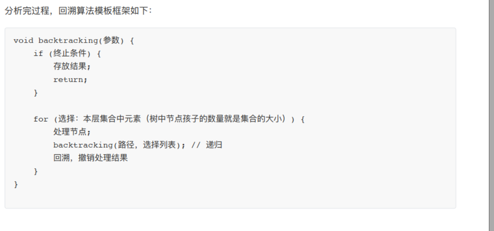


## 77组合

[77. 组合 - 力扣（LeetCode）](https://leetcode.cn/problems/combinations/description/)

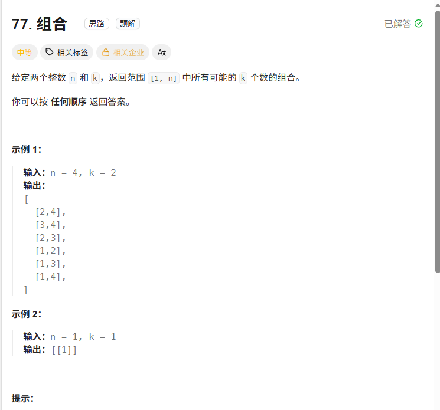


###  思路

感觉就是正常的回溯算法和递归算法，没啥思路hhh ，不过确实和这个一模一样


回溯算法： 处理本层节点之后，再撤销掉下一层的结果继续递归

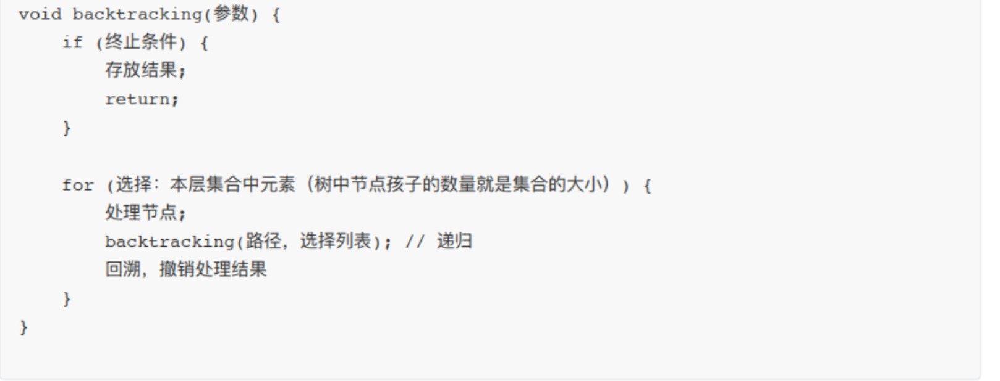

### 易错点：

### 知识点：

```python
 #  在 Python 中，list[:] 是一种切片语法。当你不指定起始和结束位置，只写一个冒号时，它代表从头到尾复制整个列表
# 	它会在内存中开辟一块全新的空间，把 self.path 当前的值一五一十地“抄”过去
```


### 重写一遍之后还会犯的错

### 伪代码

```python
										1.没有剪枝
class Solution:
    def backtracking(self,n,k,startIndex):
        if len(self.path)==k:
            self.result.append(self.path[:])
            return 

        for i in range(startIndex,n+1):
            self.path.append(i)
            self.backtracking(n,k,i+1)
            self.path.pop()   #这里就体现出了回溯 ： 下一层结果不影响上一层，path还是原来那个path


    def combine(self, n: int, k: int) -> list[list[int]]:
        self.result=[]
        self.path=[]
        self.backtracking(n,k,1)
        return self.result
    

    
  										  2.加上剪枝
    #就是在第8行
      for i in range(startIndex,n+1):
            替换为
      for i in range(startIndex, n - (k - len(self.path)) + 2):
        
        
        # n - (k - len(self.path)) + 2 再外后的话就说明数字都不够用了，再往后也没用		比如 i：2 3 4 ，i到3的时候 如果k是4 ， 后面数字都不够用，无效
       	1.n为总长度 ，k为需要的个数  
        k-len(self.path)： 还需要多少
        
        2.如果我们选了 i，那么从 i 到 n 这段区间里，一共有多少个数字？
        n - i + 1  #比如 n=4，当前 i=2，那 2, 3, 4 一共是 4 - 2 + 1 = 3 个数字
         
        3.从 i 到 n 的数字总个数 >= 还差的个数
        n - i + 1 >= k - len(self.path)
        
        4.数学变形
        n + 1 - (k - len(self.path)) >= i
        
        5.但是python是右闭所以再+1
        
```


## 组合优化：其实就是剪枝没啥说的


## 组合总和III

[216. 组合总和 III - 力扣（LeetCode）](https://leetcode.cn/problems/combination-sum-iii/description/)

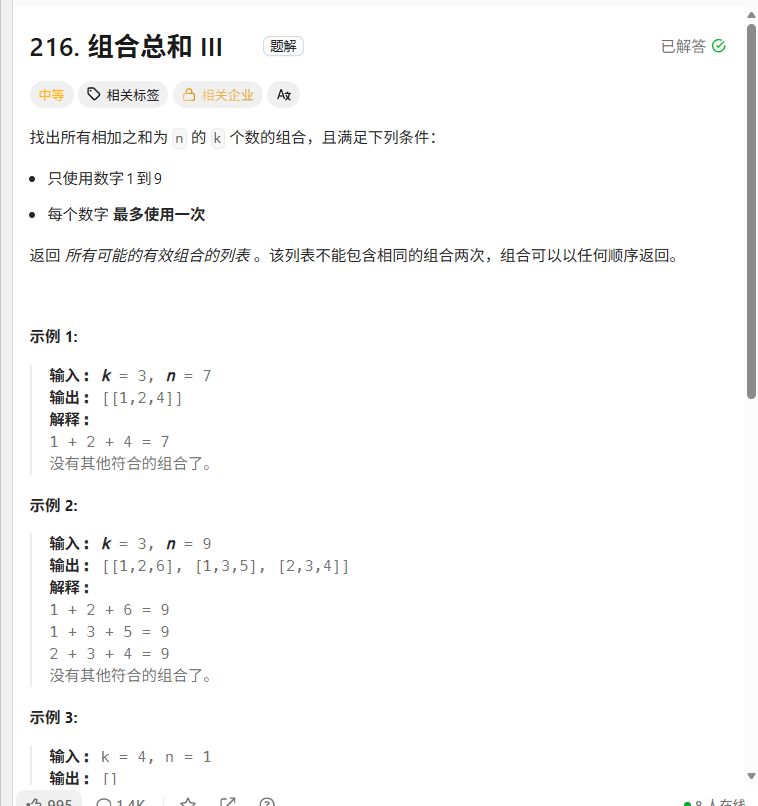


###  思路

**和上一题差不多 区别有以下几点：**

**1.加了sum作为总和去判断 ，处理方式和path一模一样**

2. **2步剪枝： 1. 数量剪枝  9 - (k - len(self.path)) + 2       2.总和剪枝 if self.sum>n:**

### 易错点：

### 伪代码

```python
class Solution:

    def backtracking(self,n,k,startIndex):
        if self.sum>n: #第一步剪枝：如果当前和已经大于目标和 n，直接返回（因为后面的数字只会让和更大）
            return 

        if len(self.path)==k:
            if self.sum==n:
                self.result.append(self.path[:])
            return 
        
        for i in range(startIndex,9 - (k - len(self.path)) + 2): #第二步剪枝 后面的数字不够用了
            self.sum+=i
            self.path.append(i)
            self.backtracking(n,k,i+1)
            self.path.pop()
            self.sum-=i

    def combinationSum3(self, k: int, n: int) -> List[List[int]]:
        self.result=[]
        self.path=[]
        self.sum=0

        
        self.backtracking(n,k,1)
        return  self.result
    
    
    
    							# 或者把剪枝放在这个for循环里也可以
        for i in range(startIndex,9 - (k - len(self.path)) + 2): 
            if self.sum+i>n: #剪枝 #一定要这样写不要先加起来再去比较，会造成污染
                return 
            self.sum+=i
            self.path.append(i)
            self.backtracking(n,k,i+1)
            self.path.pop()
            self.sum-=i
```


## 17电话号码的字母组合

[17. 电话号码的字母组合 - 力扣（LeetCode）](https://leetcode.cn/problems/letter-combinations-of-a-phone-number/)

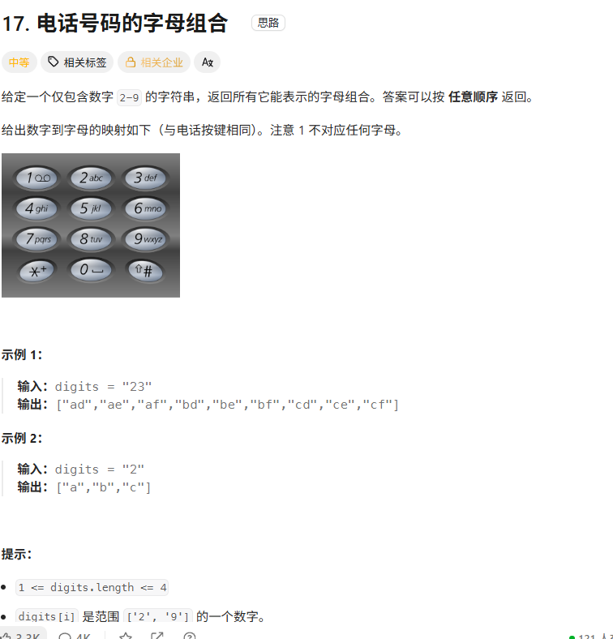

###  思路

### 易错点

#### 1.字符串如何拼接

​    **self.result.append(self.path[:])  #记得要去 用： 去赋值  但在这里也不行，运行出来的结果是这** **个 ，这样就是纯拼接字符串，会自动加上**

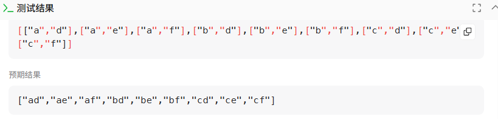

**self.result.append("".join(self.path)) # 将字符列表拼接成字符串**  **这样就是把path按照没有空格的形式拼接**

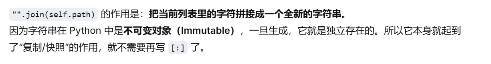

#### digits是字符不是数字

**digits[i] 是字符，需要转为整数才能作为 letterMap 的索引**


### 重写一遍之后还会犯的错

### 伪代码

```python
								1.我自己写第一遍的答案（第一层for完全可以舍去，因为不需要像之前组合那样抛弃第一个字符）
class Solution:
    letterMap = [
    "",     # 0
    "",     # 1
    "abc",  # 2
    "def",  # 3
    "ghi",  # 4
    "jkl",  # 5
    "mno",  # 6
    "pqrs", # 7
    "tuv",  # 8
    "wxyz"  # 9
]
    def backtracking(self,digits,startIndex):
         # 终止条件：路径长度等于数字字符串长度
        if len(self.path)==len(digits):
            self.result.append("".join(self.path)) # 将字符列表拼接成字符串
            return 

        for i in range(startIndex,len(digits)):#------------------------------------这个for循环不需要
            # 注意：digits[i] 是字符，需要转为整数才能作为 letterMap 的索引
            digit=int (digits[i])
            for letter in  self.letterMap[digit]:
                self.path.append(letter)
                self.backtracking(digits,i+1 )
                self.path.pop()


    def letterCombinations(self, digits: str) -> list[str]:
        self.result=[]
        self.path=[]
        self.backtracking(digits,0)
        return self.result
    
    
    
    									2.不需要外层循环的代码
class Solution:
    letterMap = [
    "",     # 0
    "",     # 1
    "abc",  # 2
    "def",  # 3
    "ghi",  # 4
    "jkl",  # 5
    "mno",  # 6
    "pqrs", # 7
    "tuv",  # 8
    "wxyz"  # 9
]
    def backtracking(self,digits,startIndex):
         # 终止条件：路径长度等于数字字符串长度
        if len(self.path)==len(digits):
            self.result.append("".join(self.path)) # 将字符列表拼接成字符串
            return 

      
            # 注意：digits[startIndex] 是字符，需要转为整数才能作为 letterMap 的索引
        digit=int (digits[startIndex])
        for letter in  self.letterMap[digit]: #这里是从字map的字母a开始
            self.path.append(letter)
            self.backtracking(digits,startIndex+1 )
            self.path.pop()


    def letterCombinations(self, digits: str) -> list[str]:
        self.result=[]
        self.path=[]
        self.backtracking(digits,0)
        return self.result
```


## 39组合总和

[39. 组合总和 - 力扣（LeetCode）](https://leetcode.cn/problems/combination-sum/)

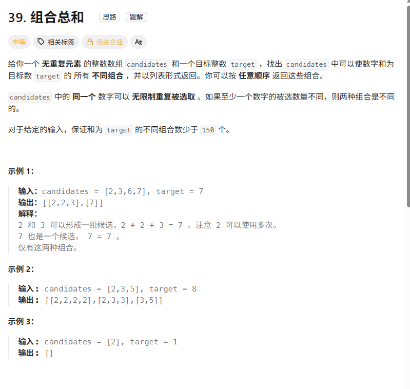


###  思路


```python
	#版本一：我是想用going去作为标志位，如果sum加起来大于target的话，就直接让i+1去递归，但是going干扰了每一层的走向
    
    
    1.我自己写的代码（使用self.going去判断到底什么时候i+1----但是还是会报错，因为going没考虑好）
class Solution:
    def backtracking(self,candidates,target,startIndex):
        if self.sum>target:			#在这里剪枝 然后用going当做标志位
            self.going=1
            return 
        if self.sum==target:
            self.result.append(self.path[:])
            return

        for i in range(startIndex,len(candidates)):
            self.sum+=candidates[i]
            self.path.append(candidates[i])
            #going在这里
            if self.going==1:
                self.backtracking(candidates,target,i+1)
            else:
                self.backtracking(candidates,target,i)
                
            self.sum-=candidates[i]
            self.path.pop()

    def combinationSum(self, candidates: list[int], target: int) -> list[list[int]]:
        self.result=[]
        self.path=[]
        self.sum=0

        self.going=0

        self.backtracking(candidates,target,0)
        return self.result
    
    
    
    
    
```

```python
 '''
 版本二：直接把剪枝放到for循环里，排好序的candidates  ，如果sum值加起来都大于target，直接跳出循环   	
 		直接break出去跳出这一页层for循环	，后面的也一直会break掉
 		
 		
 版本三： 不用排序  candidates.sort() ，break直接替换continue   ，但是这样会全部都遍历一遍，没达到兼职的效果
 '''		
    
    
    		2.把剪枝放到了for循环里面 ，然后这样就能跳出for循环去让i+1了！！！！妙哉妙哉
    class Solution:
    def backtracking(self,candidates,target,startIndex):

        if self.sum==target:
            self.result.append(self.path[:])
            return

        for i in range(startIndex,len(candidates)):
            if self.sum+ candidates[i] > target:		#一定要这样写不要先加起来再去比较，会造成污染
                break
            self.sum+=candidates[i]
            self.path.append(candidates[i])
            self.backtracking(candidates,target,i)
            self.sum-=candidates[i]
            self.path.pop()

    def combinationSum(self, candidates: list[int], target: int) -> list[list[int]]:
        self.result=[]
        self.path=[]
        self.sum=0
        # 必须先排序，才能使用上面的 break 剪枝
        candidates.sort()       
        self.backtracking(candidates,target,0)
        return self.result
```


## 40组合总和II

[40. 组合总和 II - 力扣（LeetCode）](https://leetcode.cn/problems/combination-sum-ii/description/)

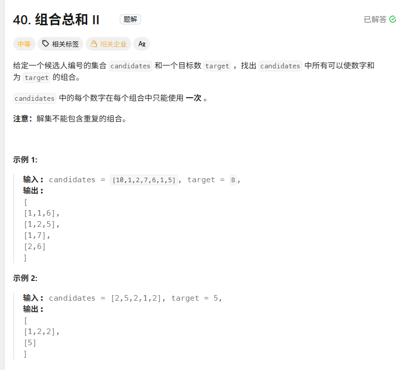


###  思路：

和之前的代码区别就在这一行，这样就可以去掉重复的树层，我之前一直在想 如果 11123  target=6 那会不会用这个去掉了正确结果   1113  123 

其实如果数字一样，一定是前面的数字的可能性更多也更全，后面的基本不可能了

​      if i > startIndex and candidates[i] == candidates[i-1]:

​        continue


（经过重写代码的时候我发现了一个细节）：

```python
      if i > startIndex and candidates[i] == candidates[i-1]: #和之前代码区别就在这，去重
              continue
            
有这个能保证			1 2 2 的存在   还可以去除 1 2 的重复   
有这个能保证			1 2 2 的存在   还可以去除 1 2 的重复            
有这个能保证			1 2 2 的存在   还可以去除 1 2 的重复            
有这个能保证			1 2 2 的存在   还可以去除 1 2 的重复            
这里 i > startIndex 是实现去重的关键 ，比如 1 2 2 3  选择了 1 2 之后，跳过了第一个2就进入了第二个2，这样才会重复
这是本层的第一个选择，无论选什么都不会和“本层之前的自己”重复
```


脑子思维定式了

### 伪代码

```python
									1.用set（）去重
class Solution:
    def backtracking(self, candidates: list[int], target: int, curr_sum: int, start_index: int):
        # 终止条件：如果当前和等于目标值，保存结果并返回
        if curr_sum == target:
            self.result.append(self.path[:])
            return
        
        # 定义 set 对本层元素去重
        used_set = set()
        
        for i in range(start_index, len(candidates)):
            # 剪枝：如果当前和加上当前元素已经超过目标值，因为数组已排序，后面的更大，直接结束循环
            if curr_sum + candidates[i] > target:
                break
            # 如果本层已经使用过该元素，则跳过
            if candidates[i] in used_set:
                continue
            used_set.add(candidates[i]) 
            curr_sum += candidates[i]    
            self.path.append(candidates[i]) 
            # 递归，注意这里是 i + 1，因为每个数字在每个组合中只能用一次
            self.backtracking(candidates, target, curr_sum, i + 1)
            curr_sum -= candidates[i]
            self.path.pop()
            
    def combinationSum2(self, candidates: list[int], target: int) -> list[list[int]]:
        self.result = []
        self.path = []
        
        # 去重前必须排序，让相同的元素相邻
        candidates.sort()
        
        self.backtracking(candidates, target, 0, 0)
        return self.result


										2.排序之后用算法去重
class Solution:

    def backtracking(self,candidates,target,startIndex):
        if self.sum==target :
            self.result.append(self.path[:])
            return 

        for i in range(startIndex,len(candidates)):
            if self.sum+candidates[i]>target:#一定要这样写不要先加起来再去比较，会造成污染
                break
            if i > startIndex and candidates[i] == candidates[i-1]: #和之前代码区别就在这，去重
                continue
            self.sum+=candidates[i]
            self.path.append(candidates[i])
            self.backtracking(candidates,target,i+1)
            self.sum-=candidates[i]
            self.path.pop()

    def combinationSum2(self, candid	ates: list[int], target: int) -> list[list[int]]:
        self.result=[]
        self.path=[]
        self.sum=0
        candidates.sort()
        self.backtracking(candidates,target,0)
        return self.result

```


## 131分割回文串

[131. 分割回文串 - 力扣（LeetCode）](https://leetcode.cn/problems/palindrome-partitioning/)

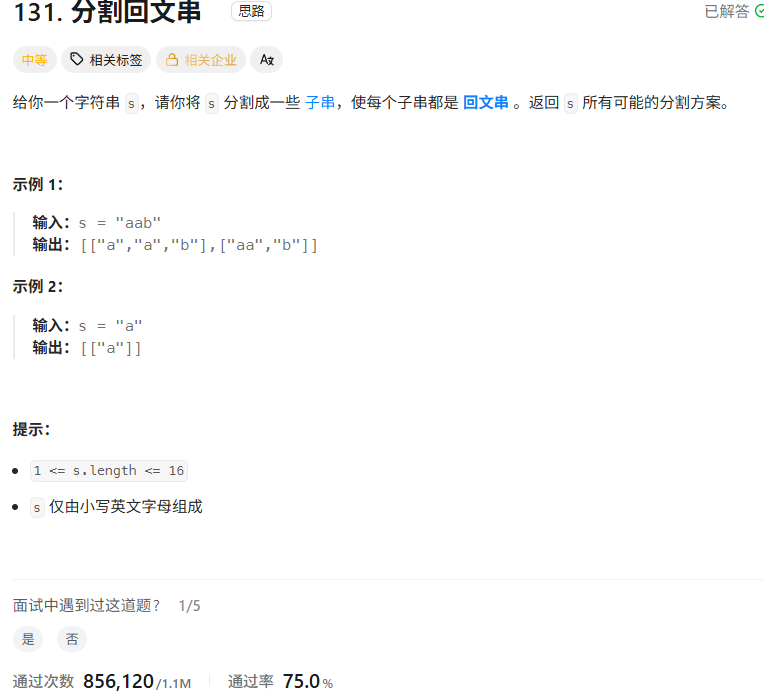


###  思路

1.终止条件：startIndex大于len（s）就直接放到结果，都分割到这一步了，直接累加

2.我感觉和之前没啥区别呀，不就多加了一个判断回文，有啥写不出来的

### 伪代码

```python
														1.没剪枝（用函数判断是否回文串）
class Solution:
    # 判断是否为回文串（使用 Python 的翻转切片写法，最简洁）
    def isPalindrome(self, s: str, start: int, end: int) -> bool:
        sub_string = s[start : end + 1]
        return sub_string == sub_string[::-1]

    def backtracking(self,s,startIndex,endIndex):
        if  startIndex>=len(s):
            self.result.append(self.path[:])
            return 

        for i in range(startIndex,endIndex):
            if self.isPalindrome(s,startIndex,i):
                self.path.append(s[startIndex:i+1])
                self.backtracking(s,i+1,endIndex)
                self.path.pop()


    def partition(self, s: str) -> list[list[str]]:
        self.result=[]
        self.path=[]
        self.backtracking(s,0,len(s))
        return self.result

															2.遍历字符串后用dp数组记录回文串，然后查询
class Solution:
    def backtracking(self, s: str, startIndex: int, dp: list[list[bool]]):
        # 终止条件：起始位置等于字符串长度
        if startIndex == len(s):
            self.result.append(self.path[:])
            return

        for i in range(startIndex, len(s)):
            # 【优化】直接查表，O(1) 时间判断是否为回文
            if dp[startIndex][i]:
                self.path.append(s[startIndex : i + 1])
                self.backtracking(s, i + 1, dp)
                self.path.pop()  
                
    def partition(self, s: str) -> list[list[str]]:
        self.result = []
        self.path = []
        n = len(s)
        
        # 【优化核心】构建 DP 数组，dp[i][j] 表示 s[i..j] 是否是回文串
        # 初始化全为 False
        dp = [[False] * n for _ in range(n)]
        
        # 必须从下往上、从左往右遍历，因为 dp[i][j] 依赖于 dp[i+1][j-1]
        for i in range(n - 1, -1, -1):
            for j in range(i, n):
                if s[i] == s[j]:
                    # 如果只有 1 个字符 (i==j)，或 2 个字符 (j - i == 1)，直接是回文
                    # 否则看中间部分 dp[i+1][j-1] 是不是回文
                    if j - i <= 1:
                        dp[i][j] = True
                    else:
                        dp[i][j] = dp[i + 1][j - 1]
        
        # 将 dp 数组传给回溯函数
        self.backtracking(s, 0, dp)
        return self.result

    
```


二维dp数组长这样：

用这张图可以看出如果s[i] == s[j]  那么就查找dp[i+1][j-1]     看看是不是回文，是的话他就也是因为首尾已经一样，里面的再是回文就一样了

至于for循环的顺序： 因为 dp[i][j] 依赖于 dp[i+1][j-1]

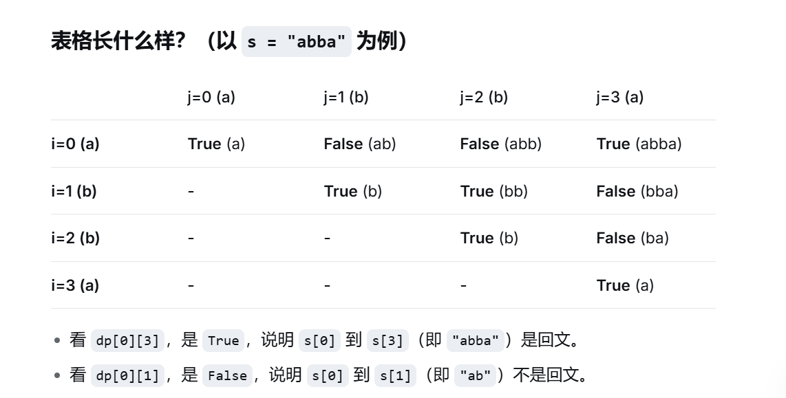


## 93复原IP地址

[93. 复原 IP 地址 - 力扣（LeetCode）](https://leetcode.cn/problems/restore-ip-addresses/)

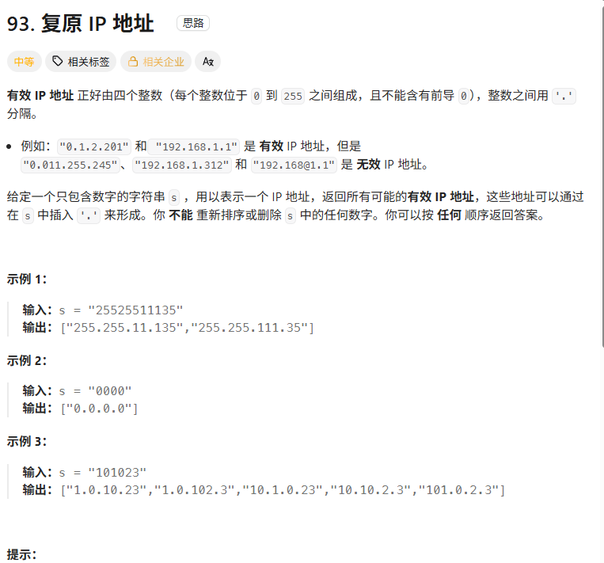


### 知识点：

```python
 s[startIndex:endIndex] ： #字符串的索引是左开右闭的

    #在判断是否true的时候
    elif int(s[startIndex])==0 and int(s[startIndex:endIndex])>0  我原来写的是这个  但是如果遇到0010 还是不行
```


### 易错点：

**`startIndex == len(s)-1` 不是"用完"。** 它是"还剩最后一个字符没处理"。用完应该是 `startIndex == len(s)`。

**) 段数没控制。** IP 必须恰好 4 段。你可能切 2 段、3 段、5 段都返回，结果全错。

```python
       所以最后的判断结果为
    
    if len(self.path) == 4:
            if startIndex == len(s):#最后的索引到达了最后值
                self.result.append(self.path[:])
                return 
```


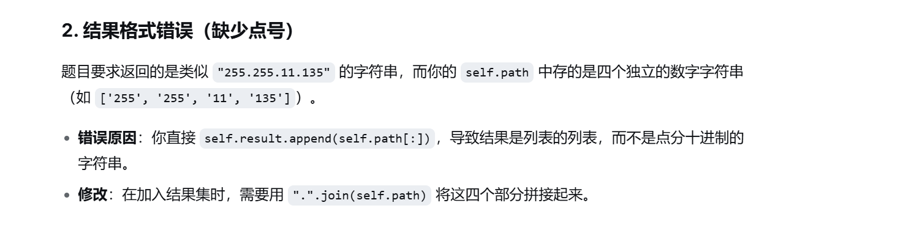


### 思路

和分割回文串一样，只不过这里有好多细节要去注意：写的时候注意istrue要是左闭右开的，所以传入endIndex的时候要+1


1.最终结果的返回 要经过两个if  ，第一个判断长度为4 ，第二个判断startIndex=len（s） 也就是到达了s之外

2. s【startIndex，endIndex】是没有索引到endIndex的，也就是左闭右开的
3. self.result.append(".".join(self.path))  最后的结果要加点，所以要这样写，我还是一直没想到，还想用+“.”的方式
4. int(s[startIndex])==0 and endIndex - startIndex > 1:  判断是否为真的的时候，首位为0 那长度还大于1 那就直接false

### 伪代码

```python
class Solution:
    def istrue(self,s,startIndex,endIndex): #s[] 字符串的索引左闭右开 ，传入的endIndex就是要索引不到的
        if startIndex >= endIndex:          # 空区间，补上
            return False        
        if int(s[startIndex:endIndex])>255 or  int(s[startIndex:endIndex])<0: #这个数超过范围
            return False
        elif int(s[startIndex])==0 and endIndex - startIndex > 1:#这个数首位为0但是后面不为0
            return False
        return True

    def backtracking(self,s,startIndex):
        if len(self.path) == 4:
            if startIndex == len(s):#最后的索引到达了最后值
                self.result.append(".".join(self.path))
                return 

        for i in range(startIndex,len(s)):
            if self.istrue(s,startIndex,i+1): #注意判断的这个endIndex是左闭右开的 ，所以这里也要i+1
                self.path.append(s[startIndex:i+1])
                self.backtracking(s,i+1)
                self.path.pop()
            
    def restoreIpAddresses(self, s: str) -> list[str]:
        self.result=[]
        self.path=[]
        if len(s) < 4 or len(s) > 12:#剪枝1111
       		return self.result
        self.backtracking(s,0)
        return self.result
```


## 78子集

子集I   是 不重复的数组返回子集    子集II是重复的数组返回子集

1.子集I和其他的区别就在于 每path改变一次就要result 去append一次

2.子集II 区别在要排序之后还要去重         if i > startIndex and nums[i] == nums[i-1]:	


[78. 子集 - 力扣（LeetCode）](https://leetcode.cn/problems/subsets/description/)

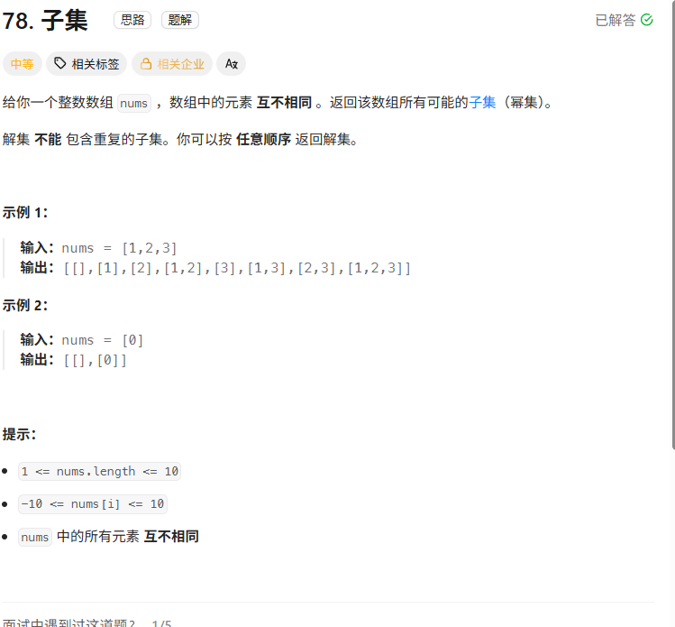


###  思路

只要知道顺序是这样加进去的就迎刃而解了  1   12   123   13   2   23   3  ，甚至比组合问题还简单hhh

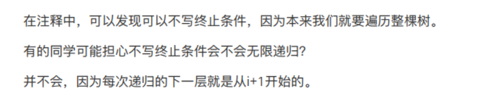

还有绞尽脑汁的几点：

1.**这一层的 结果要在写一个递归里面实现result.append（）**    **比如结果 `[1]`，是不是在选了 `1` 之后，进入下一层递归时才被记录下来的**

2.**不写终止结果也可以，因为for循环的边界已经治好了 这个返回**

### 伪代码

```python
class Solution:
    def backtracking(self,nums,startIndex):
        self.result.append(self.path[:]) #放到最前面因为空集是所有元素的集合
        if startIndex>=len(nums):
            return 

        for i in range(startIndex,len(nums)):
            self.path.append(nums[i])
            self.backtracking(nums,i+1)
            self.path.pop()

    def subsets(self, nums: list[int]) -> list[list[int]]:
        self.result=[]
        self.path=[]
        self.backtracking(nums,0)
        return self.result
    
    
    									2.如果实在不理解就把加入result放到for里面也可以
    
class Solution:
    def backtracking(self,nums,startIndex):

        if startIndex>=len(nums):
            return 

        for i in range(startIndex,len(nums)):
            self.path.append(nums[i])
            self.result.append(self.path[:]) 
            self.backtracking(nums,i+1)
            self.path.pop()

    def subsets(self, nums: list[int]) -> list[list[int]]:
        self.result=[]
        self.path=[]
        self.result.append([])
        self.backtracking(nums,0)
        return self.result
```


## 子集II

[90. 子集 II - 力扣（LeetCode）](https://leetcode.cn/problems/subsets-ii/)

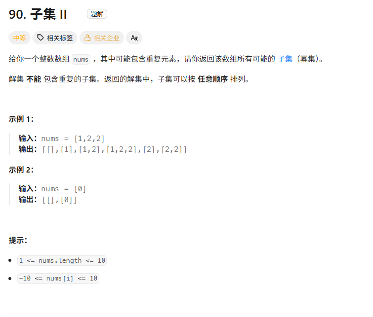

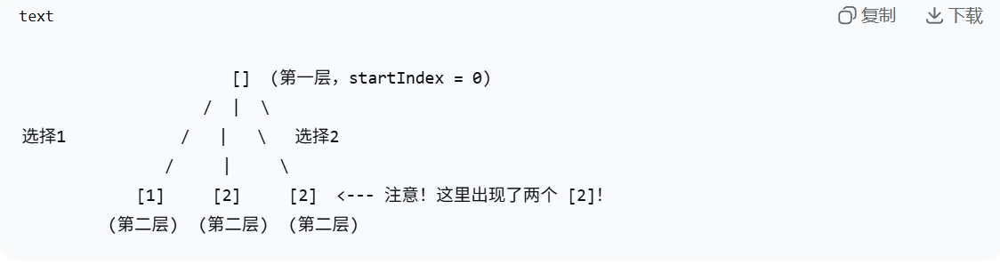


###  思路

​	和最普通的回溯区别就在用在了这行代码 if i > startIndex and nums[i] == nums[i-1]: 去重，如果只是nums[i] == nums[i-1] 运行就会报错如下：

会缺少 1 2 2这个结果的存在

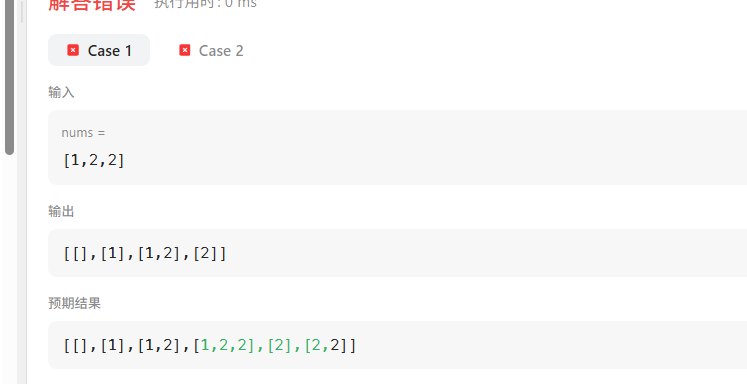

（经过重写代码的时候我发现了一个细节）：

```python
      if i > startIndex and candidates[i] == candidates[i-1]: #和之前代码区别就在这，去重
              continue
            
这里 i > startIndex 是实现去重的关键 ，比如 1 2 2 3  选择了 1 2 之后，跳过了第一个2就进入了第二个2，这样才会重复

有这个能保证			1 2 2 的存在   还可以去除 1 2 的重复
有这个能保证			1 2 2 的存在   还可以去除 1 2 的重复            
有这个能保证			1 2 2 的存在   还可以去除 1 2 的重复            
这是本层的第一个选择，无论选什么都不会和“本层之前的自己”重复 
这是本层的第一个选择，无论选什么都不会和“本层之前的自己”重复
这是本层的第一个选择，无论选什么都不会和“本层之前的自己”重复
这是本层的第一个选择，无论选什么都不会和“本层之前的自己”重复
```


### 伪代码

```python
										1.使用set（）去重	  也可以用数组去重的
class Solution:
    def backtracking(self, nums: list[int], start_index: int):
        # 收集子集，要放在终止添加的上面，否则会漏掉自己
        self.result.append(self.path[:])
        
        # 定义 set 对本层元素去重
        used_set = set()
        
        for i in range(start_index, len(nums)):
            # 如果本层已经使用过该元素，则跳过
            if nums[i] in used_set:
                continue
            
            used_set.add(nums[i])      # 记录这个元素在本层用过了
            self.path.append(nums[i])  # 处理节点
            self.backtracking(nums, i + 1) # 递归
            self.path.pop()            # 回溯，撤销处理的节点
    def subsetsWithDup(self, nums: list[int]) -> list[list[int]]:
        self.result = []
        self.path = []
        
        # 去重前必须排序，让相同的元素相邻
        nums.sort()
        
        self.backtracking(nums, 0)
        return self.result


            
            
            
            
            					2.使用i > startIndex and nums[i] == nums[i-1]算法去重

class Solution:
    def backtracking(self,nums,startIndex):


        for i in range(startIndex,len(nums)):
            if i > startIndex and nums[i] == nums[i-1]:		 #本层的第一个选择，无论选什么都不会和“本层之前的自己”重复 
                continue #这里不用break，因为后面的还有呢，又不是没了
            self.path.append(nums[i])
            self.result.append(self.path[:])
            
            self.backtracking(nums,i+1)
            self.path.pop()


    def subsetsWithDup(self, nums: list[int]) -> list[list[int]]:
        self.result=[]
        self.path=[]
        self.result.append([])
        nums.sort()
        self.backtracking(nums,0)
        return self.result
    
    
    										  也可以用数组去重的
    
```


## 非递减子序列

[491. 非递减子序列 - 力扣（LeetCode）](https://leetcode.cn/problems/non-decreasing-subsequences/)

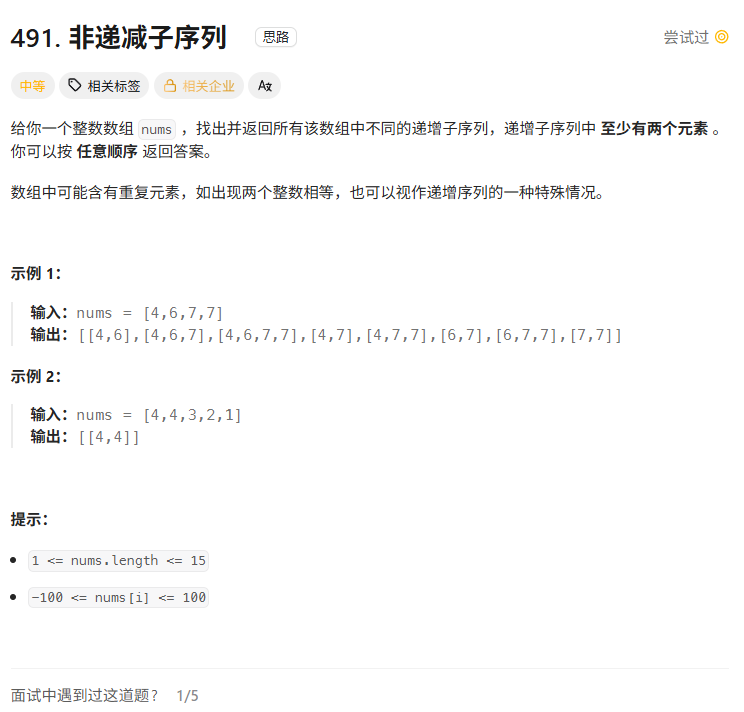


###  思路

1.此题是无序的，所以之前的完全不适用了

2.用集合set来储存每一层使用过的节点， set每一层都是自己新定义的

3.新的nums【i】 和self.path比较

### 易错点：

1.无序数组

```python
#判断要不要continue的时候  我写的nums[i]<nums[i-1]  但这个是有序的时候的，此题为无序
if nums[i] in used or nums[i]<nums[i-1]
```


###！！！！ 放在for里面和放在递归开头其实没啥区别，因为这两个顺序完全是一样的，进入了下个递归就要添加result ，习惯一种方法即可

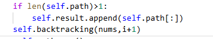

### 伪代码

```python
										1.添加result摆放的位置在外面
class Solution:
    def backtracking(self,nums,startIndex):
        if len(self.path)>1:
            self.result.append(self.path[:])

        used=set()#每一层都是新定义的set
        for i in range(startIndex,len(nums)):
            if nums[i] in used or (self.path and nums[i]<self.path[-1]):  #注意这里适合self.path比较
                continue
            used.add(nums[i]) 
            self.path.append(nums[i])
            self.backtracking(nums,i+1)
            self.path.pop()


    def findSubsequences(self, nums: list[int]) -> list[list[int]]:
        self.result=[]
        self.path=[]
        self.backtracking(nums,0)
        return self.result
    
    		
    										2.添加result的位置在for里面
    class Solution:
    def backtracking(self,nums,startIndex):


        used=set()
        for i in range(startIndex,len(nums)):
            if nums[i] in used or (self.path and nums[i]<self.path[-1]):
                continue
            used.add(nums[i]) 
            self.path.append(nums[i])
            if len(self.path)>1:
                self.result.append(self.path[:])
            self.backtracking(nums,i+1)
            self.path.pop()


    def findSubsequences(self, nums: list[int]) -> list[list[int]]:
        self.result=[]
        self.path=[]
        self.backtracking(nums,0)
        return self.result
```


## 46全排列


排列：全部的数字都要用上才叫排列，所以长度不需要再去判断了，也不需要startIndex，因为本来就需要全部遍

不重复的数组话，用set和数组都可以 ，因为都能实现判断是否使用过

重复的数组话，只能用数组，因为set只能存储不重复的，存不了重复的


而且排列开始不需要传递startIndex，因为全排列，全部都要进去


[46. 全排列 - 力扣（LeetCode）](https://leetcode.cn/problems/permutations/description/)

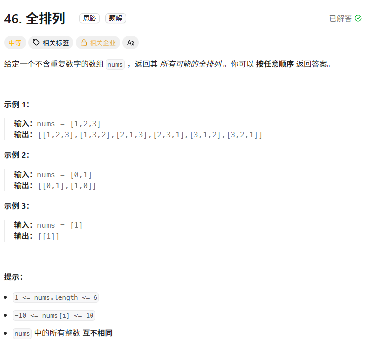


###  思路

在这里就不需要这一层是否重复了，因为这是全排列，全局定义self.used ，遇到有的就直接continue即可 ，记得去撤销标记 self.used.remove(nums[i]) 

上一题是这一层不能重复，也就是比如：4 7 7 8   478 其中两个7都会出现，就每一层 去重


**数组版本的空间复杂度要小一点，可以就学数组的也不赖**

**#这里没有排列是因为根本不需要去有判断是否有相同元素重复的情况**

### 伪代码

```python
    								1.数组版本
class Solution:
    def backtracking(self,nums):
        if self.path and len(self.path)==len(nums):
            self.result.append(self.path[:])
            

        
        for i in range(0,len(nums)):
            if self.used[i]:
                continue
            self.used[i]=True
            self.path.append(nums[i])
            self.backtracking(nums)
            self.path.pop()
            self.used[i] = False  	 # 回溯：撤销标记 ← 关键！

    def permute(self, nums: list[int]) -> list[list[int]]:
        self.used=[False]*len(nums)
        self.result=[]
        self.path=[]										#这里没有排列是因为根本不需要去有判断是否有相同元素重复的情况
        self.backtracking(nums)
        return self.result	
    
    
    
   									 2.set（）版本
class Solution:
    def backtracking(self,nums):
        if self.path and len(self.path)==len(nums):
            self.result.append(self.path[:])
            

        for i in range(0,len(nums)):
            if nums[i] in self.used:
                continue
            self.used.add(nums[i])
            self.path.append(nums[i])
            self.backtracking(nums)
            self.path.pop()
            self.used.remove(nums[i])    # 回溯：撤销标记 ← 关键！

    def permute(self, nums: list[int]) -> list[list[int]]:
        self.used=set() 
        self.result=[]
        self.path=[]
        self.backtracking(nums)
        return self.result
    
    

```


## 全排列II

[47. 全排列 II - 力扣（LeetCode）](https://leetcode.cn/problems/permutations-ii/)

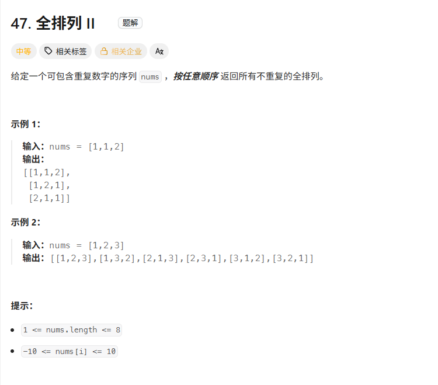


###  思路

这里有重复的元素，如果可以的话就排列一下


用nums[i-]  的 时候，记得判断i>0               if i > 0 and nums[i] == nums[i-1]

### 伪代码

```python
									  1.使用set（）去重
class Solution:
    def backtracking(self, nums: list[int], used: list[bool]):
        # 终止条件：当前排列长度等于原数组长度，说明找到了一个全排列
        if len(self.path) == len(nums):
            self.result.append(self.path[:])
            return
        
        # 定义 set 对本层元素去重
        used_set = set()
        
        for i in range(len(nums)):
            # 如果当前元素在本层已经使用过，则跳过
            if nums[i] in used_set:
                continue
            
            # 如果当前元素在全局(当前排列路径中)已经被使用过，则跳过
            if used[i]:
                continue
            
            used_set.add(nums[i])  
            used[i] = True          
            self.path.append(nums[i]) 
            self.backtracking(nums, used)
            self.path.pop()
            used[i] = False
    def permuteUnique(self, nums: list[int]) -> list[list[int]]:
        self.result = []
        self.path = []
        
        # 去重前必须排序，让相同的元素相邻
        nums.sort()
        
        # used 数组用于标记 nums 中的元素是否已经在当前排列中被使用
        used = [False] * len(nums)
        
        self.backtracking(nums, used)
        return self.result


										2.使用数组去重
class Solution:
    def backtracking(self,nums):
        if self.path and len(self.path)==len(nums):
            self.result.append(self.path[:])
            

        
        for i in range(0,len(nums)):
            if self.used[i]: #如果这个数已经用完了  # 剪枝1：下标 i 已经用过
                continue
           
            # 值相同 且 前一个相同值self.used是False → 说明前一个在"本层"已经选过了那这个相同的值也不用去排序了
             # 剪枝2：树层去重
            if i > 0 and nums[i] == nums[i-1] and not self.used[i-1]:
                continue

            self.used[i]=True           #标记使用过了
            self.path.append(nums[i])
            self.backtracking(nums)
            self.path.pop()
            self.used[i] = False  	 # 回溯：撤销标记 ← 关键！

    def permuteUnique(self, nums: list[int]) -> list[list[int]]:
        self.used=[False]*len(nums)
        self.result=[]
        self.path=[]
        nums.sort()  # ← 关键！必须排序
        self.backtracking(nums)
        return self.result
```


## 332重新安排行程

[332. 重新安排行程 - 力扣（LeetCode）](https://leetcode.cn/problems/reconstruct-itinerary/description/)

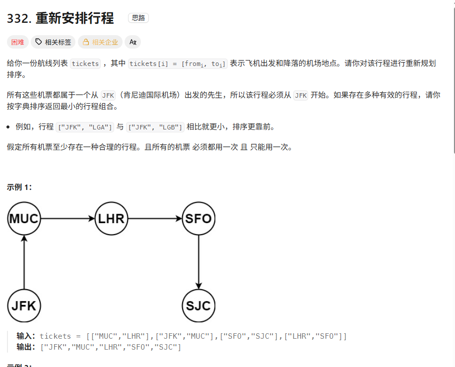


###  思路

### 易错点：

### 知识点：

```python
 

```


### 伪代码

```python
走到哪走到头（没票了），就在哪append，然后原路退回去，退回去接着走剩下的票。
旗子是"从终点插回起点"的，所以最后要倒过来读。


class Solution:
    
    def dfs(self, cur_from, tickets_dict, result):
        while tickets_dict[cur_from]:          # 还有出边
            cur_to = tickets_dict[cur_from].pop()   # 贪心走最小
            self.dfs(cur_to, tickets_dict, result)
        result.append(cur_from)                # 走完了才收集		result从后往收集的，最后要反转的，
    
    def findItinerary(self, tickets: list[list[str]]) -> list[str]:
        tickets_dict = defaultdict(list) #定义字典储存机票
        
        #把机票信息添加到字典
        for src, dst in tickets:
            tickets_dict[src].append(dst)
          #反向排序把字母小的放后面
        for src in tickets_dict:
            tickets_dict[src].sort(reverse=True)   # 反向排序配合 pop
        
        result = []
        self.dfs("JFK", tickets_dict, result)
        return result[::-1]
    
    
    
    
    
    		1.超时代码
    
    class Solution:
    def backrtacking(self,tickets_dict,tickets):
        if len(self.result)==len(tickets)+1:
            return True
        
        cur_from=self.result[-1]

        for i in range(len(tickets_dict[cur_from])):
            cur_to=tickets_dict[cur_from].pop(i)
            self.result.append(cur_to)

            if self.backrtacking(tickets_dict,tickets):
                return True

            #走到这里了，那就说明没通，把票插回去
            self.result.pop() 
            tickets_dict[cur_from].insert(i,cur_to) #i是下标位置，cur_to是原来pop出来的


    def findItinerary(self, tickets: list[list[str]]) -> list[str]:
        self.result=[] #返回结果

        tickets_dict=defaultdict(list)  #用字典储存飞机票信息

        #遍历飞机票，把它存到字典里
        for src,dst in tickets:
            tickets_dict[src].append(dst)

        for src in tickets_dict:
            tickets_dict[src].sort()

        self.result.append("JFK")
        if self.backrtacking(tickets_dict,tickets):
            return self.result
        return []
```


字典里面是这样储存的

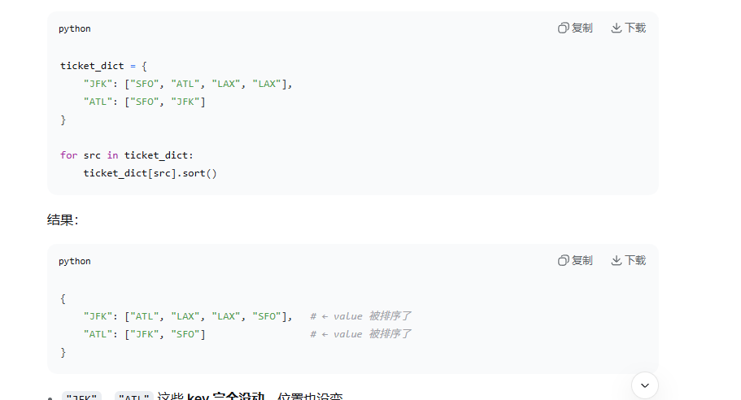


## N皇后

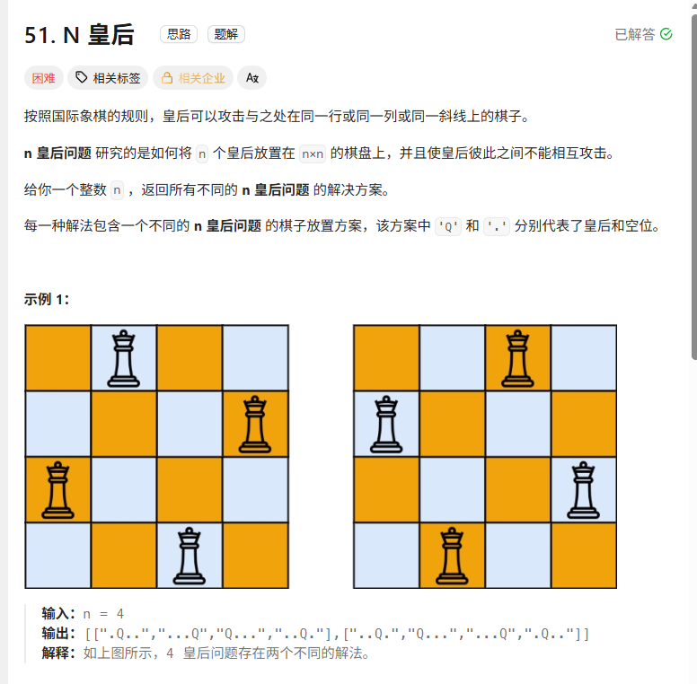


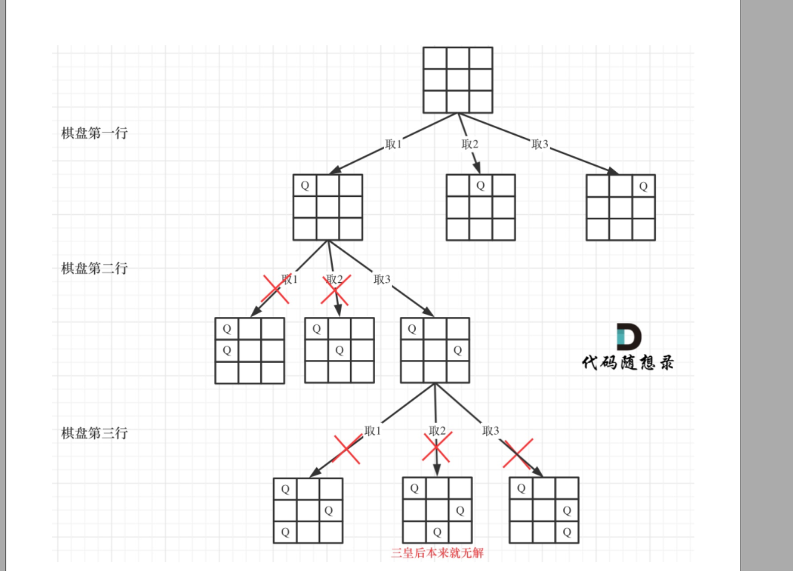

###  思路

先写一个判断是否可以放这的函数is_valid  ， 然后每一层循环遍历每个可以放的位置，


### 伪代码

```python
class Solution:
    def is_valid(self, row, col, chessboard, n): #要放的皇后的行和列 ，n是棋盘大小
        # 检查列：上面的行有没有皇后
        for i in range(row):
            if chessboard[i][col] == 'Q':
                return False
        
        # 检查 45 度角（左上方向）
        i, j = row - 1, col - 1
        while i >= 0 and j >= 0:
            if chessboard[i][j] == 'Q':
                return False
            i -= 1
            j -= 1
        
        # 检查 135 度角（右上方向）
        i, j = row - 1, col + 1
        while i >= 0 and j < n:
            if chessboard[i][j] == 'Q':
                return False
            i -= 1
            j += 1
        
        return True
    
    def backtracking(self, n, row, chessboard):
        if row == n:
            self.result.append([''.join(r) for r in chessboard])
            return
        
        for col in range(0,n):#这一行的每一列我都要试一遍
            if self.is_valid(row, col, chessboard, n): #没有被之前的皇后绞杀   切片规则 s不包括右边界
                chessboard[row] = chessboard[row][:col] + 'Q' + chessboard[row][col+1:]
                self.backtracking(n, row + 1, chessboard)
                #每次递归回来，都要把当前格恢复原样，好让 for 循环试下一个 col。
                chessboard[row] = chessboard[row][:col] + '.' + chessboard[row][col+1:]
    
    def solveNQueens(self, n: int) -> list[list[str]]:
        self.result = []
        chessboard = ['.' * n for _ in range(n)]
        self.backtracking(n, 0, chessboard)
        return self.result
```


## 解数独

[37. 解数独 - 力扣（LeetCode）](https://leetcode.cn/problems/sudoku-solver/description/)

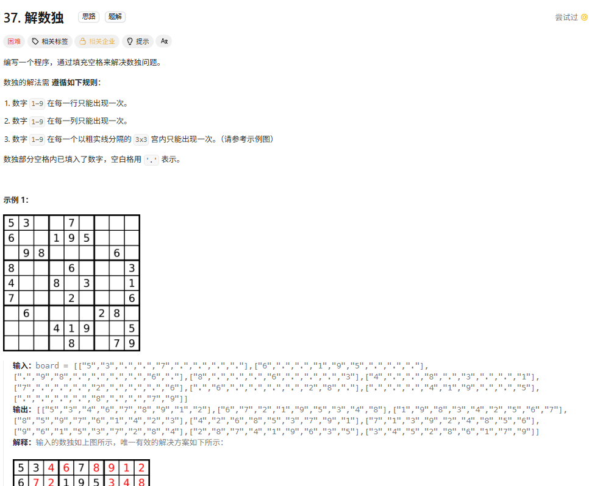


###  思路

先写一个函数is_valid判断是否可以放 ， 然后两层for循环 遍历一下所有格子 ， 对于空格子就尝试放1-9看看能不能放

### 伪代码

```python
class Solution:
    def solveSudoku(self, board: list[list[str]]) -> None:
        self.backtracking(board)
    
    def backtracking(self, board):
        # 遍历整个棋盘
        for i in range(len(board)):              # 遍历行
            for j in range(len(board[0])):       # 遍历列
                if board[i][j] != '.':           # 这个格子已经有数字了，跳过
                    continue
                
                # 空格子，尝试放 1~9
                for k in range(1, 10):
                    k = str(k)                   # 转成字符 '1'~'9'
                    if self.is_valid(i, j, k, board):   # (i,j) 放 k 是否合法
                        board[i][j] = k          # 放 k
                        if self.backtracking(board):    # 找到合适一组立即返回
                            return True
                        board[i][j] = '.'        # 回溯，撤销 k
                
                # 9 个数都试完了，都不行，返回 False
                return False
        
        # 遍历完没返回 False，说明找到合适棋盘了
        return True
    
    def is_valid(self, row, col, val, board):
        # 判断行里是否重复
        for i in range(9):
            if board[row][i] == val:
                return False
        
        # 判断列里是否重复
        for j in range(9):
            if board[j][col] == val:
                return False
        
        # 判断 3x3 九宫格里是否重复
        start_row = (row // 3) * 3
        start_col = (col // 3) * 3
        for i in range(start_row, start_row + 3):
            for j in range(start_col, start_col + 3):
                if board[i][j] == val:
                    return False
        
        return True
```


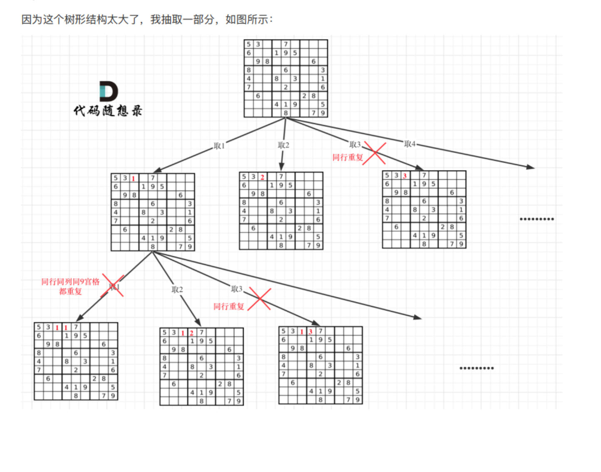

