# 贪心

贪⼼的本质是选择每⼀阶段的局部最优，从⽽达到全局最优。  

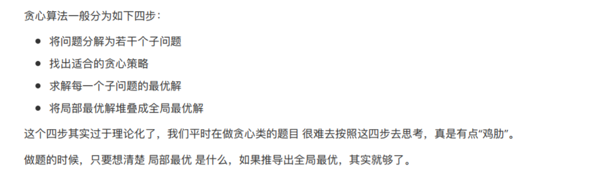


**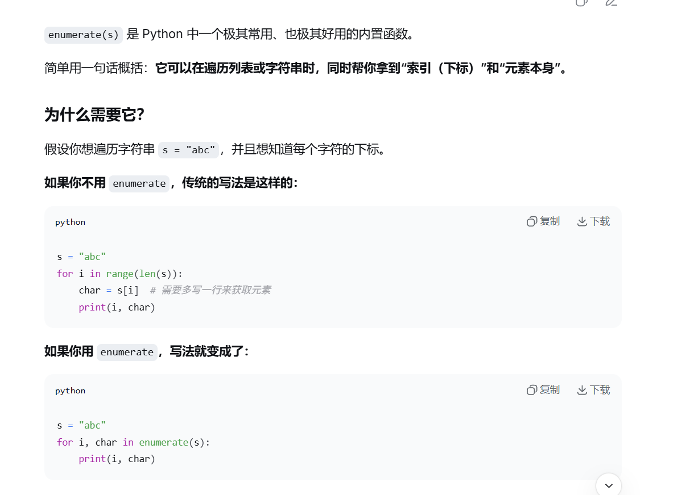**


## 分发饼干

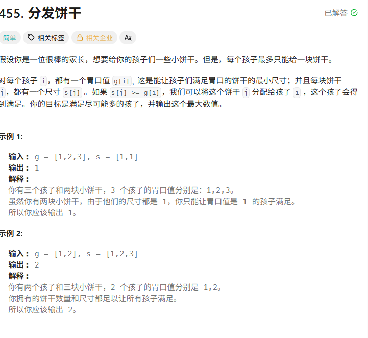


###  思路

先排序，然后遍历用大的饼干喂大的小孩，满足了之后就下一个饼干，下一个小孩， 不满足就换下一个小孩

（不能用饼干堆起来喂大小孩）  ------------------题目要求：：每个孩子最多只能给一块饼干

### 伪代码

```python
class Solution:
    def findContentChildren(self, g: List[int], s: List[int]) -> int:
        s.sort()    #饼干的大小
        g.sort() #小孩的胃口
        result=0 #有多少个小孩满足条件


        for i in range(len(g)-1,-1,-1): 
            if s and s[-1]>=g[i]: #饼干大小能满足
                result+=1
                s.pop()
                
        return result
        
```


###  思路

s一定要判断存在 s【-1】


## 摆动序列

[376. 摆动序列 - 力扣（LeetCode）](https://leetcode.cn/problems/wiggle-subsequence/)

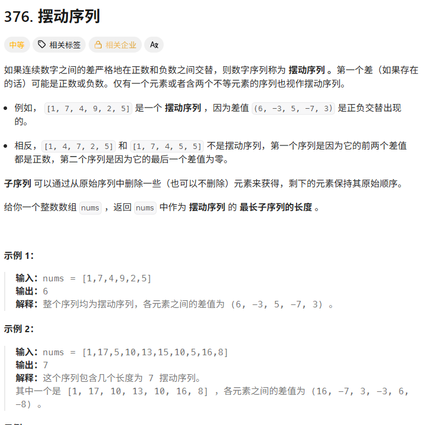


###  思路

1.题目要求就算有一个数字，那他也是摆动的 ，result=1

2.不必去执行删除元素的操作

3.用trend记录上一个趋势

### 伪代码

```python
class Solution:
    def wiggleMaxLength(self, nums: list[int]) -> int:
        if len(nums)<=1:
            return len(nums)

        result=1 #就算只有一个数字，那么他也是摆动 
        trend=0     #初始状态等于0  上升为1 ，下降为-1

        for i in range(1,len(nums)): #所以这里从第二个数字开始判断
            if trend>=0 and nums[i-1]>nums[i]: #如果上一个状态是平的或上升 并且当前值小于前一个值（即下降）
                trend=-1
                result+=1
            elif  trend<=0 and nums[i-1]<nums[i]:#如果上一个状态是平的或下降并且当前值小于前一个值（即上升）
                trend=1
                result+=1
        return result

```


## 最大子数组和

[53. 最大子数组和 - 力扣（LeetCode）](https://leetcode.cn/problems/maximum-subarray/description/)

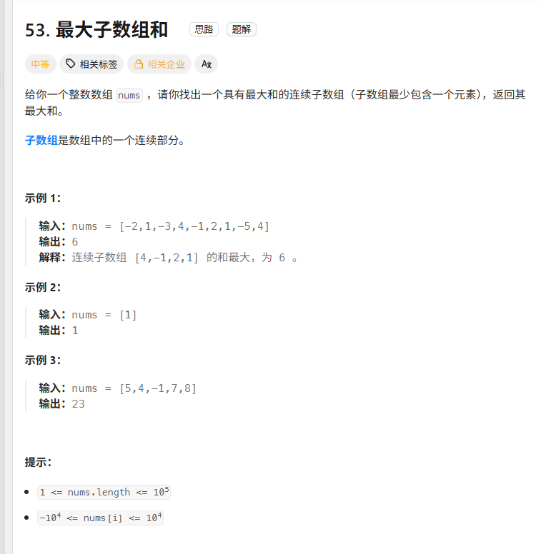


###  思路

前缀和： 包括这个数所有的值加起来  					 最小前缀和： 最小的前缀和

要求的最大值： 当前前缀和  --减去-- 之前某个点最小的前缀和 		 那么留下的就是最大的子数组的序列了


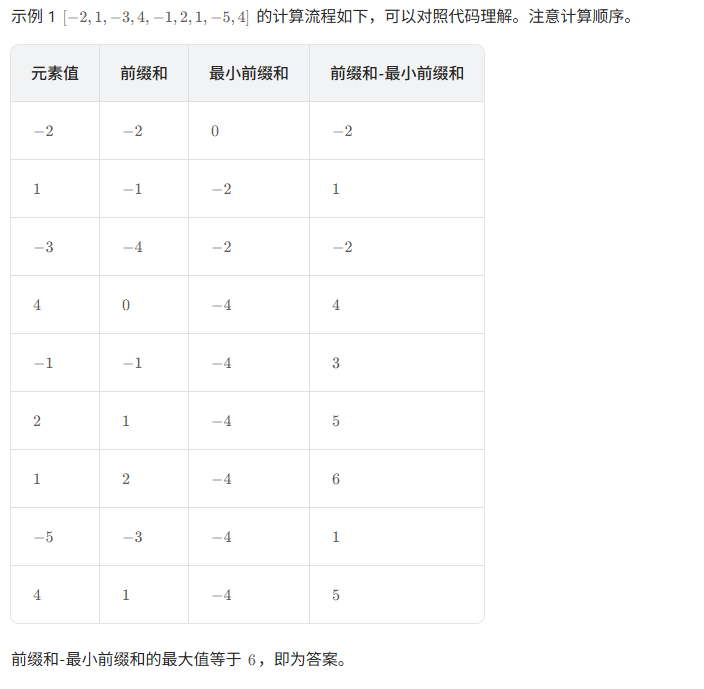

### 伪代码

```python
class Solution:#当前前缀和  --减去-- 之前某个点最小的前缀和 		 那么留下的就是最大的子数组的序列了
    def maxSubArray(self, nums: list[int]) -> int:
        result=-inf 
        min_pre_num =0 #之前最小前缀和
        pre_num=0        #当前的前缀和

        for i in nums:
            pre_num+=i          #当前前缀和 一直去累加
            result=max(result,pre_num-min_pre_num) #结果就是result和pre_num-min_pre_num 比较
            min_pre_num=min(min_pre_num,pre_num)#最小前缀和更新
        return result
            
```


## 买卖股票最佳时机II

[122. 买卖股票的最佳时机 II - 力扣（LeetCode）](https://leetcode.cn/problems/best-time-to-buy-and-sell-stock-ii/)

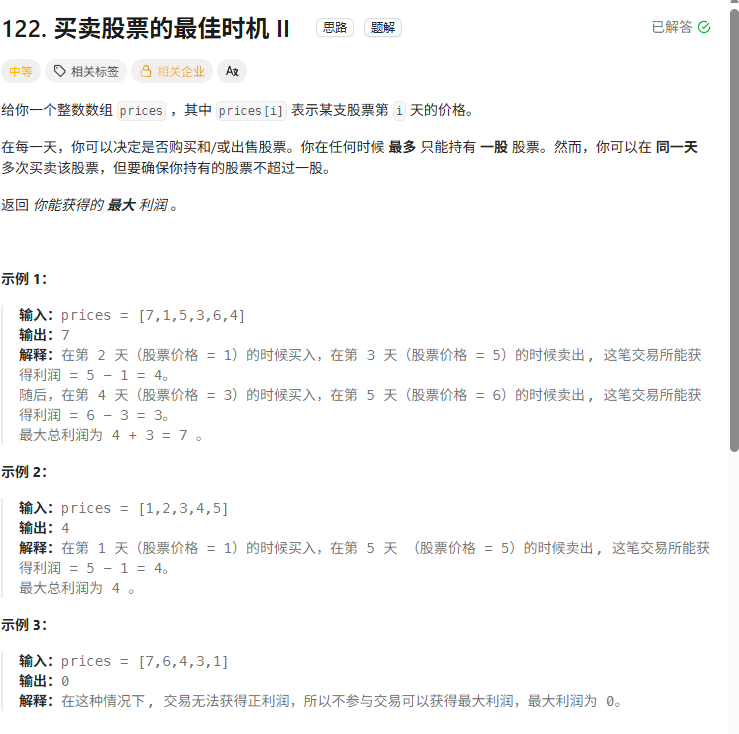


###  思路

小学生来了都会


### 伪代码

```python
class Solution:
    def maxProfit(self, prices: List[int]) -> int:
        profit = 0
        for i in range(1, len(prices)):
            tmp = prices[i] - prices[i - 1]
            if tmp > 0: profit += tmp
        return profit


```


##	55跳跃游戏

[55. 跳跃游戏 - 力扣（LeetCode）](https://leetcode.cn/problems/jump-game/)

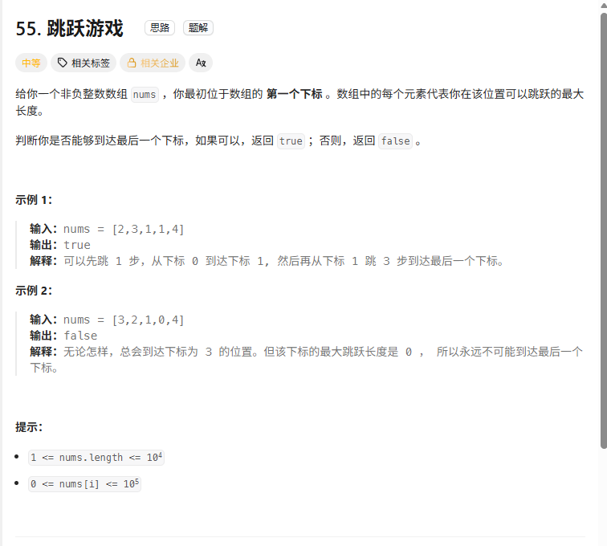


###  思路

用下标cover 记录能覆盖的最远下标 ，遍历nums下标的时候再用		i+nums[i] 去更新


### 伪代码

```python
class Solution:
    def canJump(self, nums: list[int]) -> bool:
        cover = 0  # 当前能覆盖到最远下标
        
        if len(nums) == 1:
            return True
            
        for i in range(len(nums)): #遍历每一个nums		
            if i > cover:  # 如果当前下标已经超出了能覆盖的最远范围，说明卡住了
                break
                
            cover = max(i + nums[i], cover)
            if cover >= len(nums) - 1:
                return True
                
        return False
```


## 跳跃游戏II

[45. 跳跃游戏 II - 力扣（LeetCode）](https://leetcode.cn/problems/jump-game-ii/)

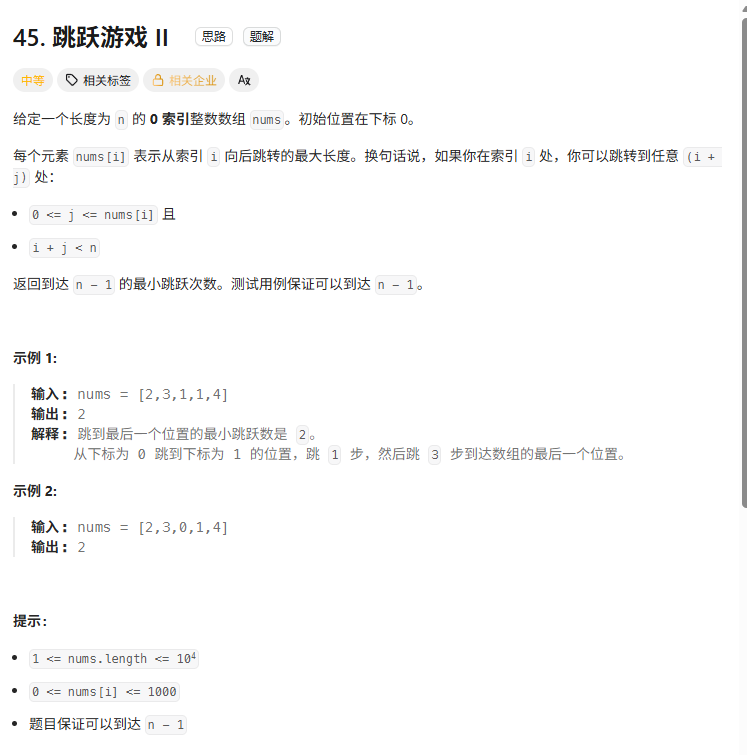


###  思路

用ans记录步数 ， curDistance上一步覆盖的最远下标  ，边遍历 边准备记录nextDistance 

### 伪代码

```python
class Solution:
    def jump(self, nums: list[int]) -> int:
        curDistance = 0   # 当前这一步覆盖的最远距离下标
        ans = 0           # 记录走的步数
        nextDistance = 0  # 下一步覆盖的最远距离下标
        

        for i in range(len(nums) - 1):#-1是因为就是跳到这个nums的最后的位置，不需要跳出去

            nextDistance = max(nums[i] + i, nextDistance)
            
            if i == curDistance:	#走到了上一个最远下标
                curDistance = nextDistance  # 更新当前边界为下一步的边界
                ans += 1                    # 步数加一
                
                
        return ans
```


## k次取反后最大化的数组和

[1005. K 次取反后最大化的数组和 - 力扣（LeetCode）](https://leetcode.cn/problems/maximize-sum-of-array-after-k-negations/description/)

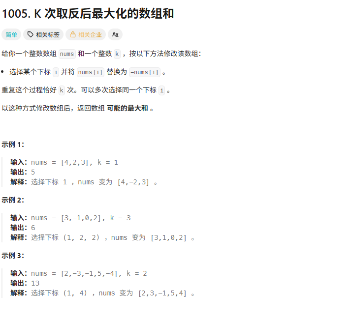

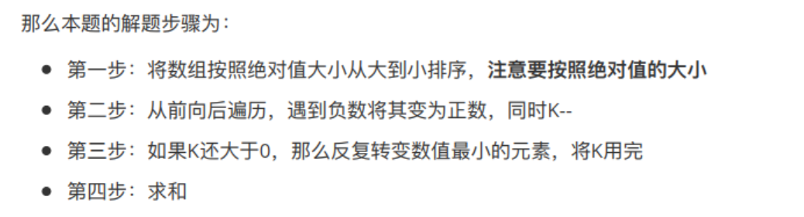


###  思路

1.先用绝对值排序

2. 遇到负的 并且还有反转的k值，那就直接翻转
3. 如果 到了最后还有剩余就一直翻转最后一个（这样会超时间，直接判断奇偶）


### 伪代码

```python
class Solution:
    def largestSumAfterKNegations(self, nums: list[int], k: int) -> int:
        # 第一步：按照绝对值从大到小排序
        # key=abs 表示按绝对值排序，reverse=True 表示降序
        nums.sort(key=abs, reverse=True)
        
        # 第二步：遍历数组，遇到负数且还有修改次数，就把它变成正数
        for i in range(len(nums)):
            if nums[i] < 0 and k > 0:
                nums[i] *= -1
                k -= 1
                
        # 第三步：如果修改次数还有剩余（即 k 是奇数）          如果不去判断直接翻转的话，会超出时间限制
        if k % 2 == 1:
            nums[-1] *= -1
            
        # 第四步：求和并返回
        return sum(nums)
```


## 加油站

[134. 加油站 - 力扣（LeetCode）](https://leetcode.cn/problems/gas-station/description/)

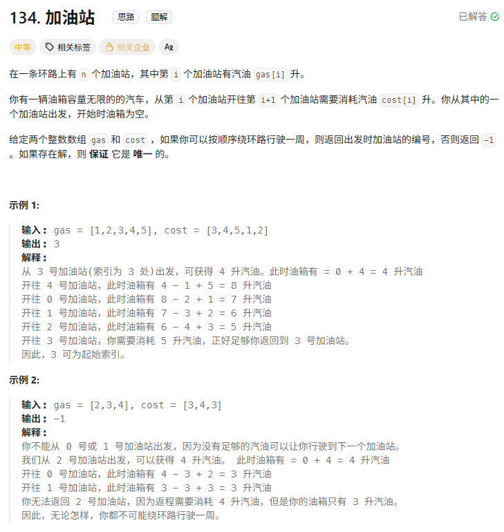


###  思路

用totalsum记录所有gas-cost 看看是否小于0 ： 不会回到原点

用cursum 记录当前start开始的所有gas-cost  ： 只要出现<0 那就说明 不能从之前的start开始，会填不满  i 的要求

### 伪代码

```python
class Solution:
    def canCompleteCircuit(self, gas: list[int], cost: list[int]) -> int:
        totalsum=0  #全部的汽油和加油站的位置
        cursum=0      # 从当前位置开始累加前面的值
        start=0      #开始位置

        for i in range(len(gas)):
            cursum+=gas[i]-cost[i]
            totalsum+=gas[i]-cost[i]

            if cursum <0: #前面累加的都填不饱 i 的负载
                start=i+1 #那就从i+1开始
                cursum=0
        
        if totalsum<0:
            return -1
        return start
```


## 分发糖果

[135. 分发糖果 - 力扣（LeetCode）](https://leetcode.cn/problems/candy/description/)

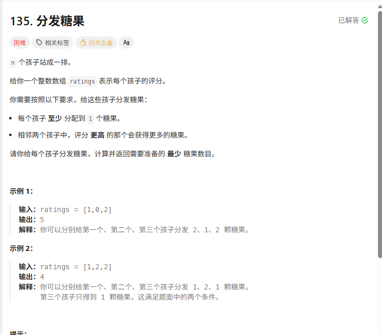


###  思路

第一阶段： 从左往右遍历： 右孩子比左孩子大就右孩子+1 ，**我已满足左边**

第二阶段 ：从右往左遍历 ： 左孩子比右孩子大就  在 **右孩子+1 和原来的值取  max**  ，因为要是固定右孩子+1  可能出现右孩子很小+1 还破坏了第一阶段的平衡

### 伪代码

```python
class Solution:
    def candy(self, ratings: List[int]) -> int:
        VandyVec=[1]* len(ratings) #每个孩子至少有一颗

        for i in  range(0,len(ratings)-1):
            if ratings[i+1]>ratings[i]:#如果右边的大于左边
                VandyVec[i+1]=VandyVec[i]+1

        for i in range(len(ratings)-1,0,-1):
            if ratings[i-1]>ratings[i]:
                VandyVec[i-1]=max(VandyVec[i]+1,VandyVec[i-1]) 
                # 必须用 max，因为不能破坏第一轮已经定好的“递减”规则 
        
        result=0

        for i in range(len(VandyVec)):

            result+=VandyVec[i]

        return result


```


## 柠檬水找0

[860. 柠檬水找零 - 力扣（LeetCode）](https://leetcode.cn/problems/lemonade-change/)

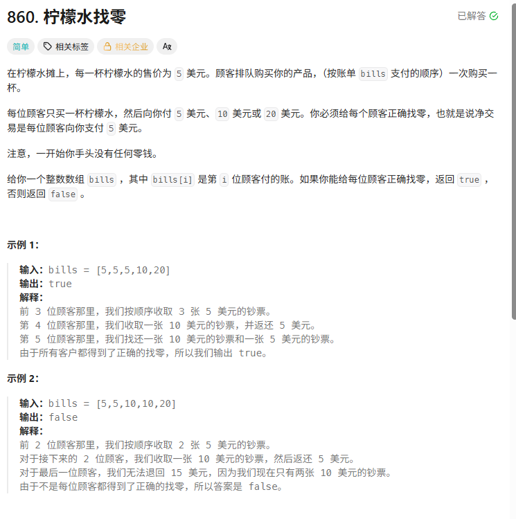


###  思路

就10块钱看看5块还有没， 20块看看 10块和5块 还有没即可 

### 伪代码

```python
class Solution:
    def lemonadeChange(self, bills: List[int]) -> bool:
        change=defaultdict(int)

        for i in bills:
            if i==5:
                change[5]+=1
            elif i==10:
                change[10]+=1
                if change[5]:
                    change[5]-=1
                    continue
                return False
            elif i==20 :
                change[20]+=1
                if change[10] and change[5]:#用15找钱
                    change[10]-=1
                    if change[5]:
                        change[5]-=1
                        continue
                elif change[5]>=3:
                    change[5]-=3
                    continue
                else : 
                    return False
        return True

```


## 根据身高重建队列


###  思路

先确定一个维度：身高，并且是从大到小排，就可以后续通过k值插入到前面，保证h -身高值的健壮性 （注意后面插入的是已经确定好的前面的索引）


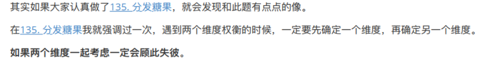


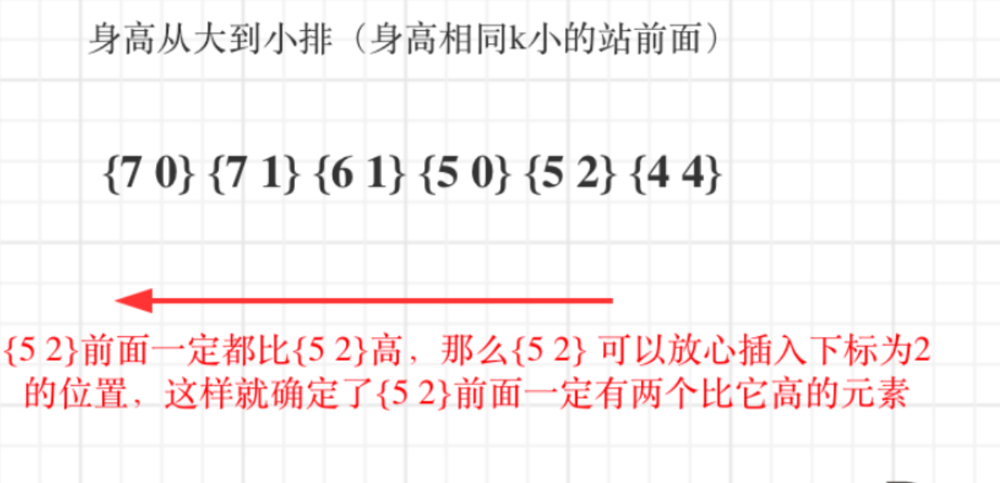

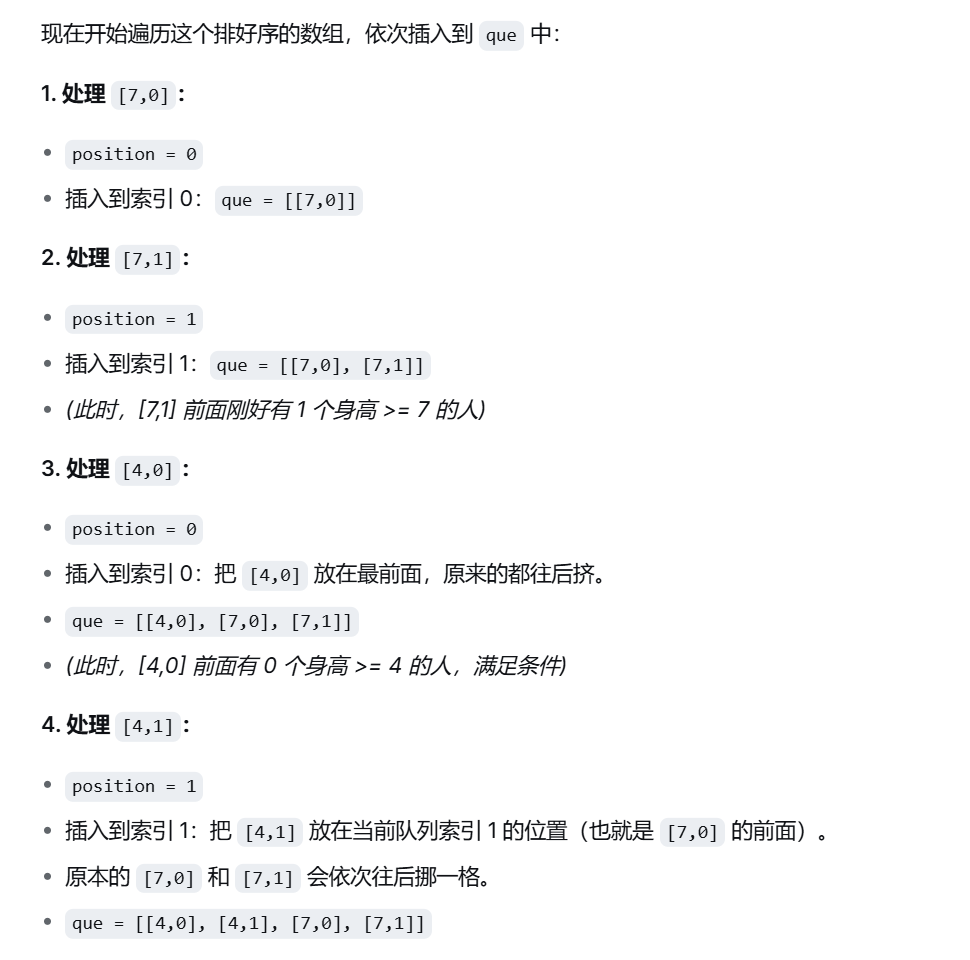

### 伪代码

```python
 # 【7,0】  【7,1】 【4,1】  【4,0】 他会先排 前面俩个，然后用现在数组再排4,1 插入到现在数组的索引 

class Solution:
    def reconstructQueue(self, people: List[List[int]]) -> List[List[int]]:
        # 1. 排序
        # 按照身高 h (即 x[0]) 降序排列
        # 如果身高相同，则按照 k (即 x[1]) 升序排列
        people.sort(key=lambda x: (-x[0], x[1])) 
        
        que = []
        
        # 3. 遍历并插入
        for person in people:
            position = person[1]  
            # 在 que 列表的 position 位置插入当前 person  ，反正往前插入比原来小的值不会影响
            que.insert(position, person)
            
        return que
```


## 用最少的数量的箭引爆气球

[452. 用最少数量的箭引爆气球 - 力扣（LeetCode）](https://leetcode.cn/problems/minimum-number-of-arrows-to-burst-balloons/)

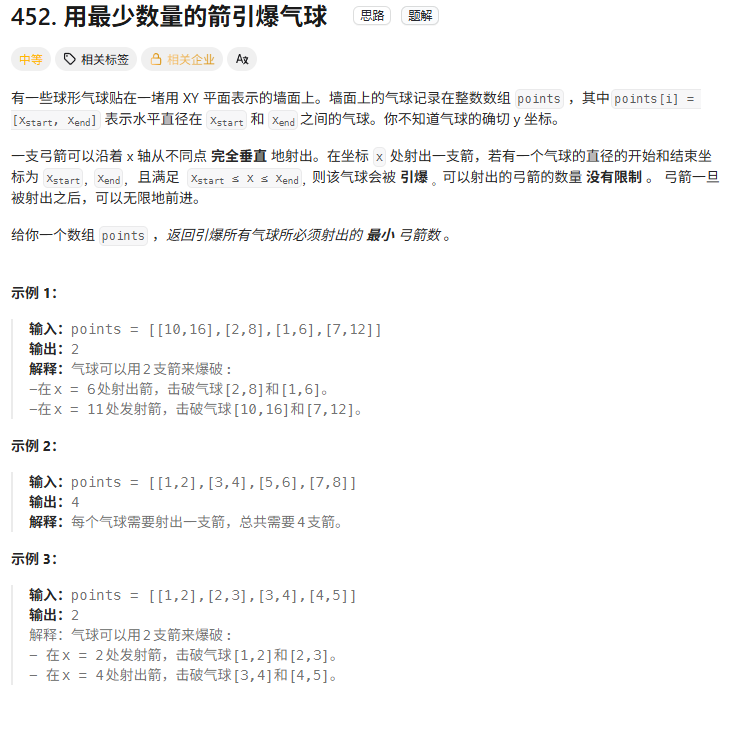


###  思路

1.先用左边第一个值排序

2.然后判断当前值左边界和前一个值的右边界 是否重合，不重合就需要新的一支箭 result+1

3.重合的话 更新当前值和前一个值的右边界，	**取min值更新**	，因为后面还需要去比较


### 伪代码

```python

class Solution:
    def findMinArrowShots(self, points: List[List[int]]) -> int:
        if not points:
            return 0
        
        # 按气球的左边界从小到大排序
        # Python 的默认排序对列表就是按第一个元素排，所以直接 sort 即可
        points.sort(key=lambda x: x[0])
        
        result = 1  
        
        for i in range(1, len(points)):
            # 气球 i 和气球 i-1 不挨着（注意这里不是 >=，因为边界相切也算重叠）
            if points[i][0] > points[i - 1][1]:
                result += 1  # 需要一支新箭
            else:
                # 气球 i 和气球 i-1 挨着（重叠）
                # 更新重叠气球的最小右边界，作为下一轮比较的基准 ，直接修改数组里的值
                points[i][1] = min(points[i - 1][1], points[i][1])
                
        return result
```


## 无重叠区间

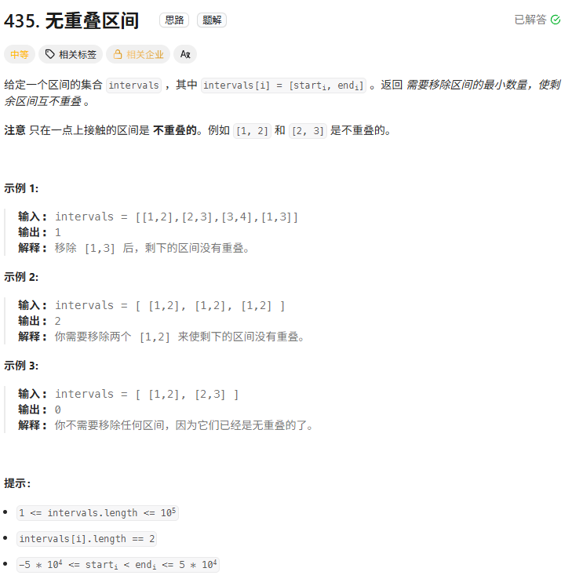

###  思路

还是按照左边界排序

**一旦发现后一个区间的左边界 < 前一个区间的右边界（即发生重叠），我们就必须删掉一个区间（`count++`），并且保留那个右边界更小的区间（更新 `intervals[i][1]`），以便给后面的区间留出更多空间**

### 伪代码

```python
class Solution:
    def eraseOverlapIntervals(self, intervals: List[List[int]]) -> int:
        if len(intervals)<=1:
            return 0

        result=0
        intervals.sort(key=lambda x : x[0])

        for i in range(0,len(intervals)-1):
            if intervals[i][1]>intervals[i+1][0]:#前一个区间的右边界大于后一个区间的左边界 那就是重合
                intervals[i+1][1]=min(intervals[i+1][1],intervals[i][1])
                result+=1

        return result
```


## 763划分字母区间

[763. 划分字母区间 - 力扣（LeetCode）](https://leetcode.cn/problems/partition-labels/description/)

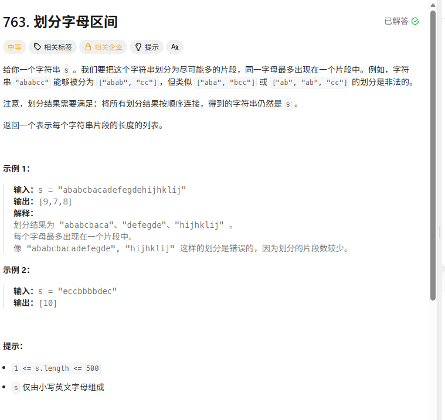


###  思路

1.先用遍历所有字母 ，然后一遇到字符就 只储存右边界   

2.然后再遍历所有字母 ，用rigth一直去记录最大区间，直到 便利的时候 i==right ，就right-left+1 ，同时更新left

### 伪代码

```python
class Solution:
    def partitionLabels(self, s: str) -> list[int]:

        last_pos=defaultdict(int)#统计每个字符最后出现的位置
        result=[]
        left=0
        right=0


        for i,char in enumerate(s):#用字典存起来每个的字符最后出现的位置
           last_pos[char]=i 
        
        for  i, char in enumerate(s):
            right=max(right,last_pos[char])
            if i==right:
                result.append(right-left+1)
                left=i+1
        return result

```


## 56合并区间

[56. 合并区间 - 力扣（LeetCode）](https://leetcode.cn/problems/merge-intervals/description/)

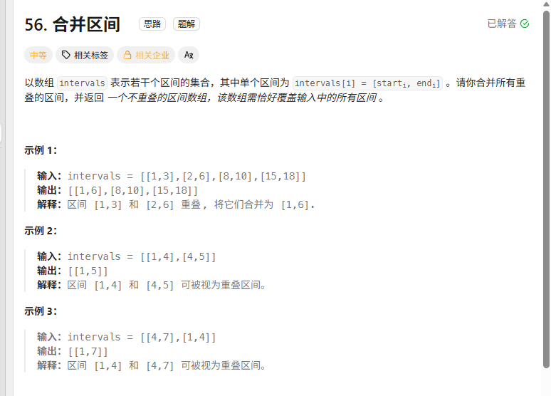


###  思路

我自己写的代码思路：

1.先按照左边界排序，然后用left和right记录左右边界， 初始值为第一个的左右边界

2.遍历数组，如果rigtht大于当前值的左边界（已经重叠），那么就更新左边界

3.否则没有重叠的话 ，就append到result里面， left和right更新

4.最后一组还得再最后for循坏外result.append([left, right])   ，不然会漏一组


题解的思路：

1.按照左边界排序

2.然后遍历数组，如果当前区间左边界小于result最后一个区间的右边界 ，那么就是重叠的，取最大值更新result[-1][1]

3.不重叠，直接加入进去

### 伪代码

```python
									1.我自己写的代码
class Solution:
    def merge(self, intervals: list[list[int]]) -> list[list[int]]:
        if not intervals:
            return []
        result=[]
        intervals.sort(key=lambda x:x[0])
        left=intervals[0][0]
        right=intervals[0][1]

        for i in range(1,len(intervals)):
            if intervals[i][0]<=right :  #如果i的左区间小于i-1的右区间，那么合并
                right=max(intervals[i][1],right) #当前值右边界要去和后一个值左边界比较呢
            else:
                result.append([left,right])
                left=intervals[i][0]
                right=intervals[i][1]
      # 【关键修复】循环结束后，必须把最后一组区间加进去
        result.append([left, right])           
        return result
	
						
        
        									2.题解的代码（空间复杂度更小）
class Solution:
    def merge(self, intervals: list[list[int]]) -> list[list[int]]:
        if not intervals:
            return []
            
        # 1. 按照左边界排序
        intervals.sort(key=lambda x: x[0])
        
        result = [intervals[0]]  # 先把第一个区间放进去
        
        for i in range(1, len(intervals)):
            # 拿 result 中最后一个区间的右边界 和 当前区间的左边界比较
            if intervals[i][0] <= result[-1][1]:
                # 重叠，更新 result 最后一个区间的右边界
                result[-1][1] = max(result[-1][1], intervals[i][1])
            else:
                # 不重叠，直接加入 result
                result.append(intervals[i])
                
        return result

```


## 单调递增的数字

[738. 单调递增的数字 - 力扣（LeetCode）](https://leetcode.cn/problems/monotone-increasing-digits/description/)

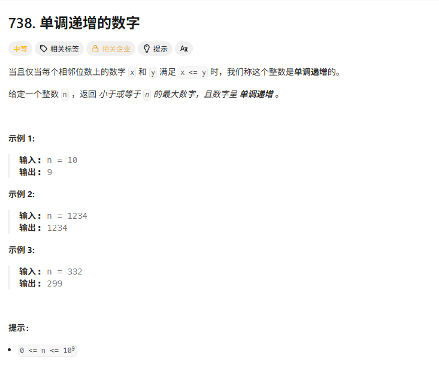

###  思路

1.先把数字转为字符串，在变成字符串列表，这样好进行单个的-1操作

2.用flag作为标志位，只要后一个比前一个小，就把前一个减去1 后面这个置为9 

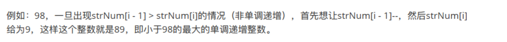

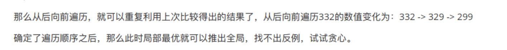


### 伪代码

```python
class Solution:
    def monotoneIncreasingDigits(self, n: int) -> int:
        # 将数字转为字符在转化为列表，方便修改
        str_n = list(str(n))
        flag=len(str_n)

        for i in range(len(str_n)-1,0,-1):
            if str_n[i-1]>str_n[i]: #如果前一位大于后一位
                flag=i
                str_n[i-1]=str(int(str_n[i-1])-1)#字符转为int -1之后再转为str

        # 将 flag 及其后面的所有位都变成 '9'
        for i in range(flag, len(str_n)):
            str_n[i] = '9'

        return  int("".join(str_n))
```


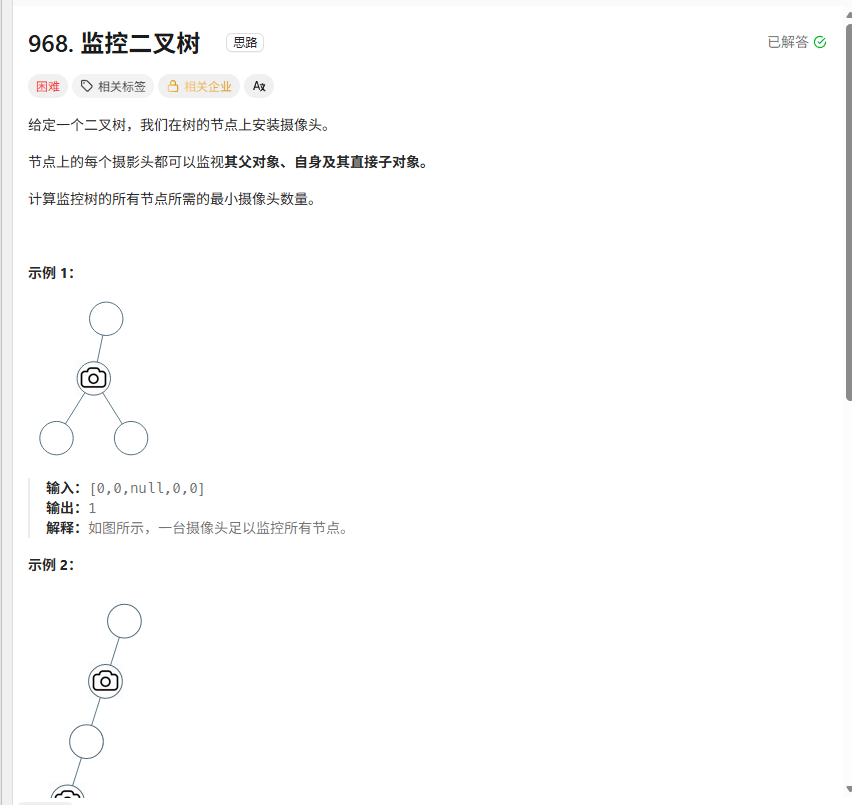

[968. 监控二叉树 - 力扣（LeetCode）](https://leetcode.cn/problems/binary-tree-cameras/)

###  思路

1.叶子节点的空节点是有覆盖的状态，这样叶子节点就不会再去放摄像头，所以在叶子节点的父节点放摄像头，符合我们的放摄像头原理

2. 一共有   00 11 22 01  02 12  六种情况

    00 01 02 这三种情况	 父节点返回 1

   22 这一种情况			   父节点返回0

   12 11 这俩种情况 	    父节点返回2

   

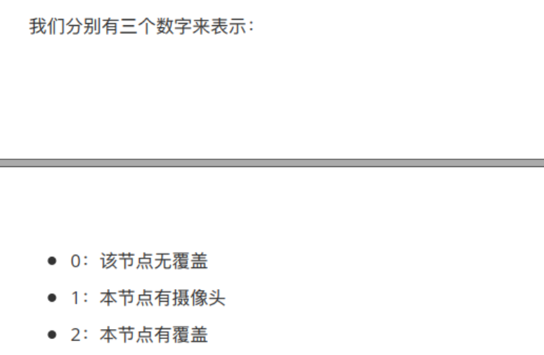


### 伪代码

```python
# Definition for a binary tree node.
# class TreeNode:
#     def __init__(self, val=0, left=None, right=None):
#         self.val = val
#         self.left = left
#         self.right = right

class Solution:
    def __init__(self):
        self.result = 0

    def traversal(self, cur: TreeNode) -> int:
        # 空节点，该节点有覆盖
        if cur is None:
            return 2
            
        left = self.traversal(cur.left)   # 左
        right = self.traversal(cur.right) # 右
        
        # 情况1：左右节点都有覆盖
        if left == 2 and right == 2:
            return 0
            
        # 情况2：左右节点至少有一个无覆盖的情况
        elif left == 0 or right == 0:
            self.result += 1
            return 1
            
        # 情况3：左右节点至少有一个有摄像头
        else:
            return 2

    def minCameraCover(self, root: TreeNode) -> int:
        self.result = 0 # 重置全局变量，防止多次调用测试用例时出错
        
        # 情况4：root 节点无覆盖
        if self.traversal(root) == 0:
            self.result += 1
            
        return self.result
```


